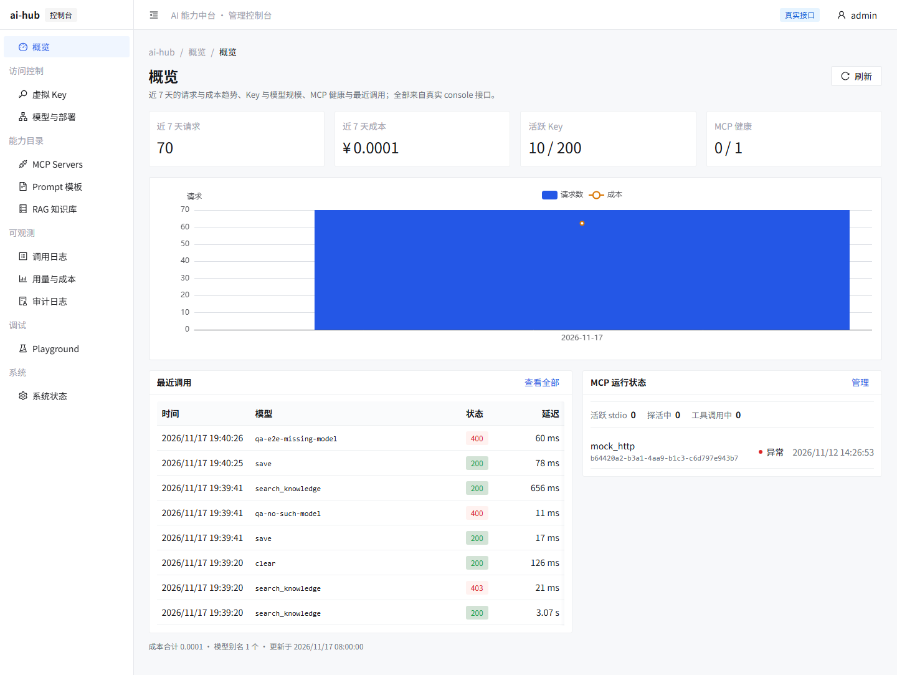
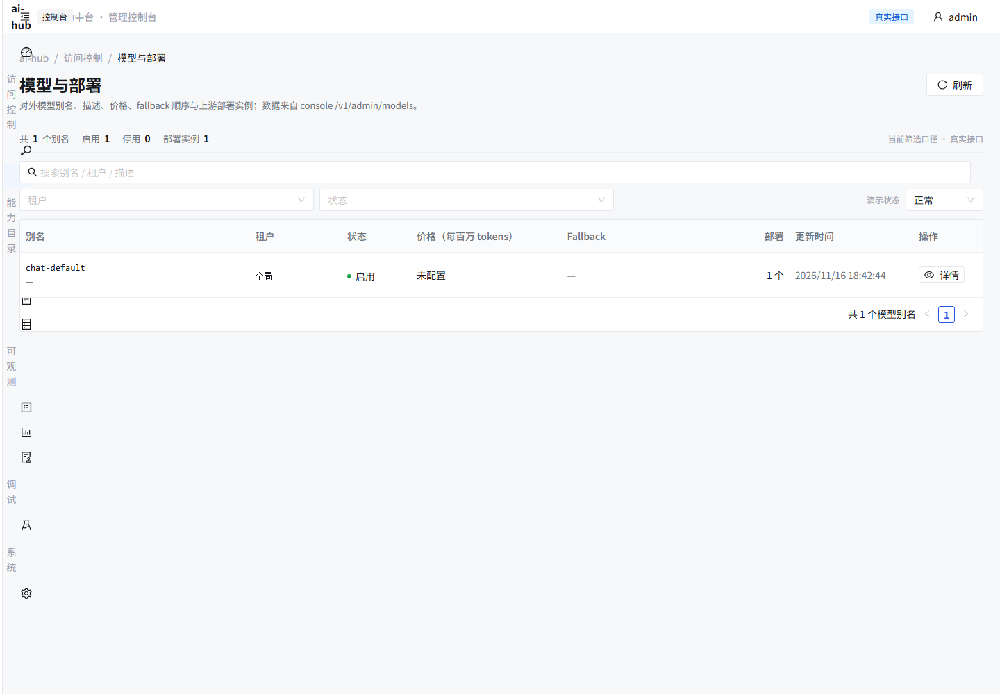
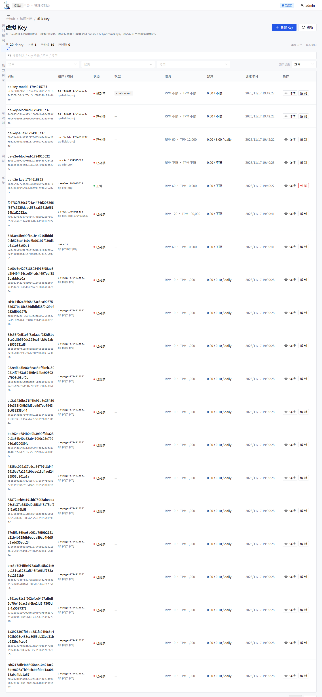
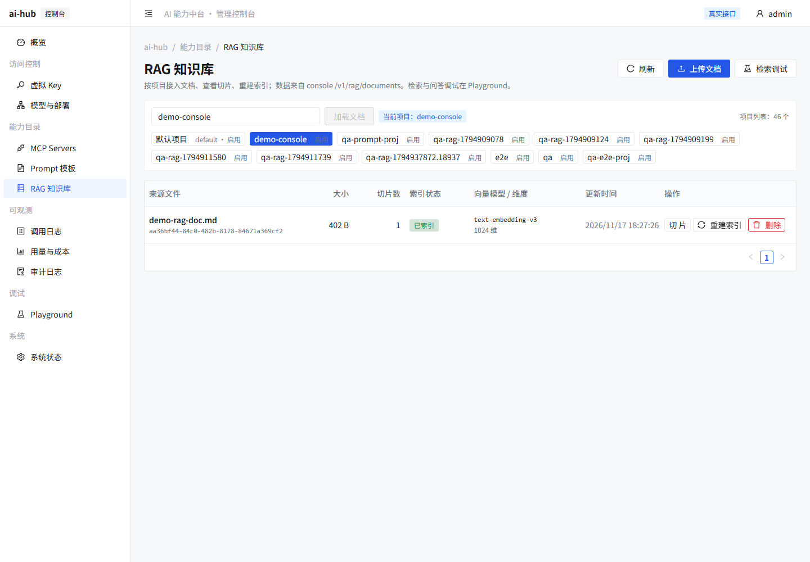
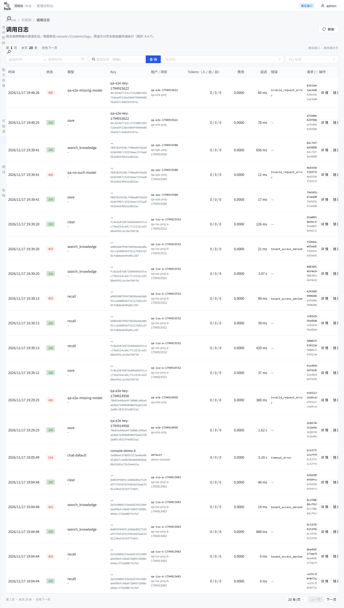
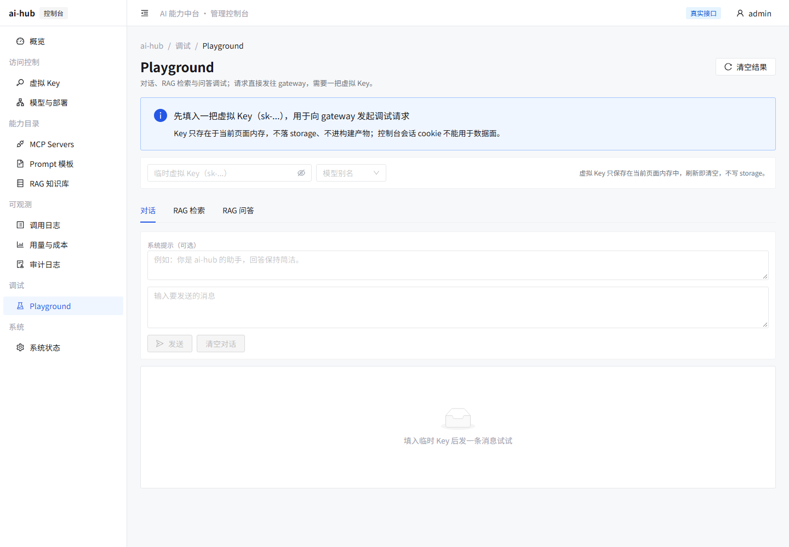

# ai-hub

面向 Agent 的 AI 中台：把大模型调用、MCP 工具、知识库检索、会话记忆和多租户治理收进一层统一入口。

业务系统用一个 OpenAI 兼容接口使用模型和工具，管理员在浏览器管理台统一管理 Key、模型、Prompt、知识文档、用量与审计。它要解决的问题是团队里的大模型能力各自为政：每接一个模型或工具，都要重复做鉴权、限流、计费、链路追踪和租户隔离；这套中台把这些横切能力下沉一次，上层只关心业务。

## 界面实拍

管理台是 React 单页应用，下面都是真实运行时截图，点开可以看细节。

| 概览 | 模型管理 |
|---|---|
|  |  |
| **Key 管理** | **知识库** |
|  |  |
| **调用日志** | **Playground** |
|  |  |

## 这个平台能做什么

| 方向 | 能力 |
|---|---|
| 统一网关 | chat 与 embeddings 转发，单入口多部署路由，重试与 fallback，SSE 流式，虚拟 Key 鉴权 |
| 工具 | MCP Server 注册与探活，工具聚合发现，调用代理，chat 内自动调用工具 |
| 知识库 | 文档接入（pdf、docx、pptx、xlsx、html、md、txt），切片与向量化，混合检索，带引用回答 |
| 记忆 | 会话记忆写入与召回，按项目隔离，可跨项目共享（默认关闭） |
| 治理 | 多租户与项目隔离，Key 级 RPM、TPM 与预算，全链路 Trace，成本统计，只追加审计日志 |

## 能看什么：管理台

管理台是 React 单页应用，十一页全部接真实接口，登录后可以直接操作：

| 页面 | 能做的事 |
|---|---|
| 概览 | 请求量、花费、Key 与模型状态一屏总览 |
| Key 管理 | 新建虚拟 Key（明文只显示一次）、封禁与解封、分页浏览、单 Key 详情 |
| 模型 | 注册模型别名与部署、维护价格、启用或停用 |
| MCP Servers | 注册 HTTP 或 stdio 类型的 MCP Server，查看探活状态，手动重新探活 |
| Prompt | 管理模板与版本，发布新版本，运行时渲染 |
| 知识库 | 上传文档，查看切片，重建索引 |
| 调用日志 | 按租户、模型、Key、状态筛选，打开链路抽屉查看分段耗时 |
| 用量 | 按时间、模型、Key 统计花费并导出 |
| 审计 | 查看只追加的操作记录，按动作和目标筛选 |
| Playground | 用真实模型对话，验证网关链路 |
| 系统 | 查看服务健康状态与关键配置 |

## 快速开始

### 前置依赖

- JDK 21
- Maven 3.9 或更高
- Docker Desktop（含 Docker Compose）
- Node.js 20.19 或更高（前端使用 Vite 8），自带 npm
- 端口 5432、6379、18080、18081、5175 空闲

### 方式一：一键启动（Windows PowerShell）

```powershell
.\scripts\start-local.ps1
```

脚本会依次完成：用 Docker Compose 启动 PostgreSQL（带 pgvector）和 Redis；源码有变更时自动打包后端；先启动 console（18081），健康后再启动 gateway（18080）；最后启动前端 Vite（5175）。已在运行且健康的端口会自动复用。

- 停止全部服务：`.\scripts\start-local.ps1 -Stop`
- 强制重新打包：`.\scripts\start-local.ps1 -Build`
- 运行日志目录：`%TEMP%\ai-hub-local`
- 登录账号：由启动参数 `-AdminUser` 与 `-AdminPassword` 指定，账号口令以脚本启动时打印的为准；仅用于本机演示，部署到任何共享环境前请自行改掉
- 模型清单：脚本不激活 local 配置；要用 `application-local.yml` 里的示例模型和价格，先在当前终端设置 `SPRING_PROFILES_ACTIVE=local` 再运行脚本，否则需要在管理台手动注册模型

### 方式二：手动启动（任意平台）

第一步，启动依赖服务：

```bash
docker compose up -d postgres redis
```

`docker-compose.yml` 里也定义了 console 和 gateway 两个服务。要整栈容器化运行，先执行 `mvn -DskipTests package` 再执行 `docker compose up -d --build`；只跑依赖时按上面的命令指定服务名即可。

第二步，设置环境变量。密钥一律通过环境变量注入，不写进代码、不落库：

| 变量 | 必填 | 用途 |
|---|---|---|
| `GATEWAY_MASTER_KEY` | 生产必填 | 管理主密钥。控制面用它调用管理接口；数据面拒绝这个凭证，避免管理权限泄漏到业务侧。未设置时两侧鉴权放行，只适合本机开发 |
| `GATEWAY_SECRET_KEY` | 生产必填 | 上游凭据的加密密钥（AES-256-GCM）。console 与 gateway 必须使用同一个值，否则一侧解不开库里加密的凭证；缺失时退化为弱编码并告警 |
| `DB_URL` | 否 | 数据库连接串，默认 `jdbc:postgresql://localhost:5432/aihub` |
| `DB_USER`、`DB_PASSWORD` | 否 | 数据库账号，默认都是 `aihub`，与 compose 中的依赖服务一致 |
| `REDIS_HOST`、`REDIS_PORT` | 否 | Redis 地址，默认 `localhost:6379` |
| `DASHSCOPE_API_KEY` | 用 RAG 时必填 | 默认 embedding 模型 text-embedding-v3 的密钥，知识库切片向量化依赖它 |
| `DEEPSEEK_API_KEY` | 接入示例模型时必填 | 示例模型清单里的 chat 与 reasoner 上游密钥 |
| `SPRING_PROFILES_ACTIVE` | 接入示例模型时设 `local` | 模型清单与价格默认写在 `application-local.yml`，该文件只在 local 配置激活时加载；详见下面的模型配置说明 |
| `CONSOLE_SESSION_ENABLED` | 用管理台登录时必填 | 设为 `true` 开启浏览器登录；不设置时登录关闭，只能使用 master key 调用管理接口 |
| `CONSOLE_SESSION_USERNAME` | 同上 | 管理员账号 |
| `CONSOLE_SESSION_PASSWORD_HASH` | 同上 | 管理员口令的 PBKDF2-SHA256 哈希，用 `.\scripts\hash-console-password.ps1 -Password <你的口令>` 生成 |
| `CONSOLE_SESSION_COOKIE_SECURE` | 否 | 会话 cookie 是否只走 HTTPS。本地 http 演示设为 `false`，HTTPS 部署保持默认 `true` |
| `GATEWAY_TRACE_SAMPLE_RATE` | 否 | Trace 采样率 0 到 1，默认 1.0 全量采集，生产可降到 0.1 |

模型配置说明：仓库自带 `ai-hub-start/src/main/resources/application-local.yml.example`，里面是示例模型清单、价格表和会话默认值。首次使用时复制成同目录的 `application-local.yml`（该文件已被 gitignore），填入自己的上游密钥引用，并在启动时激活 local 配置。不激活也可以跑，但模型目录为空，需要登录管理台后在模型页手动注册别名和部署。

上面的管理员账号与密码哈希请统一使用 `CONSOLE_SESSION_USERNAME` 和 `CONSOLE_SESSION_PASSWORD_HASH`，这两个变量直接绑定配置属性，不依赖 local 配置。`application-local.yml.example` 里另有一组 `CONSOLE_ADMIN_USERNAME` 和 `CONSOLE_ADMIN_PASSWORD_HASH` 占位符别名，只在 local 配置激活时生效；两种写法二选一即可，不要混用。

第三步，先 console 后 gateway。console 负责执行 Flyway 迁移，gateway 显式关闭迁移，顺序不能反：

```bash
export SPRING_PROFILES_ACTIVE=local
mvn -pl ai-hub-console spring-boot:run
# 等 http://localhost:18081/actuator/health 返回 UP
mvn -pl ai-hub-gateway spring-boot:run
```

Windows PowerShell 把 `export` 换成 `$env:SPRING_PROFILES_ACTIVE = 'local'`。

第四步，启动前端：

```bash
cd frontend/app
npm ci
npm run dev -- --port 5175
```

开发模式下，前端把 `/v1` 代理到 console（默认 `http://127.0.0.1:18081`），把 `/__gateway` 代理到 gateway（默认 `http://127.0.0.1:18080`），可用 `CONSOLE_PROXY_TARGET` 和 `GATEWAY_PROXY_TARGET` 覆盖。开发模式默认启用 mock 登录，验证真实会话需要设 `VITE_USE_MOCK_SESSION=false`，一键脚本已经代为设置。

### 访问地址

| 入口 | 地址 |
|---|---|
| 管理台前端 | http://localhost:5175 |
| console 管理 API | http://localhost:18081（健康检查 `/actuator/health`） |
| gateway 数据面 API | http://localhost:18080（健康检查 `/actuator/health`） |

登录使用上面设置的 `CONSOLE_SESSION_USERNAME` 与对应口令；用一键脚本时以脚本打印的账号为准。

### 第一次调用

管理台登录后可以在 Key 管理页新建一个虚拟 Key，然后直接体验数据面：

```bash
curl -X POST http://localhost:18080/v1/chat/completions \
  -H "Authorization: Bearer <你的虚拟Key>" \
  -H "Content-Type: application/json" \
  -d '{"model":"<模型别名>","messages":[{"role":"user","content":"你好"}]}'
```

虚拟 Key 在页面上只显示一次明文，请当场保存。

## 架构

系统拆成两个应用，共享同一个数据库：

| 应用 | 端口 | 角色 | 鉴权 |
|---|---|---|---|
| `ai-hub-console` | 18081 | 控制面：管理台、Key、模型、Prompt、文档接入、查询、审计 | 只认 master key 或管理员会话 cookie |
| `ai-hub-gateway` | 18080 | 数据面：聊天、嵌入、RAG、MCP、记忆 | 只认虚拟 Key，收到 master key 一律拒绝 |

拆开的原因有三个：两边鉴权模型相反，物理隔离后再也不存在管理接口复用业务鉴权的越权面；流量特征不同，数据面高并发长连接，控制面低频带文件上传，可以各自扩容；失败域隔离，控制面不可用时已签发的虚拟 Key 仍可继续服务。

代价也很明确：跨应用没有本地事务，所以写操作要么在单个应用内闭环，要么依靠幂等；管理面所有 JSON 写请求支持 `Idempotency-Key` 请求头，重复提交不会重复执行。

### 模块

```
ai-hub-common       通用工具与配置
ai-hub-api          对外契约（DTO 与异常）
ai-hub-dal          数据访问（MyBatis 与 Flyway 迁移）
ai-hub-manager      领域管理
ai-hub-integration  上游适配（模型客户端、MCP、Redis 限流、向量存储）
ai-hub-core         业务核心（RAG 检索、MCP 聚合、Prompt 渲染）
ai-hub-service      应用服务（shared、admin、gateway 三个分面）
ai-hub-start        公共壳（配置、过滤器、异常处理）
ai-hub-gateway      数据面启动模块（18080）
ai-hub-console      控制面启动模块（18081），唯一执行 Flyway 的应用
ai-hub-tests        集成测试
```

依赖方向由 ArchUnit 强制：启动模块依赖 start 与 service，service 向下依赖 core，core 依赖 manager 与 integration，manager 与 integration 依赖 api 和 dal，common 在最底层。

## 技术栈

Java 21，Spring Boot 4.1，LangChain4j 1.22，PostgreSQL 16 加 pgvector，Redis 7，MyBatis，Flyway，React 19，Ant Design 6，Vite，ECharts。

## 质量门禁

```bash
mvn -Pquality verify
```

覆盖编译、Checkstyle、SpotBugs、ArchUnit 架构规则、JaCoCo 覆盖率与全部集成测试；测试使用 H2，不依赖外部服务即可运行。

前端单独校验：

```bash
cd frontend/app
npm run verify
```

## 项目状态

第一期到第五期已完成：OpenAI 兼容网关、MCP 工具层、Prompt 版本管理、RAG 知识库、数据面与控制面拆分、会话登录与统一管理台。当前以本地一键启动为主要交付方式，公网演示部署尚未完成。

## 开发文档

- 研发流程入口：[ai-workflow/README.md](ai-workflow/README.md)
- 当前状态与数据表速查：[ai-workflow/STATUS.md](ai-workflow/STATUS.md)
- 设计基线：[ai-workflow/DESIGN.md](ai-workflow/DESIGN.md)
- 开发流程：[ai-workflow/docs/WORKFLOW.md](ai-workflow/docs/WORKFLOW.md)
- 编码规范：[ai-workflow/docs/STANDARDS.md](ai-workflow/docs/STANDARDS.md)
- 项目规约：[ai-workflow/docs/PROJECT.md](ai-workflow/docs/PROJECT.md)
- 接口路径与契约：[docs/API-PATHS.md](docs/API-PATHS.md)
- 单需求验收：[ai-workflow/acceptance/](ai-workflow/acceptance/)

## License

[MIT](LICENSE)
