# 设计基线（ai-hub）

- 更新于：2026-11-16
- 对应状态：第 4 期完成；第 5 期数据面/控制面拆分（REQ-5.1）
- 维护规则：只有架构、运行时链路、跨需求决策发生变化时才更新；需求细节见 `records/`。

## 1. 系统全景

ai-hub 是 OpenAI 兼容的 LLM 网关（项目 7 · Agent 与 MCP 集群），行为对标 LiteLLM：

- 第 1 期：LLM 网关核心（统一入口 / 模型路由 / 虚拟 Key / 限流预算 / 日志计量 / 容错 / 流式）✅
- 第 2 期：MCP 与 Prompt 中心（MCP 注册/发现/调用代理 + Prompt 模板/渲染 + MCP Server 暴露）✅
- 第 3 期：RAG 与记忆服务（文档接入 REQ-3.1、向量化 REQ-3.2、检索 REQ-3.3、生成与引用 REQ-3.4、记忆 REQ-3.5、MCP 暴露 REQ-3.6 已完成）
- 生产化补强：REQ-3.7 Embedding 一等能力（阿里 text-embedding-v3 + `/v1/embeddings` + 计量计价）、REQ-3.8 RAG answer 计费回填 / chunk 推导 / 上传限制
- 第 4 期：治理收尾（多租户 / Trace / 成本 / 管理端 / 审计）

架构图（唯一活图）：`acceptance/assets/design.svg`（源文件 `design.drawio` 同目录）。

```text
客户端 ──Bearer──> AuthFilter ──> Controller ──> Service ──> Core ──> Integration ──> 上游 LLM
                     │                                        │
                     └─ api_keys（虚拟 Key / 白名单）           └─ 路由选择 / 协议改写
```

## 2. 模块与依赖

| 模块 | 职责 |
|---|---|
| `ai-hub-common` | 异常、常量、配置模型（GatewayProperties/RagProperties）、模型目录端口（ModelCatalog/ModelDeployment/EmbeddingModel/EmbeddingModelProvider）、工具 |
| `ai-hub-api` | Service 接口 + Req/Res DTO（OpenAI 契约，含 Embedding） |
| `ai-hub-manager` | BO 与 BO↔DO 转换（ChatCompletionBO / ApiKeyBO）；模型目录 YAML 实现（YamlModelCatalog）；pgvector 存储；记忆数据门面 |
| `ai-hub-dal` | MyBatis Mapper + DDL（api_keys / call_logs / mcp_servers / prompt_templates / memories / memory_audit_logs / rag_*） |
| `ai-hub-integration` | 上游 HTTP + OpenAI 协议适配 + 协议改写；远端 embedding（DashScope OpenAI 兼容）；文档解析（PDFBox / POI / jsoup）；MCP 探活/工具客户端/stdio 进程管理；Prompt 模板渲染与消息解析 |
| `ai-hub-core` | 纯业务编排：部署选择、协议改写、上游调用、usage 解析；RAG 索引/检索/chunk 校验（不含限流/预算/计价/日志） |
| `ai-hub-service` | 应用服务：`service.shared`（Key 鉴权、审计、Trace 写入）、`service.admin`（控制面管理）、`service.gateway`（网关治理） |
| `ai-hub-start` | 公共壳：共享配置、RequestIdFilter、异常处理、Jackson/WebClient/线程池配置；无 Controller、无启动类 |
| `ai-hub-gateway` | 数据面：聊天/嵌入/模型列表/MCP 调用/Prompt 运行时/RAG 检索生成/记忆 + 虚拟 Key 鉴权与治理链 |
| `ai-hub-console` | 控制面：Key/模型/MCP 注册/Prompt 管理/RAG 文档接入/Trace/用量/审计 + admin 鉴权；Flyway 唯一执行方 |
| `ai-hub-tests` | 集成测试 + ArchUnit + JaCoCo 聚合 |

依赖方向：`gateway/console → start/service → core → manager/integration → dal → common`（ArchUnit 强制，禁止反向）。

### 2.1 数据面 / 控制面边界（REQ-5.1）

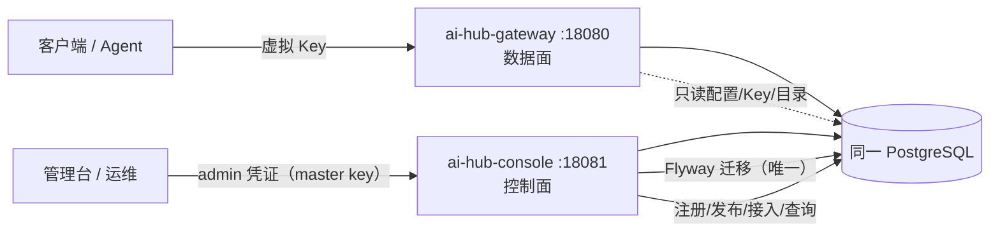

- 鉴权物理隔离：gateway 不加载 admin 鉴权；console 不加载虚拟 Key 业务鉴权；两套 Filter 互不兜底。
- 管理端点路径保持 4.x 契约（`/key/*`、`/v1/prompts`、`/v1/mcp/servers`、`/v1/rag/documents`、`/v1/traces`、`/v1/usage`、`/v1/audit-logs`、`/v1/admin/*`），隔离靠「console 只认 admin 凭证」。
- 控制面启动先于数据面（Flyway）；停 console 不影响数据面已启动的转发。
- 例外：`RagDocumentService` 放在 `service.shared`，因为数据面 MCP 运行时工具 `ingest_document` 复用同一实现；HTTP 接入端点仍只在 console。
- 例外：MCP Server 启动探活加载器归 console（写注册表状态）；数据面按需连接工具。

## 2.5 数据模型

- 表速查（按业务域、用途、关键关系、状态）见 `docs/DATA-MODEL.md`；`STATUS.md` 自动生成同名区块并与 DDL 校验（只显示当前已建表）。
- DDL 由 Flyway 管理：`ai-hub-dal/src/main/resources/db/migration/Vn__*.sql`，应用启动自动迁移（Spring Boot 4 需 `spring-boot-starter-flyway`）；测试 H2 仍用 `spring.sql.init`（Flyway 测试禁用）。
- 本地依赖容器：`postgres:16`（5432，db/user/pass=aihub）+ `redis:7.2`（6379）；Docker Hub 不可达时使用本地已有镜像。
- 当前已实现：`api_keys`（REQ-1.3）、`call_logs`（REQ-1.5，含 call_type/target_name，REQ-3.5 增加 MEMORY、REQ-3.1 增加 RAG、REQ-3.7 增加 EMBEDDING）、`mcp_servers`（REQ-2.1）、`prompt_templates`（REQ-2.4）、`memories` / `memory_audit_logs`（REQ-3.5）、`rag_documents` / `rag_chunks`（REQ-3.1）、`rag_vectors`（REQ-3.2，V9 放宽为 vector(1024) + 低维零填充）；规划：`audit_logs`。
- ER 图：`docs/DATA-MODEL.md` 使用 Mermaid erDiagram 速查；第 3 期毕业时与 RAG 表合并输出 `acceptance/assets/data-model.drawio|svg`。

## 3. 核心运行时链路

### 3.1 聊天补全（`POST /v1/chat/completions`、`POST /chat/completions`）

```text
1. AuthFilter：Bearer token 认证
   - == master key → KeyAuthDTO.master()
   - 否则 SHA-256 查 api_keys：不存在/封禁/过期 → 401 auth_error
   - /key/* 仅 master
2. GatewayGovernanceFilter（统一治理入口）：
   ① 缓存请求体；解析 model；模型白名单（403）
   ② 模型目录为空 → 400；RPM/TPM/预算预占（429/400）
   ③ 治理上下文放入 request attribute
3. ChatCompletionController：原始 JSON → ChatCompletionReqDTO（携带 KeyAuthDTO）
4. ChatCompletionServiceImpl（业务）：校验 model/stream/messages → ChatCompletionCore
5. ChatCompletionCore（纯业务）：
   加权随机选部署 → model 别名改写为上游真实名 → 调上游 → 响应 model 回写别名 → 解析 usage
6. Controller 回填 usage/deploymentModel；Filter 按实际 usage/cost 结算 TPM/预算、累加 spend、异步写 call_logs（成功/失败都写）
7. 返回上游原始 JSON（usage 等原样透传）
```

### 3.4 限流与预算（REQ-1.4）

```text
AuthFilter（KeyAuthDTO 携带 rpm_limit / tpm_limit / max_budget / budget_duration）
→ GatewayGovernanceFilter → GatewayGovernanceService（统一治理入口，接口无关）：
   ① RPM：Redis ZSET 滑动窗口（key + model，窗口 60s）
   ② TPM：输入估算（字符/4）+ max_tokens 预占，响应后按实际 usage 结算
   ③ 预算：估算成本 × 预占，响应后按实际 cost 结算；失败释放
   ④ 超限：rpm/tpm → 429 rate_limit_error；预算 → 400 budget_exceeded
   ⑤ Redis 故障：默认 fail-open（WARN），可配置 fail-closed
   ⑥ 命中写 call_logs.error_type，供 REQ-4.x 统计
```

### 3.6 容错：重试 / 主备 / fallback / 冷却（REQ-1.6）

```text
ChatCompletionCore.chat
→ 别名链 = [请求别名] + gateway.fallbacks[请求别名]（去重保序）
→ 每个别名：
   候选 = 冷却过滤（Redis）→ 请求内失败排除 → priority 最小层 → 加权随机
   上游调用失败且 retryable（超时/5xx/401/429）→ Redis 失败计数（达到 allowed-fails 冷却）
   → 本次请求排除该部署 → 同别名重试（num-retries）→ 下一个 fallback 别名
→ 成功：响应 model 回写请求别名；记录 served_alias/retry_count/fallback_used
→ 治理层只按最终成功调用结算一次、写 1 条 call_logs
```

- 冷却状态：`{resilience}:fails:<deployment>` 与 `{resilience}:cooldown:<deployment>`；部署标识 = SHA-256(alias|upstreamModel|apiBase|apiKey)。
- 全部部署冷却时 fail-open；Redis 故障 fail-open 并 WARN。

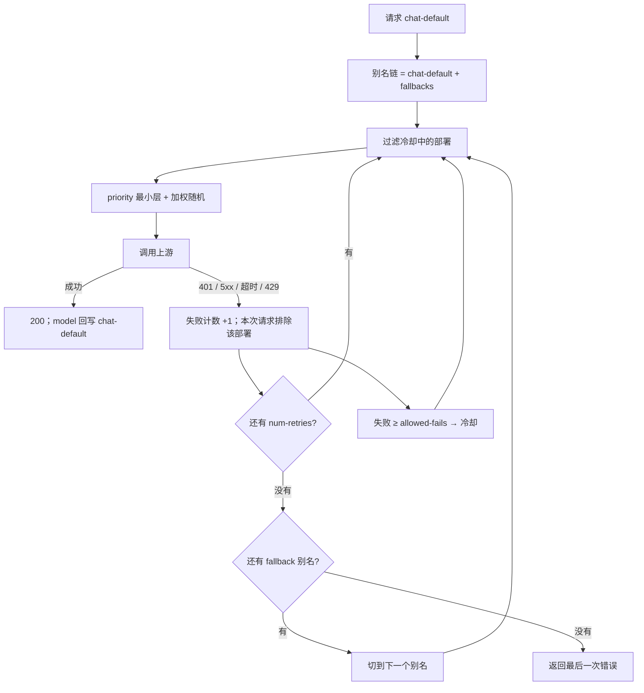

### 3.7 流式 SSE（REQ-1.7）

```text
AuthFilter → GatewayGovernanceFilter（预占后标记 streaming，跳过同步收尾）
→ Controller 解析 stream=true → Service/Core
→ WebClient 订阅上游 text/event-stream（请求注入 stream_options.include_usage）
→ 逐块改写 model 为请求别名 → SseEmitter 透传 data
→ 末块 usage 累积到单次请求的 AtomicReference
→ 流完成/失败：Controller 回调 GatewayGovernanceService 结算/写日志
→ 客户端断开/超时：取消上游订阅释放连接
```

- 流式不做请求内重试/fallback：一旦开始发送 SSE 无法切换部署；流开始前的错误仍走标准 JSON 错误。
- WebClient.Builder 在 `start/config/WebClientConfig` 提供；项目保持 Spring MVC，不启用 WebFlux Server。

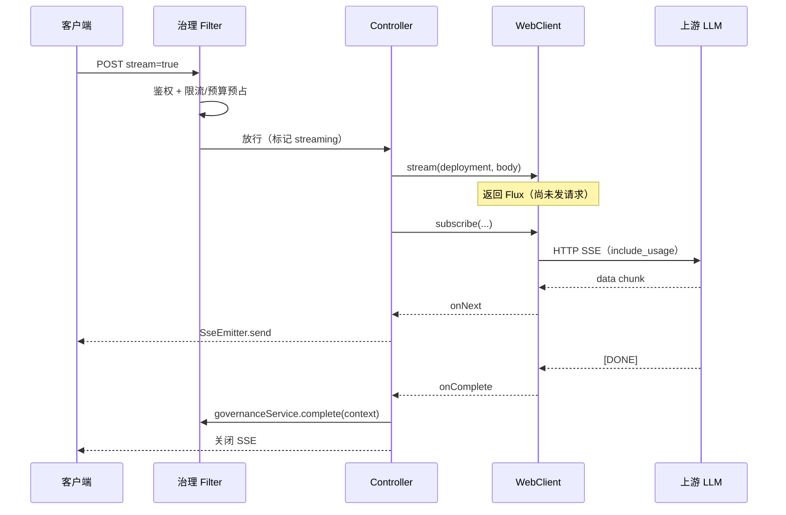

### 3.5 计量与日志（REQ-1.5）

```text
RequestIdFilter（生成 request_id）→ GatewayGovernanceFilter
→ Controller → ChatCompletionServiceImpl → ChatCompletionCore
→ 上游响应 usage（prompt/completion/total）
→ YamlPricingCatalog（每 1M tokens 单价，缺失 WARN + cost=0）
→ ModelPrice.costOf（BigDecimal scale=8）
→ CallLogManager.addSpend（原子 UPDATE，虚拟 Key）
→ CallLogManager.record（有界线程池异步 INSERT；饱和时 CallerRuns；失败 ERROR 兜底）
```

### 3.2 Key 管理（仅 master）

```text
POST /key/generate → SecureRandom 生成 sk- 明文 → SHA-256 → INSERT api_keys → 返回明文（仅一次）
GET  /key/info     → SHA-256 查库 → 掩码 key + spend/models/expires/...
POST /key/block    → UPDATE blocked=true → 后续鉴权 401
POST /key/unblock  → UPDATE blocked=false → 恢复
```

### 3.3 模型目录

```text
GET /models、GET /v1/models → 只返回别名（不泄露上游模型名/api-base/api-key）
```

### 3.8 MCP Server 注册与工具发现（REQ-2.1 / 2.2）

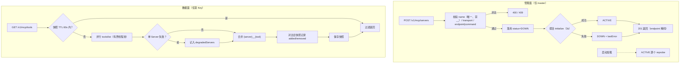

### 3.9 MCP 调用代理（REQ-2.3）

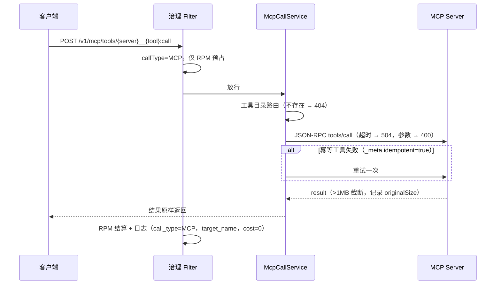

### 3.10 Prompt 模板管理与渲染接入（REQ-2.4 / 2.5）

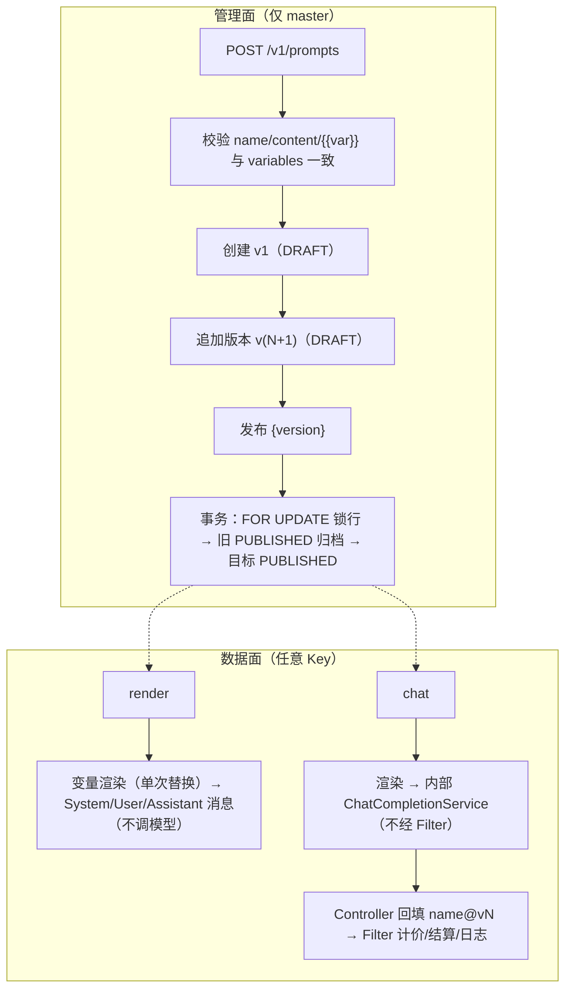

### 3.11 ai-hub 作为 MCP Server（REQ-2.6）

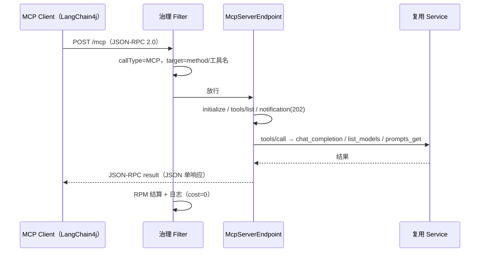

### 3.12 记忆服务（REQ-3.5）

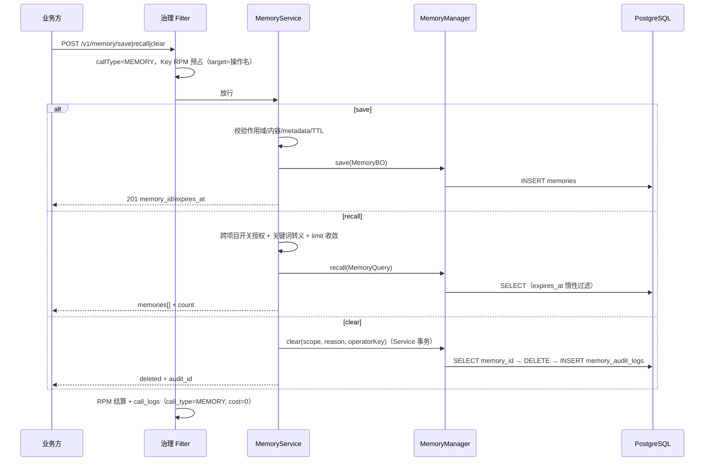

- 两级记忆：`session_id` 有值为会话级（绑定 project），为空为用户级（可配置同租户跨项目共享）。
- 默认隔离：召回强制 `tenant_id + user_id`，项目内再按 `project_id`；跨项目需配置开启且显式 `cross_project=true`，会话级记忆永远不跨项目。
- TTL：保存时算 `expires_at`，查询 SQL 过滤 `expires_at IS NULL OR expires_at > now()`；不做单机定时清理，多实例天然一致。
- 物理删除审计：clear 在 Service 事务内「取 id → 删 → 写审计」，审计记录作用域、实际条数、id 快照、operator key 与原因。
- 向量检索预留：`common/memory/MemoryRecallPort` 端口，本期结构化实现，后续可接向量检索。

### 3.13 RAG 文档接入（REQ-3.1）

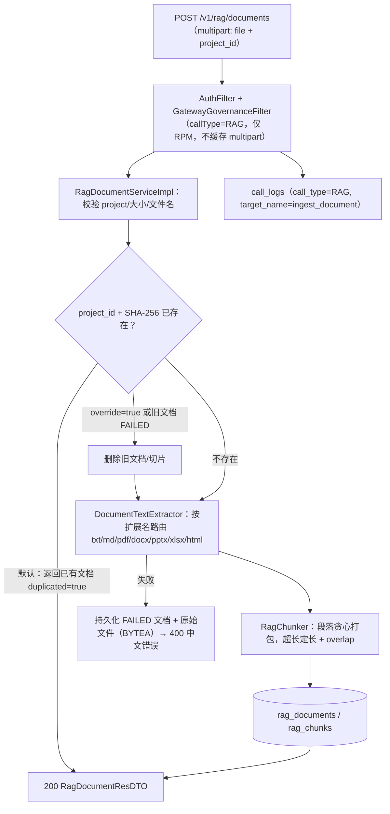

- 解析器注册表（REQ-3.9）：`DocumentTextParser` 按扩展名注册；txt/md 严格 UTF-8，pdf 用 PDFBox，
  docx/pptx/xlsx 用 POI（XWPF/XSLF/XSSF），html 用 jsoup；老 `.doc/.xls/.ppt` 拒绝并给出另存为指引。
- OOXML 安全（REQ-3.9）：解析前读 ZIP 中央目录校验条目数/单条目/解压总大小；POI `ZipSecureFile`
  全局限制（压缩比 1%、单条目 64MB、文本 10M 字符）兜底；加密 OOXML 通过 OLE2 `EncryptionInfo` 识别。
- 解析上限（REQ-3.9）：输出字符、表格行/单元格、工作表行/列/单元格、幻灯片/形状数均受
  `gateway.rag.parse.*` 约束，默认 `fail`，可配置 `truncate`。
- 索引加载（REQ-3.10）：`RagIndexCore` 按 `chunk_index` 游标分页读取（`page-size` 默认对齐
  embedding batch-size），每页向量化并 upsert，内存占用为一页；失败按批重试，整篇 FAILED 可 reindex。
- embedding 成本（REQ-3.7）：索引时按模型单价写入 `rag_documents.embedding_cost`；本地/确定性为 0。

- 去重键：`project_id + content_hash`（SHA-256）；默认幂等返回已有文档，覆盖为显式配置。
- 原始文件落库而非本机目录：多实例一致，解析失败也可追溯/删除。
- 删除：Service/Core 事务内先删向量（REQ-3.2 起），再删切片与文档。
- 列表/删除强制 `project_id`；跨项目文档按 404 处理，避免存在性泄露。

### 3.14 RAG 检索与重排（REQ-3.3）

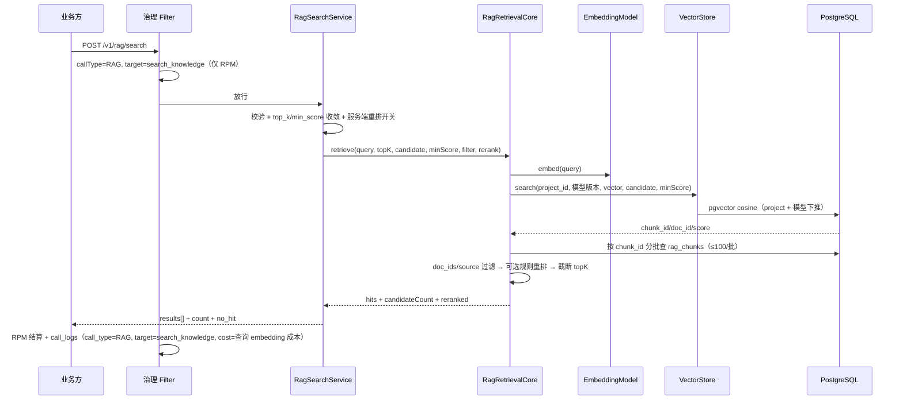

- 候选放大：`candidate = min(max-candidates, top_k × candidate-multiplier)`，抵消过滤/重排淘汰；
  不改 REQ-3.2 的 `VectorSearchQuery` 契约，过滤按切片字段在编排层完成。
- 重排：规则重排（`vectorScore×(1-w) + query 词项覆盖率×w`），服务端 `rerank-enabled` 为总开关，
  请求只能关闭；无 query 词项时保持原序并标记 `reranked=false`。
- 无命中：HTTP 200 + 空数组 + `no_hit=true`；检索日志只记 query、chunk_id/score、候选数与耗时，不记正文。

### 3.15 RAG 生成与引用溯源（REQ-3.4）

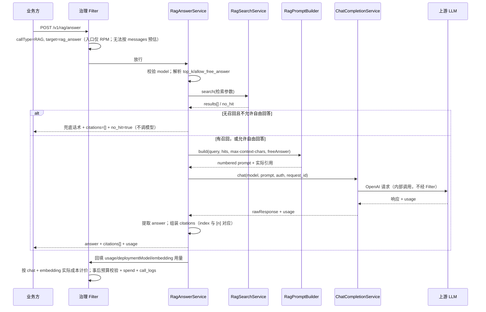

- 检索与生成分层：answer 复用 search，检索语义只有一处；内部 chat 直接调 Service，避免双重治理。
- 计费（REQ-3.8）：入口只做 RPM；响应后按实际 usage 结算，`chargeAfterwards` 检查预算并原子累计，
  超出预算在 `call_logs.error_type=budget_exceeded` 留痕（不改变已成功响应）。
- 引用契约：prompt 编号与 citations 同源生成、`index` 从 1 连续；citations 只含实际进入 prompt 的切片。
- 兜底：无召回默认不调模型并返回可配置话术；自由回答需服务端开关 + 请求显式开启，且 citations 为空。
- 可观测：同一 request_id 记录 query、召回、prompt 长度/hash、usage/耗时与引用清单，不落 prompt 正文。

### 3.16 RAG/记忆 MCP 工具（REQ-3.6）

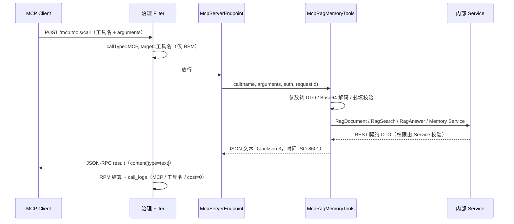

- 工具：`ingest_document`、`search_knowledge`、`rag_answer`、`save_memory`、`recall_memory`、`clear_memory`；
  schema 与 REST 契约同字段，工具直接调用内部 Service，不复制业务/权限逻辑。
- 文档接入：`content`（UTF-8 文本）或 `content_base64`（PDF 等二进制）二选一，服务端解码后复用同一接入流程。
- 记忆授权：完全复用 REQ-3.5（租户/项目/用户作用域、跨项目开关、会话级不跨项目）；MCP 只透传入参。
- 序列化：JSON-RPC 信封用 Jackson 2；工具结果用 Jackson 3（与 Web 一致，内置 java.time）。
- 日志：`call_logs` 记 `call_type=MCP`、`target_name=工具名`、`request_id` 贯穿；工具入口日志只记
  作用域与内容长度，不打印记忆正文/文档全文。

### 3.17 Embedding 一等能力（REQ-3.7）

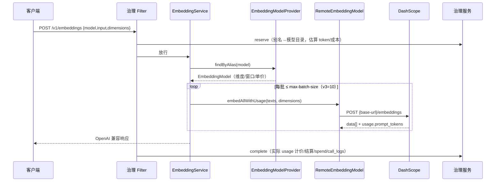

- 模型目录：`gateway.rag.embedding.models.*` 多别名；`gateway.rag.embedding.model` 选择 RAG 主模型；
  旧单模型字段在目录为空时生效（测试/离线兼容）。
- 远端：OpenAI 兼容 `POST {base-url}/embeddings`；批量上限（v3=10）、可配置重试/退避、连接/读超时、
  维度校验；供应商 usage 优先，缺失按 CJK 1 字≈1 token 估算。
- 成本归集：`/v1/embeddings` 走完整治理（RPM/TPM/预算/计价/日志，call_type=EMBEDDING）；
  RAG 索引成本写文档，检索/回答查询 embedding 成本写 `call_logs.cost`。
- pgvector：列固定 `vector(1024)`，低维模型零填充；V9 迁移清空派生向量，文档按模型/维度提示
  `reindex_required`。

### 3.18 第 4 期治理（REQ-4.1~4.5）

- **租户上下文**：`AuthFilter` 解析 Key → `TenantIdentity` → `TenantContextHolder`（ThreadLocal）→
  `TenantScopeGuard` 在 Service 入口校验请求声明；不一致 403，禁止参数覆盖 Key 绑定。
- **隔离落点**：RAG 文档/切片/向量、Prompt、MCP、记忆、call_logs、trace_events、audit_logs
  全部带 `tenant_id`；RAG 向量先过滤再排序；跨项目只经 `project_authorizations` 显式授权。
- **模型目录**：YAML → DB（`model_aliases/model_deployments/别名↔部署/别名↔Key`）；
  `DbModelCatalog`（@Primary）每请求读库，`ModelCatalogSeeder` 空库时从 YAML 灌入；
  上游凭证 AES-256-GCM（`SecretCipher`）。
- **Trace**：`request_id = trace_id`，MDC + `X-Trace-Id`；`trace_events` 分段（gateway/model/
  rag/answer/mcp），`TraceRecorder` 端口 + 有界线程池异步写，按 trace 确定性采样。
- **用量**：`v_usage_daily` 实时视图，`/v1/usage` + CSV，缺价模型单列告警。
- **管理端**：`/v1/admin/**` 仅 master，Key/模型/日志/项目授权；api-key 永不回显。
- **审计**：`audit_logs` 只追加 + PG 触发器；`AuditRecorder` 记录脱敏快照与 trace_id。

## 4. 跨需求设计决策

| 决策 | 理由 | 引入需求 | 日期 |
|---|---|---|---|
| 请求 model 转发前改写为部署真实模型；响应 model 回写别名 | 上游只认真实模型名；对外保持别名语义 | REQ-1.1 | 2026-10-19 |
| 无状态加权随机路由（WeightedRandomSelector） | 多实例部署天然安全；有状态轮询需 Redis | REQ-1.2 | 2026-10-20 |
| 权重 rpm 优先 → tpm 回退 → 默认 1；同一别名必须同源 | 避免量级混用导致路由偏斜 | REQ-1.2 | 2026-10-20 |
| 虚拟 Key 只存 SHA-256，明文仅生成时返回一次 | 降低泄露风险；高熵无需加盐 | REQ-1.3 | 2026-10-22 |
| 虚拟 Key 白名单校验在 core，先授权 403 后未知模型 400 | 业务规则归属；避免状态码探测模型目录 | REQ-1.3 | 2026-10-22 |
| `/key/*` 管理面仅 master；虚拟 Key 只走数据面 | 管理面与数据面隔离 | REQ-1.3 | 2026-10-22 |
| 持久层统一 MyBatis（禁止 JdbcClient/JPA） | 对齐公司规范 | REQ-1.3 | 2026-10-22 |
| 网关转发保持原始 JSON，不经过 LangChain4j 归一化 | 避免字段丢失；AI 框架用于 2 期起的 MCP/RAG | 架构基线 | 2026-10-20 |
| 模型目录收口为 `ModelCatalog` 端口（YAML 实现） | 业务层不依赖配置类；未来迁 DB + 缓存只换实现 | 架构重构 | 2026-10-30 |
| rpm/tpm 分层：部署 `weight` / Key 级限流 | 避免路由权重与限流阈值同名混用 | 团队决策 | 2026-10-30 |
| 容错 = 别名级 fallbacks + 部署 priority 主备 | 高可用需要两层配合：先主备、后降级 | 团队决策 | 2026-10-30 |
| 上游 api-key AES-256-GCM + 环境密钥 | 金融场景密钥不得明文入库；KMS 留扩展 | 团队决策 | 2026-10-30 |
| prod 环境 master key 空配置启动失败 | 防止生产网关无鉴权裸奔 | 团队决策 | 2026-10-30 |
| 价格按上游真实模型匹配；1M tokens 单价 + BigDecimal scale=8 | 同一别名可路由不同上游模型，按真实模型才可复算；金额禁用 double | REQ-1.5 | 2026-11-02 |
| 日志异步、spend 同步原子累加 | 日志不阻塞响应；spend 需尽快供预算判断，`spend = spend + ?` 防丢更新 | REQ-1.5 | 2026-11-02 |
| 价格缺失只告警、cost=0，不阻断调用 | 对齐 LiteLLM B-04 教训：缺价格不能造成调用失败或错误成本 | REQ-1.5 | 2026-11-02 |
| 失败调用也写日志（status=HTTP 码），不计成本 | 审计与排障需要失败面；失败不计费，重试语义留待 REQ-1.6 | REQ-1.5 | 2026-11-02 |
| Key 级 rpm/tpm 按 `key + model` 维度、Redis ZSET 滑动窗口 | 需求卡指定；模型间互不影响；ZSET 支持精确时间窗口清理 | REQ-1.4 | 2026-11-02 |
| TPM 请求前按「输入估算 + max_tokens」预占、响应后按实际 usage 结算 | 输出 token 请求前未知；预占保证不超限，结算保证口径与 REQ-1.5 一致 | REQ-1.4 | 2026-11-02 |
| 预算金额用整数 micro 单位（1e-8 元），周期 key 带 TTL | 避免 INCRBYFLOAT 精度问题；daily/monthly 跨期自动换 key，无需定时任务 | REQ-1.4 | 2026-11-02 |
| 限流/预算 Redis 故障默认 fail-open，可配置 fail-closed | 限流是保护而非业务正确性；避免 Redis 故障导致网关整体不可用 | REQ-1.4 | 2026-11-02 |
| 限流/预算/计价/spend/访问日志放 `GatewayGovernanceFilter + GatewayGovernanceService`，业务 Service/Core 不感知 | 横切治理必须统一入口、接口无关；新增流式/文件接口自动复用，不复制治理逻辑 | 架构重构 | 2026-11-02 |
| 容错编排放 `ChatCompletionCore`，冷却状态放 `integration` + Redis | 容错属于上游调用业务编排；跨实例状态必须外置（STANDARDS §2.5），core 不直接依赖 Redis | REQ-1.6 | 2026-11-02 |
| 部署 priority 数值越小越优先；同层内加权随机 | 主备语义直观；同优先级保留负载均衡 | REQ-1.6 | 2026-11-02 |
| 容错顺序：同别名重试/主备 → 别名级 fallback 链 | 先解决单点，再跨模型降级 | REQ-1.6 | 2026-11-02 |
| 部署标识 = SHA-256(alias + upstreamModel + apiBase + apiKey) | 同别名主备可能模型/base 相同、仅 key 不同；不含 key 会共享冷却 | REQ-1.6 | 2026-11-02 |
| 一次请求只写 1 条日志、只计费一次；轨迹用 retry_count/fallback_used/served_alias | 重试不重复计费，审计可还原降级路径 | REQ-1.6 | 2026-11-02 |
| 流式用 Spring MVC SseEmitter + WebClient 客户端，不引入 WebFlux Server | 与现有 MVC 栈一致；只增加流式客户端能力 | REQ-1.7 | 2026-11-02 |
| 流式治理延迟收尾：Filter 只预占，Controller 流结束回调结算 | 同步 Filter 无法感知异步流结束；复用统一治理服务 | REQ-1.7 | 2026-11-02 |
| 流式请求强制注入 `stream_options.include_usage=true` | 保证末块 usage，计量/预算可结算 | REQ-1.7 | 2026-11-02 |
| 未来物理拆分时用 HTTP 契约（OpenAI 请求/响应或内部 `ChatCommand`），当前 Service 直接调 Core | `ChatExecutor` 是假出口：绑定内部 BO、含模型部署密钥，不能作为跨服务契约；YAGNI 删除 | 架构重构 | 2026-11-02 |
| MCP Server 注册即探活（同步 3s），失败允许注册为 DOWN | 需求卡要求；比 LiteLLM 懒探活直观；错误可 reprobe | REQ-2.1 | 2026-11-03 |
| MCP server name 禁含 `__`；endpoint 输出掩码 | 工具名分隔符防歧义（T1 校准）；防密钥泄露 | REQ-2.1 | 2026-11-03 |
| 工具目录本地快照 TTL 60s + 注册/注销失效 | 只读配置数据，多实例短时不一致可接受 | REQ-2.2 | 2026-11-03 |
| MCP 调用仅幂等工具允许重试一次 | 非幂等工具重试可能重复副作用 | REQ-2.3 | 2026-11-03 |
| 横切治理按 callType（CHAT/MCP/PROMPT）分支复用同一 Filter | 新接口零复制治理；MCP 只做 RPM，PROMPT 复用完整 chat 计量 | REQ-2.3/2.5 | 2026-11-03 |
| Prompt 版本只追加 + 发布事务（FOR UPDATE）+ 发布旧版即回滚 | 审计可信；同一 name 仅一个 PUBLISHED | REQ-2.4 | 2026-11-03 |
| 渲染单次纯文本替换（不递归） | 防注入；YAGNI 不引模板引擎 | REQ-2.4 | 2026-11-03 |
| Prompt chat 内部直接调 Service（不经 HTTP/Filter） | 避免双路径重复治理/计量 | REQ-2.5 | 2026-11-03 |
| ai-hub MCP Server 用原生 JSON-RPC（JSON 单响应） | 3 个工具、避免新 Web 栈；LangChain4j 实测兼容 | REQ-2.6 | 2026-11-03 |
| 记忆按 `tenant_id + project_id + user_id` 强制作用域，session_id 区分会话级/用户级 | 隔离是硬约束；两级模型同时覆盖对话记忆与用户画像 | REQ-3.5 | 2026-11-11 |
| 跨项目共享默认关闭，仅配置开启 + 显式 `cross_project` + 用户级记忆 | 隐私优先；会话级内容不跨项目；未开启时显式请求返回 403 | REQ-3.5 | 2026-11-11 |
| TTL 用查询时惰性过滤，不做定时清理 | 多实例无状态；避免定时任务重复执行与额外锁 | REQ-3.5 | 2026-11-11 |
| 物理删除 + `memory_audit_logs` 审计同事务 | 满足用户删除权举证；不会出现删了但无审计的半状态 | REQ-3.5 | 2026-11-11 |
| 记忆召回收敛到 `MemoryRecallPort` 端口 | 为后续向量检索预留，Service 不绑定存储实现 | REQ-3.5 | 2026-11-11 |
| call_type 统一常量 `CallTypes`，记忆调用只做 RPM、cost=0 | 复用统一治理，新接口零复制；集中枚举避免魔法值 | REQ-3.5 | 2026-11-11 |
| 检索候选按 `top_k × multiplier` 放大（上限 200），元数据过滤在编排层完成 | 不改动 REQ-3.2 的 `VectorSearchQuery` 契约；过滤/重排淘汰后仍有足够结果，资源边界明确 | REQ-3.3 | 2026-11-11 |
| 重排只做规则重排（向量分 + query 词项覆盖率），服务端总开关控制 | 无额外模型成本、可解释、可离线测试；需求允许二选一，避免 LLM 重排成本失控 | REQ-3.3 | 2026-11-11 |
| 无命中返回 200 + `no_hit`，检索日志只记 query 与 id/score | 区分“知识库没有”与“服务异常”；满足 Badcase 归因而日志不落正文 | REQ-3.3 | 2026-11-11 |
| RAG answer 复用检索服务；内部直接调 `ChatCompletionService` | 检索语义单点维护；治理只在 Filter 做一次，避免双重限流/计量 | REQ-3.4 | 2026-11-11 |
| prompt 编号与 citations 同源生成，citations 只含实际使用切片 | 从结构上保证 `[n]` 与引用一一对应；避免“返回了但未使用”的假引用 | REQ-3.4 | 2026-11-11 |
| 无召回默认不调模型；自由回答需服务端 + 请求双开关 | 不编造答案与引用；高风险能力默认关闭，防止调用方绕过 | REQ-3.4 | 2026-11-11 |
| RAG/记忆 MCP 工具直接调用内部 Service，不复制 REST/Filter 逻辑 | 一份业务与权限规则；治理只在 `/mcp` 入口做一次，避免双重限流/日志 | REQ-3.6 | 2026-11-11 |
| MCP 工具结果用 Jackson 3 序列化，JSON-RPC 信封保留 Jackson 2 | 与 Web 时间格式一致，避免为 Jackson 2 引入 jsr310 依赖 | REQ-3.6 | 2026-11-11 |
| embedding 模型目录端口化，保留旧单模型字段 | 多模型切换与测试/离线兼容；业务只依赖 `EmbeddingModel` | REQ-3.7 | 2026-11-12 |
| 默认阿里 text-embedding-v3（OpenAI 兼容），批量 10、窗口 8192 | 主人决策接云 API；官方限制明确，修复 800 字截断 | REQ-3.7 | 2026-11-12 |
| 向量列固定 1024，低维模型零填充 | 单列兼容 384/512/768/1024，cosine 语义不变，保留 HNSW | REQ-3.7 | 2026-11-12 |
| `/v1/embeddings` 复用统一治理，响应级错误不重试 | 横切治理零复制；重试无法修复响应结构问题 | REQ-3.7 | 2026-11-12 |
| RAG answer 入口 RPM + 事后实际 usage 结算/预算校验 | prompt 由检索动态拼装，入口无法预估 token | REQ-3.8 | 2026-11-12 |
| 事后预算“检查上限 + 无条件累计” | 响应已成功不可回滚，但必须让后续请求看到真实 spend | REQ-3.8 | 2026-11-12 |
| chunk 按模型窗口×0.8 推导（上限 800），越界 warn/fail 可配置 | 中文 1 字≈1 token；避免供应商静默截断 | REQ-3.8 | 2026-11-12 |
| 上传限制按扩展名配置，multipart 为硬上限 | 业务精确拒绝 + 框架防打爆分层 | REQ-3.8 | 2026-11-12 |

## 5. 演进记录

| 日期 | 需求 | 能力变化 |
|---|---|---|
| 2026-10-19 | REQ-1.1 | 统一入口 + 单模型转发 + 错误体 + 请求 ID + master key 占位 |
| 2026-10-20 | REQ-1.2 | 模型配置 + 多部署加权路由 + `/models` |
| 2026-10-20 | 重构 | Maven 9 模块分层（对齐监管报送）+ Spring Boot 4.1.1 / LangChain4j 1.22.0 / Redis |
| 2026-10-22 | REQ-1.3 | 虚拟 Key（生成/哈希鉴权/白名单/封禁/查询） |
| 2026-11-02 | REQ-1.5 | 调用日志 + Token 计量 + 显式价格表 + spend 累计 + 失败留痕 |
| 2026-11-02 | REQ-1.4 | Key 级 RPM/TPM 滑动窗口 + 预算预占结算 + 限流命中留痕 |
| 2026-11-02 | 重构 | 网关治理解耦：GatewayGovernanceFilter + GatewayGovernanceService 统一入口；业务 Service 直接调 Core，不感知治理 |
| 2026-11-02 | REQ-1.6 | 容错：同别名重试/主备 + 别名级 fallback + Redis 冷却；日志新增容错轨迹 |
| 2026-11-02 | REQ-1.7 | 流式 SSE：WebClient 透传 + SseEmitter + 末块 usage 结算 + 治理延迟收尾 |
| 2026-11-03 | REQ-2.1 | MCP Server 注册/列表/注销/重探（HTTP+stdio 探活，V5 mcp_servers） |
| 2026-11-03 | REQ-2.2 | MCP 工具发现聚合（并行 + 降级 + TTL 60s 快照 + 变更日志） |
| 2026-11-03 | REQ-2.3 | MCP 调用代理（JSON-RPC 转发 + 治理接入 + 截断 + 幂等重试） |
| 2026-11-03 | REQ-2.4 | Prompt 模板管理（版本只追加 + 发布/回滚事务 + 变量/安全校验） |
| 2026-11-03 | REQ-2.5 | Prompt 渲染与对话接入（render 分离 + 内部 chat + name@vN 日志） |
| 2026-11-03 | REQ-2.6 | ai-hub 作为 MCP Server 暴露（3 工具 + LangChain4j 客户端验证） |
| 2026-11-11 | REQ-3.5 | 记忆服务（session/user 两级、TTL 惰性失效、物理删除审计、跨项目共享开关、MEMORY 调用治理） |
| 2026-11-11 | REQ-3.3 | RAG 检索与重排（`/v1/rag/search`、项目/模型隔离、元数据过滤、阈值/条数、规则重排、no_hit、检索日志） |
| 2026-11-11 | REQ-3.4 | RAG 生成与引用溯源（`/v1/rag/answer`、引用编号/citations、无召回兜底、自由回答开关、全链路日志、黄金问题集） |
| 2026-11-11 | REQ-3.6 | RAG/记忆 MCP 暴露（6 个工具、schema 与 REST 一致、租户透传、统一治理与调用日志） |
| 2026-11-12 | REQ-3.7 | Embedding 一等能力（模型目录、DashScope v3 远端、`/v1/embeddings`、计量计价、pgvector 1024 零填充） |
| 2026-11-12 | REQ-3.8 | 计费与边界补强（RAG answer 实际 usage 回填与事后预算、chunk 窗口推导、上传类型限制） |
| 2026-11-12 | REQ-3.9 | 文档解析扩展（解析器注册表、docx/pptx/xlsx/html、`.doc` 拒绝、ZIP 解压预检与 POI 安全限制） |
| 2026-11-12 | REQ-3.10 | 索引分页加载（`chunk_index` 游标分页、页内 embedding 拆批、`index.page-size` 配置） |
| 2026-11-16 | REQ-4.1 | 多租户贯穿（Key 绑租户/项目、TenantContext、服务端强制过滤、授权表、模型目录 DB 化+AES-GCM） |
| 2026-11-16 | REQ-4.2 | 全链路 Trace（request_id=trace_id、分段事件、异步采样、`/v1/traces`） |
| 2026-11-16 | REQ-4.3 | 用量统计（`v_usage_daily` 实时视图、`/v1/usage`+CSV、缺价告警） |
| 2026-11-16 | REQ-4.4 | 管理端 API（`/v1/admin`：Key/模型/日志/授权、脱敏、分页） |
| 2026-11-16 | REQ-4.5 | 审计日志（只追加+PG 触发器）与项目总验收材料 |

## 6. 与 LiteLLM 的差异

| 项 | 相同 | 不同 + 理由 |
|---|---|---|
| 入口 | `/chat/completions`、`/v1/chat/completions` | 同 |
| 模型别名 | model_list 别名 → 部署列表 | 同；配置为 Spring YAML 绑定 |
| 路由 | simple-shuffle 加权随机 | 同；以无状态实现（多实例安全） |
| 虚拟 Key | `sk-` 前缀、models 白名单、block/unblock、info | 同；只存 SHA-256，info 只回显掩码 |
| 错误体 | OpenAI error 结构 | 同；错误码字段与类型对齐基线 |
| 计费 | spend 累计 | 已实现（REQ-1.5）；显式价格表按上游真实模型配置，缺失告警且 cost=0（避免 LiteLLM B-04 的 spend=0 静默问题） |
| 限流/预算 | Key 级 rpm/tpm、max_budget、budget_duration | 已实现（REQ-1.4）；滑动窗口 + 预占-结算；超限 429/400；Redis 故障默认 fail-open |
| MCP 注册 | Server 注册/列表/删除、工具发现/调用 | 已实现（REQ-2.1~2.3）；注册即探活、单 Server 降级不阻塞（LiteLLM 反例）、工具名 `__`、错误码规范化 |
| Prompt 管理 | 模板/版本/渲染 | 已实现（REQ-2.4/2.5）；比 LiteLLM 严格：版本只追加、发布/回滚事务、变量严格校验、render/chat 分离 |
| MCP Server 暴露 | 自身作为 MCP Server | 已实现（REQ-2.6）；原生 JSON-RPC + 3 工具；LiteLLM 是聚合网关，本方案是能力出口 |
| 记忆服务 | 会话/用户两级记忆、save/recall/clear | 已实现（REQ-3.5）；PostgreSQL 结构化存储 + TTL 惰性过滤 + 物理删除审计；向量检索预留端口，本期不实现；LiteLLM Memory 未作为行为基线（B-16 待补测） |
| RAG/记忆 MCP 暴露 | 与 07 笔记 9002/9003 的 MCP 方法同名 | 已实现（REQ-3.6）；原生 JSON-RPC + schema 与 REST 一致；比 07 设计多 `rag_answer`，租户/权限在 Service 统一判定 |
| Embedding | LiteLLM 经统一入口计量/计价 | 已实现（REQ-3.7）；模型目录 + DashScope OpenAI 兼容 + `/v1/embeddings`；RAG 成本归集到文档/调用；向量单列 1024 零填充 |

