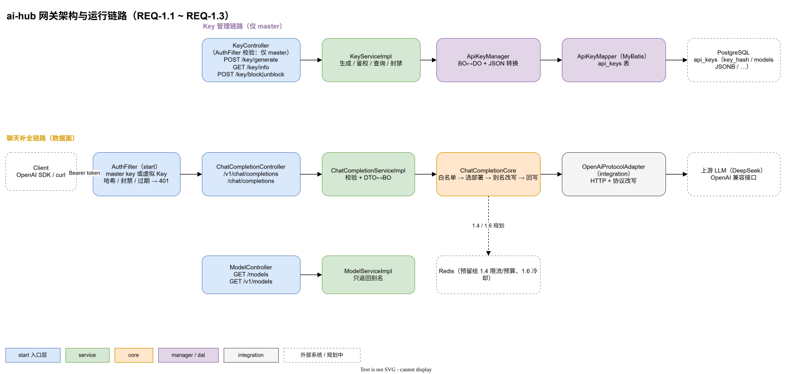

# REQ-1.1 验收：统一入口 + 单模型转发（非流式）

- 状态：已验收（2026-10-30，理解默认通过）
- 验收人：
- 需求记录：`../records/REQ-1.1.md`
- 需求来源：Vault `05-项目7-第1期-LLM网关核心.md` §REQ-1.1

## 1. 需求验收标准

- [x] 200：返回 OpenAI ChatCompletion 结构，`model=chat-default`，`usage` 完整
- [x] 未知模型 400：`invalid_request_error` / `param=model`
- [x] 未鉴权 401：`auth_error`
- [x] `stream=true` 400：明确提示流式暂未实现
- [x] `mvn -Pquality verify` 通过；单测 18 个；行覆盖率 84.97%
- [x] 真实 DeepSeek 链路验证通过

**验收命令 / 示例**：

```bash
curl -X POST http://localhost:18080/v1/chat/completions \
  -H "Authorization: Bearer sk-local-master-key" \
  -H "Content-Type: application/json" \
  -d '{"model":"chat-default","messages":[{"role":"user","content":"你好"}]}'
```

## 2. 从哪看起（固定 10 分钟）

1. 本文 §1（2 分钟）
2. `records/REQ-1.1.md` §1-3 人向说明（3 分钟）
3. 本文 §3 设计图（本次增量）+ 核心文件 `ChatCompletionController` / `ChatCompletionServiceImpl` / `ChatCompletionCore`（5 分钟）

## 3. 设计图（drawio 导出 SVG）



> 本次增量：聊天补全链路（Client → AuthFilter → Controller → Service → Core → Integration → 上游）：别名双向改写、统一错误体。 全局设计说明见 `../DESIGN.md`。

## 4. 实现要点与参考答案（按需阅读）

### 4.1 三条关键实现要点

1. **别名双向改写**：请求 `model` 别名 → 转发前改真实模型；响应 `model` 回写别名。只做一半会怎样？
2. **统一入口与错误体**：`/v1` 与无前缀两条路径共用一套 Controller；错误体统一 OpenAI error 结构。
3. **分层职责**：Controller 只收报文，Service 校验 + DTO↔BO，Core 编排与改写，Integration 做 HTTP。

### 4.2 面试 1 分钟讲法（骨架）

```text
我实现了一个 OpenAI 兼容的 LLM 网关入口：客户端用别名调用，网关改写为上游真实模型，
响应再回写别名；统一错误体和请求 ID；分层上 Controller/Service/Core/Integration 各司其职，
为后续路由、Key、限流、计量提供地基。
```

### 4.3 自测题与参考答案

1. 一次请求从进入 Filter 到返回，经过哪些环节？每层分别负责什么？
2. 为什么请求要改写 `model`、响应要回写？如果只做一半会发生什么？
3. 上游返回 400 时，网关应该透传还是转换？当前实现是哪种？
4. `stream=true` 为什么现在返回 400？拒绝发生在哪一层？
5. 新增一个模型别名需要改哪些文件？需要重启吗？

### 参考答案

1. RequestIdFilter 生成/透传 request_id → AuthFilter 鉴权 → Controller 解析原始 JSON → Service 校验 model/messages/stream、DTO↔BO → Core 选部署、别名改写 → Integration HTTP 调上游 → 响应 model 回写别名 → 返回原始 JSON。
2. 上游只认真实模型名，请求不改写会 400；响应不回写会让客户端看到上游模型名，破坏对外别名契约。只做一半分别导致调用失败或语义泄露。
3. 转换而非透传：integration 捕获上游异常，401 转 `auth_error`，其余转 `upstream_error`（502），避免把上游内部细节透给客户端。
4. 本期未实现 SSE；Service 的 `rejectStreaming` 检测 `stream=true` 直接返回 400（`param=stream`）。
5. 改 `application-local.yml` 的 `gateway.model-list` 增加别名/部署；当前 `YamlModelCatalog` 启动时映射，**需要重启**（后续迁 DB + 缓存失效可解决）。

### 4.4 亲手改的口子（可选）

- 任务：把 `application.yml` 的 `server.port` 从 18080 改为 18081，重启后用 curl 验证 `GET /models`。
- 验证方法：`mvn -pl ai-hub-start -am package -DskipTests` → 启动 → curl 18081。

## 5. 回归影响

- 无（首个需求）

## 6. 验收记录

- 验收日期：2026-10-30
- 结论：工程验收通过；理解验收默认通过（如需深挖看 §4）
- 遗留问题：无
