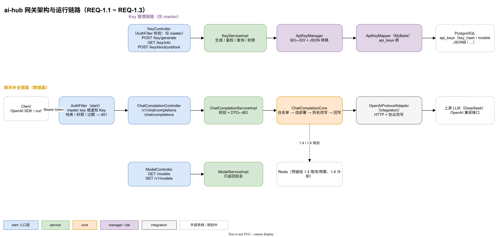

# REQ-1.2 验收：模型配置 + 多部署路由

- 状态：已验收（2026-10-30，理解默认通过）
- 验收人：
- 需求记录：`../records/REQ-1.2.md`
- 需求来源：Vault `05-项目7-第1期-LLM网关核心.md` §REQ-1.2

## 1. 需求验收标准

- [x] 配置两个别名（`chat` / `reasoner`）+ 一个别名双部署；60 次调用两个部署都被选中，3:1 权重命中明显更多（`GatewayRoutingIntegrationTest`）
- [x] `GET /models` 只返回别名，不暴露上游真实模型名、`api-base`、`api-key`
- [x] 新增/修改别名与部署只改 YAML，不改代码
- [x] 单部署路径与 REQ-1.1 行为一致（响应 `model` 回写别名、`usage` 不丢）
- [x] 单元测试覆盖：配置绑定、权重轮询、未知模型、`/models` 输出
- [x] `mvn -Pquality verify` 通过（Checkstyle 0 / SpotBugs / ArchUnit / JaCoCo ≥70%）

**验收命令 / 示例**：

```bash
curl http://localhost:18080/v1/models -H "Authorization: Bearer sk-local-master-key"
```

## 2. 从哪看起（固定 10 分钟）

1. 本文 §1（2 分钟）
2. `records/REQ-1.2.md` §1-3 人向说明（3 分钟）
3. 本文 §3 设计图（本次增量）+ 核心文件 `WeightedRandomSelector` / `ChatCompletionCore`（5 分钟）

## 3. 设计图（drawio 导出 SVG）



> 本次增量：聊天链路中的路由段（Core 选部署）+ 模型目录链路（ModelController → ModelService）：加权随机与别名隔离。 全局设计说明见 `../DESIGN.md`。

## 4. 实现要点与参考答案（按需阅读）

### 4.1 三条关键实现要点

1. **无状态加权随机**：每次请求按 rpm/tpm 权重现算，不保存轮询历史——多实例天然安全。
2. **别名隔离**：对外只暴露别名；`/models` 不含上游模型名、地址、密钥、权重。
3. **配置驱动 + 启动校验**：新增别名只改 YAML；同一别名权重字段混用会在启动时失败。

### 4.2 面试 1 分钟讲法（骨架）

```text
模型配置按 LiteLLM model_list 设计：别名映射到多部署，按 rpm/tpm 权重做无状态加权随机，
多实例部署不需要共享状态；对外只暴露别名，不泄露供应商细节；权重字段强制同源，
配置错误启动即失败。
```

### 4.3 自测题与参考答案

1. 请求 `{"model":"chat"}` 进来后，网关怎么决定这次调用哪个上游？`chat` 下有两个部署时，选哪一个、依据是什么？
2. 部署里的 `rpm` / `tpm` 在 1.2 里起什么作用？3:1 的配置大概会把流量分成什么样？如果一个部署配 `rpm`、另一个配 `tpm`，服务会怎样？
3. 单部署时，1.2 和 1.1 的请求/响应有什么不同？为什么返回给调用方的 `model` 仍是 `chat`，而不是上游真实模型名？
4. `GET /models` 返回什么、给谁用？如果新增一个 `embed` 别名，需要改代码吗？要重启吗？
5. 连续调用 `chat` 多次，怎么确认两个部署都被用到了？日志里看什么？

### 参考答案

1. Core 通过 `ModelCatalog.findDeployments(alias)` 取部署列表；多部署时 `WeightedRandomSelector` 按 `weight` 加权随机，单部署直接返回。权重来自 YAML 映射：`rpm` 优先 → `tpm` 回退 → 默认 1。
2. 1.2 中 rpm/tpm **只作路由权重**（不是限流）：3:1 约 75%/25% 分流；同别名混用 rpm 与 tpm 会在启动校验失败（权重字段必须同源）。
3. 单部署仍走目录映射，路由行为与 1.1 一致；响应 `model` 始终回写别名，保持对外契约，不泄露上游真实模型名。
4. `/models` 返回别名列表（OpenAI list 结构），供客户端发现可用模型；新增别名只改 YAML、不改代码；当前需重启（目录在启动时构建）。
5. 集成测试 `GatewayRoutingIntegrationTest` 统计 60 次调用两部署均命中；线上看上游请求记录或后续 REQ-1.5 的调用日志。

### 4.4 亲手改的口子（可选）

- 任务：把集成测试或本地 YAML 中 `chat` 的双部署权重从 3:1 改成 1:1，跑 `GatewayRoutingIntegrationTest`，观察命中比例断言是否仍然成立。
- 验证方法：`mvn -pl ai-hub-tests -am test -Dtest=GatewayRoutingIntegrationTest`。

## 5. 回归影响

- REQ-1.1：单部署聊天链路行为保持一致（响应 `model` 回写、`usage` 透传）

## 6. 验收记录

- 验收日期：2026-10-30
- 结论：工程验收通过；理解验收默认通过（如需深挖看 §4）
- 遗留问题：无
