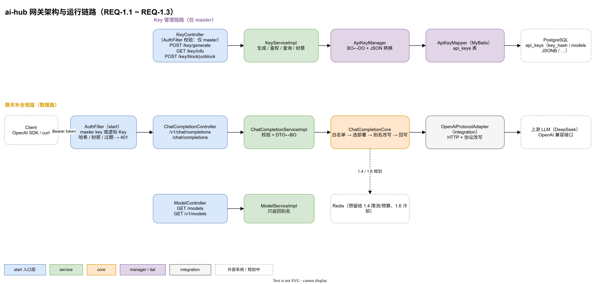

# REQ-1.3 验收：虚拟 Key

- 状态：已验收（2026-10-30，理解默认通过）
- 验收人：
- 需求记录：`../records/REQ-1.3.md`
- 需求来源：Vault `05-项目7-第1期-LLM网关核心.md` §REQ-1.3

## 1. 需求验收标准

- [x] `POST /key/generate` → 返回 `sk-` 明文；DB 查询仅存 hash（明文不可见）
- [x] 用虚拟 key 调用授权模型 → 200，响应正常
- [x] 调用未授权模型 → 403，`error.type=key_model_access_denied`、`param=model`、`code=403`
- [x] `/key/block` 后调用 → 401 `auth_error`；`/key/unblock` 恢复
- [x] 过期 key → 401；`/key/info` 字段与基线一致（key/info/spend/models/expires）
- [x] `mvn -Pquality verify` 通过

**验收命令 / 示例**：

```bash
curl -X POST http://localhost:18080/key/generate \
  -H "Authorization: Bearer sk-local-master-key" \
  -H "Content-Type: application/json" \
  -d '{"models":["chat"],"duration":"30d"}'
```

## 2. 从哪看起（固定 10 分钟）

1. 本文 §1（2 分钟）
2. `records/REQ-1.3.md` §1-3 人向说明（3 分钟）
3. 本文 §3 设计图（本次增量）+ 核心文件 `AuthFilter` / `KeyServiceImpl` / `ChatCompletionCore`（5 分钟）

## 3. 设计图（drawio 导出 SVG）



> 本次增量：Key 管理链路（KeyController → KeyService → ApiKeyManager → PostgreSQL）+ AuthFilter 的虚拟 Key 鉴权分支：哈希校验与白名单。 全局设计说明见 `../DESIGN.md`。

## 4. 实现要点（按需阅读）

### 4.1 三条关键实现要点

1. **哈希存储 + 一次性明文**：生成时返回 `sk-`，库中只有 SHA-256；`/key/info` 只回显掩码。
2. **授权顺序**：先白名单（403 `key_model_access_denied`）后未知模型（400 `invalid_model`），避免状态码差异泄露模型目录。
3. **管理面 / 数据面隔离**：`/key/*` 仅 master；虚拟 Key 只能走 chat 数据面。

### 4.2 面试 1 分钟讲法（骨架）

```text
我实现了网关的虚拟 Key 体系：生成时返回一次明文，库中只存 SHA-256；请求进来先哈希查库，
校验封禁与过期；再按 Key 的模型白名单授权，越权统一 403；管理接口只允许 master；
Key 状态全部外置数据库，多实例一致。
```

## 5. 回归影响

- REQ-1.1：聊天链路（鉴权扩展后仍支持 master key 调用）
- REQ-1.2：`/models` 与多部署路由不受影响

## 6. 验收记录

- 验收日期：2026-10-30
- 结论：工程验收通过；理解验收默认通过（如需深挖看 §4）
- 遗留问题：无
