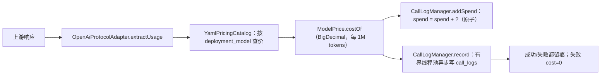

# REQ-1.5 验收：调用日志 + Token 计量 + `/key/info`

- 状态：已验收（2026-11-02，理解默认通过）
- 验收人：
- 需求记录：`../records/REQ-1.5.md`
- 需求来源：Vault `05-项目7-第1期-LLM网关核心.md` §REQ-1.5

## 1. 需求验收标准

> 实现前冻结，唯一勾选点；实现完成后只补 §2-4，不改本节标准。

- [x] 一次成功调用 → `call_logs` 恰好 1 条，字段完整（request_id / key_id / model_alias / deployment_model / prompt_tokens / completion_tokens / total_tokens / cost / latency_ms / status），`cost` 可按价格表复算
- [x] 连续两次虚拟 Key 调用 → `/key/info` 的 `spend` 等于两次 cost 之和
- [x] `call_logs` 能还原「哪个 key 调了哪个模型、花了多少钱、耗时多少」
- [x] 上游失败与业务拒绝（如越权 403）也各留 1 条日志，`status` 为对应 HTTP 码
- [x] 价格缺失的模型：启动 WARN，调用成功且 `cost=0`，不产生错误成本
- [x] 日志异步写入不阻塞响应；执行器饱和时由调用线程兜底执行（不丢日志）
- [x] `mvn -Pquality verify` 通过

**验收命令 / 示例**：

```bash
# 1) 生成 Key
curl -X POST http://localhost:18080/key/generate \
  -H "Authorization: Bearer sk-local-master-key" \
  -H "Content-Type: application/json" \
  -d '{"models":["chat"]}'

# 2) 调用两次
curl -X POST http://localhost:18080/v1/chat/completions \
  -H "Authorization: Bearer <虚拟 Key>" \
  -H "Content-Type: application/json" \
  -d '{"model":"chat","messages":[{"role":"user","content":"hi"}]}'

# 3) 查看 spend
curl "http://localhost:18080/key/info?key=<虚拟 Key>" \
  -H "Authorization: Bearer sk-local-master-key"

# 4) 查日志
psql -U aihub -d aihub -c "select request_id, key_id, model_alias, deployment_model, prompt_tokens, completion_tokens, cost, latency_ms, status from call_logs order by id desc limit 5;"
```

## 2. 从哪看起（固定 10 分钟）

1. 本文 §1（2 分钟）
2. `records/REQ-1.5.md` §1-3 人向说明（3 分钟）
3. `DESIGN.md` 链路增量 + 核心文件 `ChatCompletionCore` / `CallLogManager` / `YamlPricingCatalog`（5 分钟）

## 3. 实现要点（按需阅读）

### 3.0 先看懂计量与日志



### 3.1 三条关键实现要点

1. 计量在 core：成功与失败都生成 `CallLogBO`，日志异步落库，spend 同步原子累加。
2. 价格表按上游真实模型匹配，`BigDecimal` 按「每 1M tokens」换算，缺失价格告警且 cost=0。
3. `request_id` 从入口透传到日志，一条日志可还原完整调用事实。

### 3.2 面试 1 分钟讲法（骨架）

```text
网关每次调用都会计量：先解析上游返回的 usage，再按上游真实模型的输入/输出单价用 BigDecimal 计价，
虚拟 Key 的 spend 用原子 SQL 累加，调用日志通过有界线程池异步落库，失败调用同样留痕；
价格表缺失只告警不阻断，cost 记 0。这样限流、预算、成本看板和审计都有统一数据底座。
```

## 4. 回归影响

- REQ-1.1：聊天链路必须仍返回上游原始结构（usage 不丢）
- REQ-1.3：`/key/info` 字段结构不变，`spend` 开始真实累计
- REQ-1.2：`/models` 与路由不受影响

## 5. 验收记录

- 验收日期：2026-11-02
- 结论：工程验收通过（`CallLogIntegrationTest` 5 场景 + `mvn -Pquality verify` 全绿）；理解验收默认通过（如需深挖看 §3）
- 遗留问题：流式请求的日志补记留待 REQ-1.7；失败调用当前不计成本，重试/fallback 的计费语义留待 REQ-1.6
