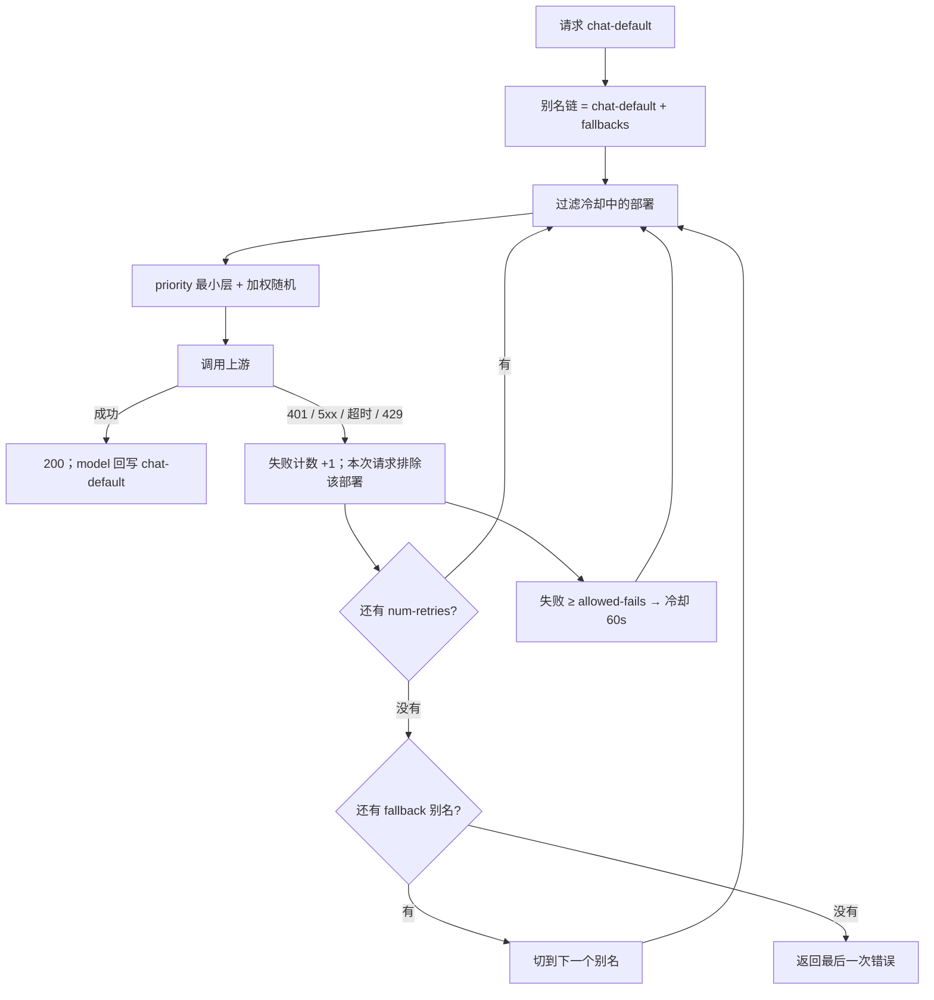

# REQ-1.6 验收：容错（重试 / fallback / 冷却）

- 状态：已验收（2026-11-02，理解默认通过）
- 验收人：
- 需求记录：`../records/REQ-1.6.md`
- 需求来源：Vault `05-项目7-第1期-LLM网关核心.md` §REQ-1.6

## 1. 需求验收标准

> 实现前冻结，唯一勾选点；实现完成后只补 §2-4，不改本节标准。

- [x] 配置错误 key 的主部署（同别名主备或 fallback 别名）→ 请求最终返回 200；响应 `model` = 请求别名
- [x] 重试次数与 `gateway.resilience.num-retries` 一致；同一请求内失败过的部署在存在其他候选时不重复选择
- [x] 超时 / 上游 5xx / 上游 401 / 上游 429 可触发重试或 fallback；上游 4xx（400/404/422）不重试
- [x] 连续失败达到 `allowed-fails` → 部署进入冷却；冷却期内不再被选中；冷却结束恢复
- [x] fallback 别名链按 `gateway.fallbacks` 配置顺序尝试；全部失败时返回最后一次真实错误
- [x] 一次请求只写 1 条 `call_logs`、只计费一次；日志含 `retry_count` / `fallback_used` / `served_alias` 轨迹
- [x] 多实例共享冷却状态（Redis）；Redis 故障时 fail-open 并告警
- [x] `mvn -Pquality verify` 通过

**验收命令 / 示例**：

```bash
# 本地配置：chat-default 主部署正确、备部署错误 key；chat-backup 为 fallback 别名
# 1) 主备/fallback 生效：应返回 200 且 model=chat-default
curl -X POST http://localhost:18080/v1/chat/completions \
  -H "Authorization: Bearer sk-local-master-key" \
  -H "Content-Type: application/json" \
  -d '{"model":"chat-default","messages":[{"role":"user","content":"hi"}]}'

# 2) 查日志轨迹
psql -U aihub -d aihub -c "select model_alias, served_alias, deployment_model, retry_count, fallback_used, cost, status from call_logs order by id desc limit 3;"

# 3) 单元/集成测试
mvn -pl ai-hub-core,ai-hub-integration,ai-hub-tests -am test -Dtest='*Resilience*,ChatCompletionCoreTest'
```

## 2. 从哪看起（固定 10 分钟）

1. 本文 §1（2 分钟）
2. `records/REQ-1.6.md` §1-3 人向说明（3 分钟）
3. `DESIGN.md` 容错链路增量 + 核心文件 `ChatCompletionCore` / `RedisDeploymentCooldownStore`（5 分钟）

## 3. 实现要点（按需阅读）

### 3.0 先看懂容错链路（一句话 + 一张图）

**一句话**：别名是招牌，部署是后厨；同一别名内先换后厨（priority 主备），全趴了再按 `fallbacks` 去别的招牌；某个后厨连续失败就让它"歇业"（Redis 冷却）一段时间。



**具体走查**（配置见 `records/REQ-1.6.md` §3.1）：

| 步骤 | 发生了什么 | 日志/响应 |
|---|---|---|
| 1 | `chat-default` 主部署（错误 key，priority 0）被选中 | — |
| 2 | 主部署返回 401（可重试） | 失败计数=1 ≥ allowed-fails=1 → 主部署冷却 60s；本次请求排除 |
| 3 | 还有 `num-retries=1`，重新选：主部署冷却，选备部署（priority 1） | — |
| 4 | 备部署 200 | 响应 `model=chat-default`；日志 `served_alias=chat-default`、`retry_count=1`、`fallback_used=false`、`cost` 按备部署 usage 计一次 |
| 5 | 若备部署也失败，则进入 `chat-backup` 别名 | `served_alias=chat-backup`、`fallback_used=true`、`retry_count=2` |
| 6 | 全部失败 | 返回最后一次真实错误，`status`/`error_type` 写日志，`cost=0` |

**别名 fallback 与主备的区别**：主备是同一别名内的部署切换（priority）；fallback 是跨别名切换（`gateway.fallbacks`）。两者是串行关系：先主备，后 fallback。

**冷却为什么放 Redis**：冷却和失败计数是跨请求、跨实例状态。放本地 Map 会导致每个实例判断不一致，故障部署仍会被其他实例打爆；实例重启后冷却还会丢。

### 3.1 三条关键实现要点

1. 请求内排除 + 跨请求冷却两层机制：前者保证一次请求内主备真实切换，后者限制故障部署被持续打爆。
2. 可重试边界按「错误归属」划分：请求自身问题（4xx）不重试，部署/上游问题（超时、5xx、401、429）才重试或降级。
3. 计费与日志只在最终结果发生一次；轨迹字段让审计与排障能还原降级路径。

### 3.2 面试 1 分钟讲法（骨架）

```text
网关的容错分两层：同一别名内先按 priority 选主备并重试，失败后再走配置的 fallback 别名链。
同一请求内失败过的部署不会再次被选中，跨请求的连续失败计数和冷却状态放 Redis，多实例共享。
只对超时、5xx、401、429 这些部署级错误重试，4xx 直接返回；最终只按成功调用计费一次，
日志里记录 retry_count、fallback_used 和最终服务别名，可以还原整条降级路径。
```

## 4. 回归影响

- REQ-1.1：正常单部署聊天链路不变（响应结构与 model 回写）
- REQ-1.2：`/models` 与加权路由不变；新增 priority 分层
- REQ-1.3：鉴权与白名单不变
- REQ-1.4：限流/预算预占-结算不变；最终结算按成功调用
- REQ-1.5：日志字段新增，原有字段不变

## 5. 验收记录

- 验收日期：2026-11-02
- 结论：工程验收通过（`ResilienceIntegrationTest` 4 场景 + `RedisDeploymentCooldownStoreTest` 6 场景 + `ChatCompletionResilienceTest` 7 场景；`mvn -Pquality verify` 全绿）；真实链路验证主备切换、冷却、fallback 均符合预期；理解验收默认通过
- 遗留问题：流式请求（REQ-1.7）的容错复用待实现；上游 4xx 对外仍为 502，后续如需透传上游状态码另立需求
