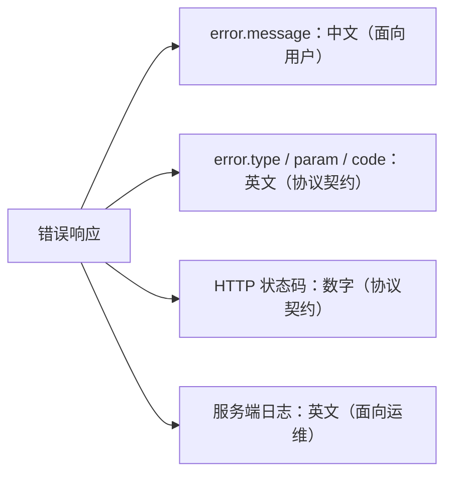

# REQ-1.8 验收：对外错误信息中文化

- 状态：已验收（2026-11-03）
- 验收人：
- 需求记录：`../records/REQ-1.8.md`
- 需求来源：用户第一期验收反馈（2026-11-03）

## 1. 需求验收标准

> 实现前冻结，唯一勾选点；实现完成后只补 §2-4，不改本节标准。

- [x] 未知模型 400：`error.message` 为中文（含「模型」），`type=invalid_request_error`、`param=model`、`code=400` 不变
- [x] 未鉴权 / Key 封禁 / Key 过期 401：`error.message` 为中文（含「鉴权」「封禁」「过期」）
- [x] 越权模型 403：`error.message` 为中文（含「无权」/「不可用」），`type=key_model_access_denied` 不变
- [x] 限流 429：`error.message` 为中文（含「限流」「频繁」）；预算 400：含「预算」
- [x] 上游 401 / 429 / 4xx / 5xx / 超时：`error.message` 为中文（含「上游」「超时」）
- [x] `/key/*` 管理接口错误（缺少字段、Key 不存在等）`error.message` 为中文
- [x] `error.type` / `param` / `code`、HTTP 状态码全部保持英文协议值与原值
- [x] `mvn -Pquality verify` 通过

**验收命令 / 示例**：

```bash
# 未知模型
curl -s -X POST http://localhost:18080/v1/chat/completions \
  -H "Authorization: Bearer sk-local-master-key" \
  -H "Content-Type: application/json" \
  -d '{"model":"no-such-model","messages":[{"role":"user","content":"hi"}]}'
# 期望：{"error":{"message":"模型 'no-such-model' 不存在或不可用...","type":"invalid_request_error","param":"model","code":"400"}}

# 未鉴权
curl -s -X POST http://localhost:18080/v1/chat/completions \
  -H "Content-Type: application/json" \
  -d '{"model":"chat-default","messages":[{"role":"user","content":"hi"}]}'
# 期望 message 为中文鉴权提示，type=auth_error、code=401 不变
```

## 2. 从哪看起（固定 10 分钟）

1. 本文 §1（2 分钟）
2. `records/REQ-1.8.md` §1-3（3 分钟）
3. 核心文件 `ChatCompletionException` / `ErrorResponse` / `GatewayExceptionHandler`（5 分钟）

## 3. 实现要点与参考答案（按需阅读）

### 3.0 文案语言边界



### 3.1 三条关键实现要点

1. 只改 `message`；`type`/`param`/`code` 与 HTTP 状态码不动，保证 OpenAI SDK 兼容。
2. 文案集中：常规错误在 `ChatCompletionException` 工厂方法；请求解析/Key 管理/治理错误在各自调用点改为中文。
3. 技术专有名词保留原文（API Key、Redis、SSE、JSON），句子用中文。

### 3.2 面试 1 分钟讲法（骨架）

```text
网关对外错误体分两层：message 给人看，type/param/code 给程序看。
我们按客群把 message 统一成中文，结构化字段保持英文协议值不变，
这样既让中文用户直接看懂，也不破坏 OpenAI SDK 的兼容性；
文案集中维护，避免各接口各自写一套。
```

### 3.3 自测题与参考答案

1. 为什么不能把 `error.type` 也改成中文？
2. 错误 message 中文化后，日志是否也要跟着改？为什么？
3. 同一个错误（如未知模型）在多个调用点出现，如何避免文案不一致？
4. 中文化后如何验证没有破坏 OpenAI SDK 兼容性？
5. 哪些中文文案需要保留英文技术名词？

### 参考答案

1. `type`/`param`/`code` 是客户端按值分支的协议契约，改成中文会破坏 SDK 与已有调用方；语言只影响人读的 message。
2. 日志面向运维检索，保持英文即可；message 中文已能满足用户排障，二者职责不同。
3. 把常规错误收敛到 `ChatCompletionException` 工厂方法；调用点只传必要参数（字段名/状态码），不各自拼整句文案。
4. 回归测试断言 type/param/code/HTTP 状态码不变，只改 message；用 OpenAI SDK 或 curl 验证错误体结构。
5. API Key、Redis、SSE、JSON、Token、HTTP 状态码等专有名词保留原文，避免歧义。

### 3.4 亲手改的口子（可选）

- 任务：把 `ChatCompletionException.invalidModel` 的 message 改成英文，跑 `ChatCompletionExceptionTest` 观察失败；再改回中文。
- 验证方法：`mvn -pl ai-hub-common -am test -Dtest=ChatCompletionExceptionTest`。

## 4. 回归影响

- 所有需求的 HTTP 状态码与 `error.type` 必须保持不变
- OpenAI SDK 兼容：错误体结构不变，仅 message 内容语言变化
- 前端/调用方若硬编码英文 message 做判断，需改为按 type/code 判断（规范要求）

## 5. 验收记录

- 验收日期：2026-11-03
- 结论：工程验收通过（`ChatCompletionExceptionTest` 2 组断言 + `ChatCompletionControllerTest` 中文 message 断言 + `KeyServiceTest` 中文断言；`mvn -Pquality verify` 全绿）；协议字段与状态码未变。
- 遗留问题：无
