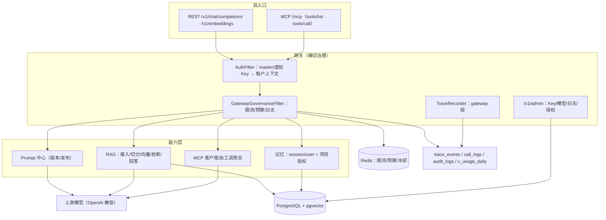

# REQ-4.5 验收：审计日志 + 项目总验收

- 状态：待验收（2026-11-16，实现与自检完成）
- 验收人：主人
- 需求记录：`../records/REQ-4.5.md`

## 1. 需求验收标准

> 实现前冻结，唯一勾选点。

- [x] 审计事件覆盖：Key 生成/封禁/解封、Prompt 发布/回滚、MCP Server 注册/注销、
      租户/项目授权变更、管理面动作
- [x] `audit_logs` 字段：actor / action / target / before / after（脱敏）/ trace_id / created_at / tenant_id
- [x] `GET /v1/audit-logs` 管理员查询，支持 action/target/tenant/时间/分页
- [x] 审计只追加：应用层无 update/delete；PostgreSQL 触发器拒绝修改/删除；保留周期可配置
- [x] 非管理员不可查审计（403）
- [x] 审计快照不含明文 Key / 上游 api-key
- [x] 总验收材料：白板、差异对照 ≥10 条、失败演示 ≥5 个、3 分钟讲述稿（见 §4）
- [x] `mvn -Pquality verify` 全绿

**验收命令**：

```bash
curl "http://localhost:18080/v1/audit-logs?tenant_id=tenant-a&limit=20" \
  -H "Authorization: Bearer $MASTER"
```

## 2. 从哪看起（固定 10 分钟）

1. 本文 §1 + §4 总验收材料（5 分钟）
2. `records/REQ-4.5.md` §1-3（2 分钟）
3. 核心文件（3 分钟）：`AuditRecorderImpl`、`V13__audit_logs.sql`、`AuditLogIntegrationTest`

## 3. 实现要点与参考答案（按需阅读）

### 3.1 三条关键实现要点

1. **只追加**：Mapper 无 update/delete；PG 触发器 `BEFORE UPDATE OR DELETE` 直接报错。
2. **脱敏快照**：before/after 只放业务标识/状态，不放密钥与正文。
3. **trace 关联**：审计记录带 `trace_id`，可跳到 `GET /v1/traces/{trace_id}` 看完整链路。

### 3.2 自测题与参考答案

1. 为什么应用层没有 update/delete 还不够？
2. 审计写失败为什么不让业务失败？
3. 审计里为什么不能放完整实体？
4. 保留周期为什么不做自动清理？
5. 如何证明「审计不可篡改」？

### 参考答案

1. 新代码/直连数据库仍可能修改，DB 触发器是最后一道闸。
2. 封禁等治理动作不能因为日志失败而失效；失败记 ERROR 供补录。
3. 实体可能含密钥/隐私，长期保留会放大泄露面；只存变更需要的标识与状态。
4. 删除本身是高风险动作，应走合规流程；本期只提供配置位。
5. 应用层无写口 + PG 触发器 + 测试断言无 update/delete 方法。

## 4. 项目 7 总验收材料

### 4.1 白板：全景



### 4.2 与 LiteLLM 的差异对照（≥10 条）

| # | 维度 | LiteLLM | ai-hub 本项目 | 理由 |
|---|---|---|---|---|
| 1 | 定位 | 通用 LLM 网关/代理 | 面向业务方的 AI 中台（RAG/记忆/Prompt/MCP 一体） | 项目 7 的能力开放平台叙事 |
| 2 | 租户模型 | Team/User/Key + 企业版 Organizations | tenant→project→user，Key 绑定 tenant/project | 需求卡明确三级简化 |
| 3 | 租户来源 | Key/Team 配置 | Key 绑定为唯一来源，请求参数不可覆盖 | 堵住请求体伪造租户 |
| 4 | 配置存储 | config.yaml / DB | 模型别名/部署实例 DB 化，YAML 仅首次种子 | 管理 API 即时生效、多实例一致 |
| 5 | 向量检索 | 无内置（外接） | 内置 pgvector + 1024 维零填充 + HNSW | 第 3 期能力，单库落地 |
| 6 | MCP | 以工具/函数调用为主 | 双入口 MCP Server（REST 同构）+ 客户端连接池 | 第 2 期 MCP 中心 |
| 7 | Prompt | 无版本中心（依赖外部） | 模板版本/发布/回滚 + 渲染接入网关 | 第 2 期 Prompt 中心 |
| 8 | 成本聚合 | 定时 spend 聚合 | `v_usage_daily` 实时视图，与日志逐条可复算 | 避免重复聚合/漂移 |
| 9 | Trace | 依赖 OTel/Langfuse 等 | 自带 trace_events 分段 + `GET /v1/traces` | 零外部依赖可排障 |
| 10 | 审计 | Audit Logs（企业版） | audit_logs 只追加 + PG 触发器 | 合规不可篡改 |
| 11 | 管理 UI | 完整 Web UI | 最小管理 API，页面可选不做 | 需求卡允许，时间投治理 |
| 12 | 鉴权粒度 | Key 白名单/Team 预算 | Key 白名单 + 租户/项目授权 + 越权 403 | 多租户隔离 |
| 13 | 记忆 | 无内置 | session/user 记忆 + 项目级显式授权 | 第 3 期 |
| 14 | 文档解析 | 无 | pdf/docx/pptx/xlsx/html 自研解析与限额 | 第 3 期 |

### 4.3 失败演示（≥5 个）

| # | 场景 | 操作 | 期望 |
|---|---|---|---|
| 1 | Key RPM 超限 | 同一 Key 连续调用超过 `rpm_limit` | 第二次 429 `rate_limit_error` |
| 2 | 预算耗尽 | 设置 `max_budget` 很小的 Key，调用一次 | 400 `budget_exceeded` |
| 3 | 主部署失败 fallback | 主部署指向不可用地址，配置 `fallbacks` | 自动切换备用别名，响应 `served_alias` 为备用 |
| 4 | MCP 超时 | 调用一个慢 MCP 工具 | 504 `timeout_error` |
| 5 | RAG 无召回 | 查询知识库不存在的内容 | 200 + 兜底文案，`no_hit=true`，不调模型（默认） |
| 6 | 跨租户越权 | B 租户 Key 伪造 A 的 tenant_id | 403 `tenant_access_denied` + WARN 日志 |
| 7 | 缺价模型 | 使用未配置价格的上游模型 | cost=0，`unpriced_models` 中列出 |

### 4.4 三阶能力自评

- L3（能讲清原理并手写）：Auth / 路由 / 限流 / 租户隔离
- L2（能改能调）：RAG 检索、Prompt 版本、MCP 代理、Trace、用量、审计

### 4.5 三分钟讲述稿

```text
这是一个面向业务方的 AI 中台，不是单纯的模型代理。入口有两类：REST 的 chat/embeddings 和
MCP 的 tools/list、tools/call，两者共用同一套网关治理：鉴权、限流、预算、日志、Trace。

第一层是隔离。虚拟 Key 在签发时绑定租户和项目，鉴权后把租户身份放进请求上下文；业务层只信
这个上下文。请求里如果写了别的 tenant/project，直接 403 并打日志。RAG、记忆、Prompt、MCP
和日志的查询全部带租户条件，向量检索先过滤再排序。跨项目共享不靠开关，而是项目级授权表。

第二层是能力。Prompt 有版本、发布、回滚；RAG 支持多格式解析、切分、pgvector 检索和带引用的
回答；记忆分会话级和用户级；MCP 有注册、探活、工具聚合和连接池。

第三层是运营。每次请求一个 trace_id，网关、召回、模型、回答、MCP 各写一条摘要事件，可以
按 trace 查完整轨迹；调用日志按天/租户/项目/模型/Key 实时聚合成用量和成本，缺价模型单独告警；
管理端可以封 Key、改模型别名、查日志、给项目授权，所有治理动作写只追加的审计日志，数据库触发器
保证不能改不能删。

取舍上，我们没有做完整管理 UI，也没有引入外部 APM；用最小 API + 自带 trace/用量/审计先把
治理闭环跑通。下一步是混合检索和大文件异步接入。
```

### 4.6 总验收清单

- [x] 四期 REQ-4.1~4.5 实现并各有中文提交
- [x] 三期遗留：Key 绑租户、表结构拆分、记忆四维隔离（4.1）
- [x] 门禁 `mvn -Pquality verify` 全绿
- [x] 白板 / 差异对照 ≥10 / 失败演示 ≥5 / 三分钟讲述稿
- [ ] LiteLLM UI 实测（B-17）——当前机器无法打开 UI，待补，不阻塞
- [ ] 主人亲验：白板讲述、差异对照理解、失败演示复现
