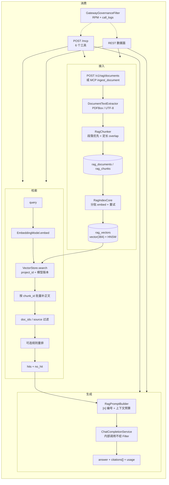

# 三期毕业验收：RAG 与记忆服务

- 状态：待验收（2026-11-11，实现、自检与真实链路演示完成）
- 验收人：主人
- 范围：REQ-3.1 文档接入、REQ-3.2 Embedding/向量存储、REQ-3.3 检索与重排、REQ-3.4 生成与引用溯源、
  REQ-3.5 记忆服务、REQ-3.6 RAG/记忆 MCP 暴露
- 需求记录：`../records/REQ-3.1.md` ~ `REQ-3.6.md`
- 验收文档：`REQ-3.1.md` ~ `REQ-3.6.md`（本次合并验收）
- 证据目录：`assets/third-phase/`（演示日志、数据库证据、入口日志摘要、演示脚本）

## 0. 一分钟结论

- 第三期 6 个需求全部完成；`mvn -Pquality verify` 全绿，379 个测试、0 失败；
  Checkstyle 0 违规、SpotBugs 0 bug、JaCoCo 覆盖率门禁通过、ArchUnit 层依赖通过，
  含 pgvector Testcontainers 真库回归。
- RAG 主链路与记忆服务均可通过 REST 与 MCP 双协议消费；MCP 6 个工具 schema 与 REST 契约一致，
  租户/项目/用户作用域透传，权限规则只有 Service 一份实现。
- 真实链路（真实 pgvector + all-minilm + DeepSeek）演示：检索命中、答案与引用对应、无召回兜底
  不调模型、跨项目授权/拒绝、跨租户隔离、模型切换未重建失败与重建恢复，全部有执行日志留证。
- 已知遗留（不阻塞本期）：终端用户级鉴权、成本计量、全链路 Trace、审计归第 4 期；中文语料的
  相似度阈值需按实际模型标定。

## 1. 链路白板（文档到引用的全链路）

### 1.1 总览

### 1.2 分阶段讲解稿

1. **接入**：业务上传 txt/md/pdf，`DocumentTextExtractor` 负责解析（PDFBox 或严格 UTF-8），
   失败时持久化 FAILED 文档并保留原始文件；`RagChunker` 按段落贪心打包，超长段落再定长切分
   + overlap，切片落 `rag_chunks`，按 `project_id + content_hash` 去重。
2. **向量化**：`RagIndexCore` 分批调用 `EmbeddingModel`（默认本地 all-minilm，384 维），
   失败重试后落 FAILED；向量写 `rag_vectors`，同 `chunk_id` 覆盖，按项目与模型版本隔离；
   文档记录模型、维度、耗时与成本。
3. **检索**：query 向量化后按 `project_id + 当前模型` 在 pgvector 做 cosine 检索；候选按
   `top_k × multiplier` 放大（上限 200），按 `chunk_id` 分批（≤100）补齐正文，再执行
   `doc_ids/source` 过滤、阈值与条数收敛；可选规则重排（向量分 + query 词项覆盖率）。
   无命中返回空列表 + `no_hit=true`，检索日志只记 query 与 id/score。
4. **生成**：`RagAnswerServiceImpl` 复用检索服务，`RagPromptBuilder` 按命中顺序分配 `[1][2]`，
   受 `max-context-chars` 预算约束，只把实际进入 prompt 的切片放进 citations；通过内部
   `ChatCompletionService` 调模型（不经 HTTP/Filter，避免双重治理）。无召回默认不调模型，
   返回可配置兜底话术；自由回答需服务端开关与请求双开关。
5. **引用**：citations 的 `index` 与答案中的 `[n]` 同源生成；`doc_id/chunk_id/source/score`
   可回查原始切片；同一 `request_id` 串起 query、召回、prompt 摘要、usage 与引用。
6. **MCP 出口**：`/mcp` 的 `tools/list` 暴露平台工具、聚合工具与 6 个 RAG/记忆工具；
   `tools/call` 由 `McpRagMemoryTools` 把参数转成同一批 DTO 并调用内部 Service；
   入口治理记录 `call_type=MCP`、`target_name=工具名` 与 `request_id`。

### 1.3 数据与表

| 阶段 | 表 | 关键字段 |
|---|---|---|
| 文档接入 | `rag_documents` / `rag_chunks` | `doc_id` / `project_id` / `content_hash` / `index_status` / `chunk_id` / `content` |
| 向量化 | `rag_vectors` | `chunk_id` / `project_id` / `embedding_model` / `embedding vector(384)` |
| 记忆 | `memories` / `memory_audit_logs` | 作用域列 / `content` / `expires_at` / 删除快照 |
| 调用轨迹 | `call_logs` | `request_id` / `call_type` / `target_name` / `cost` |

## 2. 演示：MCP Client 调用 RAG 与记忆

### 2.1 环境与方法

- 应用：`ai-hub-start` 可执行 jar，`local` profile，端口 18081。
- 数据库：临时 pgvector 容器（pgvector/pgvector:pg16，宿主 5433）；Redis 为本机既有容器。
- Embedding：LangChain4j 本地 AllMiniLmL6V2（384 维，模型标识 `all-minilm-l6-v2`）。
- 生成模型：DeepSeek `deepseek-flash`（别名 `chat-default`，经本机代理）。
- 客户端：裸 JSON-RPC `POST /mcp`（演示脚本 `assets/third-phase/phase4-mcp-demo.py`）；
  兼容性另由 LangChain4j `DefaultMcpClient` 集成测试覆盖（`RagMemoryMcpIntegrationTest`）。

### 2.2 结果

| 场景 | 结果 | 证据 |
|---|---|---|
| 工具发现 | `tools/list` 返回 9 个工具：3 个平台工具 + `ingest_document` / `search_knowledge` / `rag_answer` / `save_memory` / `recall_memory` / `clear_memory` | `phase4-demo-basic.log.txt` 第 2 行 |
| 文档接入（MCP） | 3 份文档均 `READY`、各 1 个切片 | 同上，`ingested doc_id=... status=READY` |
| 检索（MCP） | “年假有多少天” 命中 3 条，top1 `demo-hr.md`，向量分 0.736，`reranked=true` | 同上 |
| 生成（MCP） | 答案“入职满一年 5 天、满三年 10 天、满十年 15 天 [1]”，citation [1] 指向 `demo-hr.md`，usage 390 | 同上 |
| 无召回 | `search_knowledge`（阈值 0.6）`count=0`、`no_hit=true` | 同上 |
| 无召回兜底 | `rag_answer` 返回“未在知识库中检索到相关资料，无法回答该问题。”，`citations=[]`，`usage=0`（未调模型） | 同上 |
| 记忆写入/召回 | 项目 A 写“用户对芒果过敏”，同项目召回命中，metadata 保留 | 同上 |
| 默认隔离 | 项目 B 不传 `cross_project` 召回为空 | 同上 |
| 未授权跨项目 | 开关关闭时 `cross_project=true` 返回 JSON-RPC error：“未开启跨项目记忆共享，无法跨项目召回…” | 同上 |
| 会话级跨项目 | `session_id` + `cross_project=true` 被拒：“会话级记忆不支持跨项目召回…” | 同上 |
| 跨租户 | 租户 `t-other` 读取同项目同用户记忆为空 | 同上 |
| 物理删除 | `clear_memory` 删除 2 条，写审计 `deleted=2`、`audit_id`；之后召回为空 | 同上 + `phase4-db-evidence.txt` |
| 跨项目授权（开启） | 项目 B 默认召回为空；显式 `cross_project=true` 读到项目 A 用户级记忆（`project_id=p-a`） | `phase4-demo-cross.log.txt` |
| 未授权（无凭证） | 无 Bearer 的 `tools/list` 返回 HTTP 401，中文错误体 | `phase4-demo-basic.log.txt` 第 3 行 |
| 调用日志贯通 | `call_logs` 记 `MCP / search_knowledge / status=200 / cost=0`，`request_id` 与入口 `X-Request-Id` 一致 | `phase4-db-evidence.txt` + `phase4-app-log-evidence.txt` |

### 2.3 链路还原示例

- 有召回回答的 `request_id`：`fd031191-9f31-4b0e-b6e0-4359152464b8`。入口日志记录
  “MCP tool rag_answer: requestId=…, projectId=p-rag-demo, model=chat-default, citations=3,
  noHit=false”，`call_logs` 同一 `request_id` 记 `MCP/rag_answer`。
- 记忆写入的 `request_id`：`4306b6d8-3804-4698-b139-3b4c050c88b7`，入口日志只记录
  `tenant/project/user`、`memoryId` 与 `contentLength=7`，不打印记忆正文。
- 删除审计：`62a4a568-44d6-4d95-8a3e-6e7c70b64a4b`，`deleted_count=2`，原因“用户行使删除权”。

## 3. 对照：与 LiteLLM / 07 笔记设计的 5 处相同与不同

| # | 维度 | 相同 | 不同与理由 |
|---|---|---|---|
| 1 | 统一入口与治理 | 都采用“业务方带 Key 调统一网关，网关做鉴权、限流、路由、日志”的形态 | 本实现是 Spring Boot 单应用多模块，治理收敛在 `GatewayGovernanceFilter + GatewayGovernanceService`（路径/工具名分类），不是独立网关进程；07 的鉴权、限流、路由、日志四段由一条 Filter 链完成，新增入口自动复用 |
| 2 | RAG 服务方法面 | 都提供 `ingest_document` 与 `search_knowledge`，按 `project_id` 隔离 | 本实现增加 `rag_answer`（检索 + 生成 + citations 一体）和阈值/条数/元数据过滤/规则重排/`no_hit`；向量库用 PostgreSQL pgvector 而非 ChromaDB，少一个外部组件；07 只定义检索方法，生成由业务方编排 |
| 3 | 记忆服务方法面 | 都是 `save_memory` / `recall_memory` / `clear_memory`，区分会话级与用户级，用户画像可跨项目 | 本实现用 PostgreSQL 结构化字段 + TTL 查询时过滤 + 物理删除审计（07 未展开删除权）；跨项目共享默认关闭，需配置开启 + 显式 `cross_project` + 仅用户级；MCP 入参与 REST 完全一致 |
| 4 | 多租户隔离 | 都以项目/用户为隔离维度，跨项目读取用户画像 | 本实现把 `tenant_id` 也作为强制作用域（07 以 `project_id` 为主）；越权读取返回空结果或 403，不泄露存在性；会话级记忆永不跨项目（07 未明确约束） |
| 5 | 调用形态与 MCP 暴露 | 都强调 REST 是业务主路径、MCP 是 Agent 适配层；能力可被 Agent 动态发现 | 07 把 LLM/RAG/记忆/Prompt 拆成 4 个独立 MCP Server（9001–9004）；本实现是单应用内逻辑服务 + 一个 `/mcp` 统一入口（平台工具 + 聚合工具 + RAG/记忆工具），物理端口拆分留到部署期。LiteLLM 自身是 MCP 聚合网关，B-16 实测其 Memory/Vector Store 只代理托管服务、无本地 RAG 实现；本实现自建本地 embedding + pgvector + 记忆审计，可按需替换模型与存储 |

补充说明（与 LiteLLM 的整体差异）：LiteLLM 的强项是 100+ 模型统一接入、虚拟 Key、预算与路由；
本期复用其网关行为基线，RAG/记忆属于自建能力，所以对照重点是“能力面与隔离规则”，
而不是模型接入数量。

## 4. 失败演示（实际执行证据）

### 4.1 无召回

- `search_knowledge` 查询“火星基地的氧气供应方案”（`min_score=0.6`）：`count=0`、`no_hit=true`。
- `rag_answer` 同问题（`min_score=0.6`）：返回兜底话术、`citations=[]`、`usage=0`，模型未被调用。
- 证据：`assets/third-phase/phase4-demo-basic.log.txt`（“rag_answer 无召回”段）。

### 4.2 跨租户与未授权越权

- 跨租户：租户 `t-other` 以相同 `project_id` / `user_id` 召回，`count=0`；SQL 强制
  `tenant_id + user_id`，跨租户数据不可见。
- 未授权跨项目：开关关闭时 `cross_project=true` 被拒（中文 JSON-RPC error）；
  无 Bearer 的 `/mcp` 请求返回 HTTP 401。
- 证据：`assets/third-phase/phase4-demo-basic.log.txt`（“跨租户”“cross_project rejected”段）、
  `phase4-db-evidence.txt`。

### 4.3 embedding 模型切换未重建

- 操作：应用以 `--gateway.rag.embedding.model-id=all-minilm-l6-v2-v2` 重启（实际模型仍为
  AllMiniLmL6V2，维度 384；仅模型标识变化，模拟换模型）。
- 结果：文档列表 3 份均 `index_status=READY`、`embedding_model=all-minilm-l6-v2`、
  `reindex_required=true`；`search_knowledge` 返回 `count=0`、`no_hit=true`；
  `rag_answer` 返回兜底、`usage=0`——旧向量不会被新模型误用。
- 修复路径：对 `demo-att.md` 调用 `POST /v1/rag/documents/{docId}/reindex` 后
  `index_status=READY`、`embedding_model=all-minilm-l6-v2-v2`，随后检索命中 `demo-att.md`。
- 证据：`assets/third-phase/phase4-demo-model-switch.log.txt`（失败）与
  `phase4-demo-model-switch-rebuilt.log.txt`（重建后命中）。

## 5. 阅读路径

**10 分钟（了解做了什么）**

1. 本文 §0 与 §1.2 讲解稿（5 分钟）
2. `records/REQ-3.4.md` §1-3（生成与引用，3 分钟）
3. `records/REQ-3.5.md` §1-3（记忆与授权，2 分钟）

**30 分钟（理解关键设计）**

1. 本文 §1 全链路 + §3 对照（10 分钟）
2. `DESIGN.md` §3.12–3.16（记忆、RAG 接入/检索/生成、MCP 工具）（15 分钟）
3. `records/REQ-3.6.md` §3-5（MCP 工具与决策）（5 分钟）

**深入（可运行）**

1. `mvn -Pquality verify`（需 Docker 跑 pgvector 回归）
2. `assets/third-phase/phase4-mcp-demo.py` 三组演示（basic / cross / model-switch），
   按脚本头部注释启动 pgvector 容器与应用
3. 核心类：`RagRetrievalCore`、`RagAnswerServiceImpl`、`RagPromptBuilder`、
   `MemoryServiceImpl`、`McpRagMemoryTools`

## 6. 遗留与第 4 期衔接

- **终端用户鉴权**：`user_id` 目前由调用方声明，API Key 只代表应用身份；Key 与
  tenant/project 绑定、终端用户体系归 REQ-4.1 与业务方 Tier1。
- **成本与 Trace**：RAG/记忆 MCP 调用在 `call_logs` 记 `cost=0`；模型 token 成本、
  JSON-RPC 工具错误率、全链路 Trace 归 REQ-4.2/4.3。
- **审计**：记忆物理删除已有 `memory_audit_logs`；统一 `audit_logs` 归 REQ-4.5。
- **阈值标定**：all-minilm 对无关中文文本的余弦约 0.47–0.59，生产需按语料标定
  `min_score`，或换用更强中文 embedding 模型。
- **ER 图**：当前以 `docs/DATA-MODEL.md` 的 Mermaid `erDiagram` 为真源；drawio/svg
  统一导出随第 4 期架构图更新。
- **验收状态**：REQ-3.1~3.4、REQ-3.6 为“待验收（实现与自检完成）”，等待主人理解验收
  （默认通过）；REQ-3.5 已验收。

## 7. 结论

第三期完成了“文档 → 切片 → 向量 → 检索 → 生成 → 引用”的完整链路，并把 RAG 与记忆以
REST + MCP 双协议暴露给业务与 Agent。隔离与授权在 Service 层单点实现，MCP 只做适配，
因此两条协议的行为一致；失败场景（无召回、越权、模型切换）均已实际验证并按设计降级。

