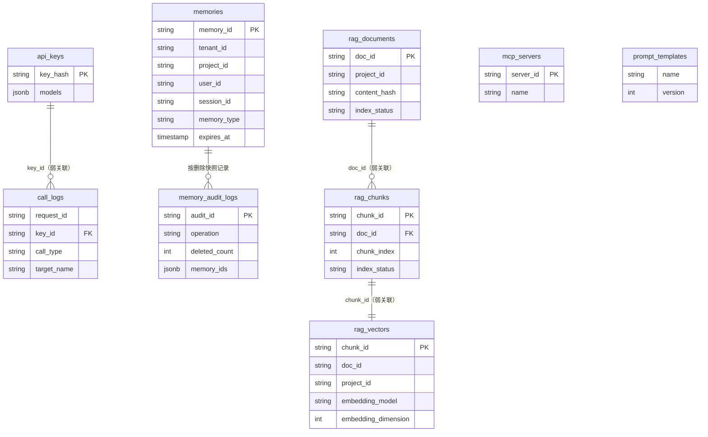

# 数据模型基线（表速查）

> 人向速查：`STATUS.md` 的「数据表速查」**只读取本文件的「当前表」区**。
> 维护规则：新增/修改表时更新本文件；DDL 真源是 `ai-hub-dal/src/main/resources/db/migration/Vn__*.sql`（Flyway），本文件补充业务语义与关系。
> 规划表仅用于设计参考，不代表已实现，不进入 STATUS。

## 当前表（active，STATUS 只显示本区）

### 租户与模型目录

| 表 | 用途 | 关键关系 | 状态 | 引入需求 |
|---|---|---|---|---|
| tenants | 租户：tenant_id（主键）/ name / status / created_at | 1:N projects、api_keys.tenant_id | active | REQ-4.1 |
| projects | 项目：tenant_id + project_id（联合主键）/ name / status | N:1 tenants；被 api_keys/rag_documents/memories 引用（逻辑） | active | REQ-4.1 |
| project_authorizations | 项目级显式授权：tenant_id / source_project_id / target_project_id / resource_type（MEMORY/KNOWLEDGE/ALL），联合唯一 | 授权源项目访问目标项目；默认隔离 | active | REQ-4.1 |
| model_aliases | 别名：alias（唯一）/ tenant_id（空=全局）/ description / fallbacks（JSONB）/ status | 1:N model_alias_deployments、model_alias_keys | active | REQ-4.1 |
| model_deployments | 部署实例：deployment_key（唯一）/ api_base / api_key_cipher（AES-GCM 密文）/ upstream_model / status | N:M model_aliases | active | REQ-4.1 |
| model_alias_deployments | 别名↔部署：alias_id + deployment_id（联合主键）/ weight / priority | 多对多关系表 | active | REQ-4.1 |
| model_alias_keys | 别名↔虚拟 Key：alias_id + key_hash（联合主键） | 多对多关系表 | active | REQ-4.1 |

### 网关与鉴权

| 表 | 用途 | 关键关系 | 状态 | 引入需求 |
|---|---|---|---|---|
| api_keys | 虚拟 Key：SHA-256 哈希、模型白名单、封禁、预算/限流字段（max_budget、budget_duration、rpm/tpm）、spend、tenant_id / project_id（绑定租户与项目，V10） | 1:N call_logs（key_id）；绑定 tenant/project | active | REQ-1.3 / REQ-1.4 / REQ-4.1 |
| call_logs | 调用日志与 Token 计量：request_id / key_id / model_alias / deployment_model / usage / cost / latency / status / error_type / retry_count / fallback_used / served_alias / call_type（CHAT/MCP/PROMPT/MEMORY/RAG/EMBEDDING）/ target_name / tenant_id / project_id / trace_id（V10） | N:1 api_keys（key_id，弱关联；master 调用为 NULL） | active | REQ-1.5 / REQ-1.4 / REQ-1.6 / REQ-2.3 / REQ-3.5 / REQ-3.1 / REQ-3.7 |

### MCP 与 Prompt

| 表 | 用途 | 关键关系 | 状态 | 引入需求 |
|---|---|---|---|---|
| mcp_servers | MCP Server 注册：server_id（UUID）/ name（租户内唯一、禁 "__"）/ transport / endpoint / command / args / status（ACTIVE/DOWN）/ last_health_at / metadata（description、lastError） | 独立配置类表；工具目录为运行时缓存（REQ-2.2） | active | REQ-2.1 |
| prompt_templates | Prompt 模板与版本：name / version / content / variables / status（DRAFT/PUBLISHED/ARCHIVED）/ tenant_id | 租户内同 name 多版本（tenant_id+name+version 唯一） | active | REQ-2.4 / REQ-4.1 |

### RAG 与记忆

| 表 | 用途 | 关键关系 | 状态 | 引入需求 |
|---|---|---|---|---|
| memories | 记忆：memory_id（UUID）/ tenant_id / project_id / user_id / session_id / memory_type（SESSION/USER）/ content / metadata（JSONB）/ expires_at；TTL 查询时过滤 | 按 tenant + project + user（+ session）逻辑分组，无强外键；用户级记忆可跨项目共享（配置开启） | active | REQ-3.5 |
| memory_audit_logs | 物理删除审计：audit_id / 作用域 / operation（CLEAR）/ deleted_count / memory_ids（JSONB，最多 1000 条）/ operator_key / reason | 与 memories 通过 audit_id 独立；保存删除快照，不做外键 | active | REQ-3.5 |
| rag_documents | 文档元数据：doc_id / project_id / source / content_type / size_bytes / content_hash / raw_content（BYTEA 原始文件）/ tenant_id / chunk_count / index_status（PENDING/PROCESSING/READY/FAILED）/ embedding_model / embedding_dimension / embedding_duration_ms / embedding_cost（按 embedding 模型单价计算；本地/确定性为 0）/ error_message | 文档 1:N rag_chunks（doc_id 逻辑关联）；租户+项目内 content_hash 唯一 | active | REQ-3.1 / REQ-3.2 / REQ-3.7 / REQ-4.1 |
| rag_chunks | 切片：chunk_id（doc_id-序号）/ doc_id / tenant_id / project_id / chunk_index / content / char_count / source / index_status / embedding_model / embedding_dimension / error_message | N:1 rag_documents（doc_id 逻辑关联）；向量在 rag_vectors（REQ-3.2） | active | REQ-3.1 / REQ-3.2 |
| rag_vectors | 切片向量：chunk_id / doc_id / tenant_id / project_id / embedding_model / embedding_dimension / embedding vector(1024)；低维模型零填充；HNSW cosine 索引（V9，REQ-3.7） | 1:1 rag_chunks（chunk_id 唯一）；按 tenant_id + project_id + 模型版本隔离 | active | REQ-3.2 / REQ-3.7 / REQ-4.1 |

## 规划表（planned，仅供设计参考，不进入 STATUS）

### 治理

| 表 | 用途 | 关键关系 | 状态 | 引入需求 |
|---|---|---|---|---|
| audit_logs | 审计：actor / action / target / before-after（脱敏）/ trace_id | 弱关联 api_keys / prompt_templates / mcp_servers | planned | REQ-4.5 |

## 关系总览（当前）

- `api_keys` 1:N `call_logs`：通过 `call_logs.key_id` 逻辑关联（弱关联，不建外键；master 调用 key_id 为 NULL）。
- `mcp_servers` / `prompt_templates`：独立配置类表，无强外键；`call_logs.call_type + target_name` 记录 MCP/Prompt 调用轨迹。
- `memories` / `memory_audit_logs`：记忆按作用域列逻辑隔离，不建外键；物理删除审计保存 `memory_ids` 快照，避免与已删除记忆耦合。
- `rag_documents` 1:N `rag_chunks`：通过 `doc_id` 逻辑关联；文档删除级联切片（及应用层级联向量），不建外键。
- `rag_chunks` 1:1 `rag_vectors`：通过 `chunk_id` 逻辑关联；重建索引时按 chunk_id 覆盖写，删除文档时级联删除。
- `rag_vectors.embedding` 列固定 1024 维；384/512/768 维模型由应用层零填充后写入（cosine 距离不变），
  V9 迁移会清空派生向量，已有文档按 `embedding_model`/`embedding_dimension` 提示 `reindex_required`。
- 规划关系见上方规划表；实现后迁入「当前表」区并更新本节。

## ER 图

- 当前 9 张表：本文件用 Mermaid `erDiagram` 维护速查图（当前真源）。
- 三期毕业验收已合并 RAG/记忆表；drawio/svg 统一导出随第 4 期架构图更新，届时在此引用。

