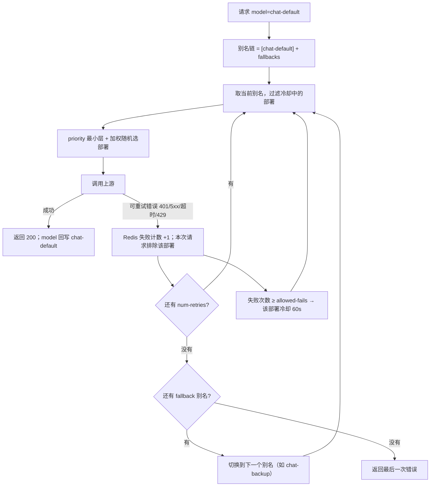

# REQ-1.6：容错（重试 / fallback / 冷却）

- 日期：2026-11-02
- 状态：已完成
- 关联规格：无（单需求，按 REQ + TDD 执行）
- 依赖需求：REQ-1.5
- 需求来源：Vault `05-项目7-第1期-LLM网关核心.md` §REQ-1.6
- 接口：无新增 HTTP 接口；聊天补全在故障场景下新增重试/降级行为

## 1. 是什么

先用一个类比：**别名是"店招牌"，部署是"后厨"**。客户端只认招牌（`model=chat-default`），后厨可以有多个：主厨（priority=0）、副厨（priority=1）。主厨今天请假（401/超时/5xx），店长自动换副厨；如果这个店的后厨全趴了，再按 `fallbacks` 去隔壁店（`chat-backup`）借人。客户端始终只看到招牌名，不知道后厨换过谁。

三个概念先分清：

| 概念 | 例子 | 作用 |
|---|---|---|
| 别名（alias） | `chat-default` | 客户端请求的 `model`；对外稳定名字 |
| 部署（deployment） | `chat-default` 下配置的多个 api-base/api-key/model | 同一别名内部的主备/多活；`priority` 数值越小越优先 |
| fallback 别名链 | `fallbacks: chat-default → [chat-backup]` | 整个别名不可用时的跨店降级；按列表顺序尝试 |

完整决策顺序（**先主备、后 fallback**）：

1. 在请求别名内，先过滤掉 Redis 中处于冷却期的部署；
2. 剩下的按 `priority` 取最小的一层，同层按权重随机；
3. 调用失败且错误可重试（超时/5xx/上游 401/上游 429）→ 本次请求排除该部署，消耗一次 `num-retries`，重新选；
4. 同别名重试次数用完 → 按 `fallbacks` 顺序切到下一个别名，重复 1-3；
5. 全部失败 → 抛最后一次真实错误。成功时响应 `model` 始终回写**请求别名**。



## 2. 有什么用

- 业务价值：上游单点故障不暴露给调用方，提升网关可用性；冷却避免持续打爆故障部署。
- 对应参照行为：B-11 fallback 实测（错误 key 部署调用返回 200）；B-12 `num_retries` / `allowed_fails`；B-13 前的容错基线。
- 面试叙事点：重试与 fallback 的顺序、请求级排除与跨请求冷却、可重试错误边界、重试不重复计费、冷却状态外置 Redis 的理由。

## 3. 怎么实现的

- 分层落点：`common`（部署优先级 / 容错配置 / 模型目录端口扩展）→ `integration`（Redis 冷却与失败计数）→ `core`（容错编排与部署选择）→ `manager`（日志 BO）→ `dal`（call_logs 字段）→ `service/start`（回填轨迹并写日志）。
- 核心类：`ChatCompletionCore`、`RedisDeploymentCooldownStore`、`YamlModelCatalog`。

### 3.1 配置长什么样

```yaml
gateway:
  model-list:
    chat-default:                 # 别名 1：对外招牌
      - api-base: https://api.deepseek.com
        api-key: sk-bad-key        # 主部署（priority 0，故意错误 key）
        model: deepseek-flash
        priority: 0
      - api-base: https://api.deepseek.com
        api-key: sk-good-key       # 备部署（priority 1，正确 key）
        model: deepseek-flash
        priority: 1
    chat-backup:                   # 别名 2：跨店降级
      - api-base: https://api.deepseek.com
        api-key: sk-good-key
        model: deepseek-flash
        priority: 0
  fallbacks:
    chat-default: [chat-backup]    # chat-default 全趴 → 试 chat-backup
  resilience:
    num-retries: 1                 # 同别名内额外重试 1 次
    allowed-fails: 1               # 失败 1 次即冷却（生产可设 3）
    cooldown-seconds: 60           # 冷却 60 秒
```

### 3.2 一次请求的完整走查（对应上面的配置）

```text
请求：POST /v1/chat/completions {"model":"chat-default", ...}

第 1 步：别名链 = [chat-default, chat-backup]
第 2 步：chat-default 内选部署
        - 冷却过滤：主/备都健康
        - priority 最小层 = 0 → 选主部署（错误 key）
第 3 步：调主部署 → 401（可重试）
        - Redis 失败计数：主部署 1 次 ≥ allowed-fails=1 → 写冷却 key（60s）
        - 本次请求排除主部署；retryCount=1
第 4 步：还有 num-retries=1 → 重新选
        - 冷却过滤：主部署已冷却，只剩备部署
        - priority 最小层 = 1 → 选备部署（正确 key）
第 5 步：调备部署 → 200
        - recordSuccess(备部署) 清零失败计数
        - 返回：model=chat-default（客户端无感知）
          served_alias=chat-default、deployment_model=deepseek-flash
          retry_count=1、fallback_used=false、cost 按备部署 usage 计一次
```

如果第 5 步备部署也失败：本次请求排除主/备 → chat-default 没有可用候选 → 进入 fallback 链 `chat-backup`；若 `chat-backup` 成功，则 `served_alias=chat-backup`、`fallback_used=true`、`retry_count=2`，响应 `model` 仍回写 `chat-default`。全部失败时返回最后一次错误。

### 3.3 冷却与 Redis key

| Key | 含义 | TTL |
|---|---|---|
| `{resilience}:fails:<deploymentKey>` | 连续失败计数；成功时删除 | 至少 60s（冷却时长×2） |
| `{resilience}:cooldown:<deploymentKey>` | 冷却标记；存在即跳过该部署 | cooldown-seconds |

`deploymentKey = SHA-256(alias + upstreamModel + apiBase + apiKey)`。**apiKey 必须参与哈希**：同别名的主备可能模型和 base 完全相同、只有 key 不同；不含 key 会让主备共享同一个冷却状态（真实链路曾暴露该缺陷，已修复并补测试）。

### 3.4 请求链路（代码视角）

```text
GatewayGovernanceFilter 预占（不变）
→ ChatCompletionCore.chat
  → 别名链 = [请求别名] + gateway.fallbacks[请求别名]
  → 每个别名：choose(部署列表, 本次已失败集合)
      = 冷却过滤 → 请求内失败排除 → priority 最小层 → 加权随机
  → 上游调用；可重试错误按 num-retries 重试，失败部署记冷却计数
  → 别名内仍失败 → 下一个 fallback 别名
  → 成功：响应 model 回写请求别名，返回 servedAlias / retryCount / fallbackUsed
→ Controller 回填治理上下文
→ Filter 结算一次（按最终成功部署 usage/cost）并写 1 条日志
```

## 4. 影响面

> 实现前填写；分级门禁依据：`additive` 自动通过，`extension` / `breaking` 必须用户确认后动手。

```yaml
capability:
  type: business
  entry_point: Core（ChatCompletionCore 上游调用编排）；冷却状态存储落 integration
  interface_agnostic: false
modules:
  add: [integration/resilience]
  change: [common, manager, dal, integration, core, service, start]
interfaces:
  add: []
  change:
    - "POST /v1/chat/completions、/chat/completions：故障场景新增重试/fallback 行为；成功响应 model 仍为请求别名"
  remove: []
tables:
  add: []
  change:
    - "call_logs：新增 retry_count、fallback_used、served_alias（向后兼容新增字段）"
config:
    - gateway.model-list[].priority
    - gateway.fallbacks
    - gateway.resilience.num-retries
    - gateway.resilience.allowed-fails
    - gateway.resilience.cooldown-seconds
depends_on: [REQ-1.5]
compat: extension
gate: confirm
regression:
  - REQ-1.1 聊天链路
  - REQ-1.2 路由与 /models
  - REQ-1.3 鉴权与虚拟 Key
  - REQ-1.4 限流与预算
  - REQ-1.5 日志与计量
```

## 5. 关键决策

| 决策 | 理由 | 日期 |
|---|---|---|
| 容错编排放 `ChatCompletionCore`，冷却状态放 `integration` + Redis | 容错属于上游调用业务编排；跨实例状态必须外置（STANDARDS §2.5），core 不直接依赖 Redis | 2026-11-02 |
| 部署 `priority` 数值越小优先级越高；同层内按权重随机 | 主备语义直观；同优先级保留负载均衡；在 PROJECT/README 写明 | 2026-11-02 |
| 执行顺序：同别名内重试/主备 → 别名级 fallback 链 | 团队拍板「先主备、后 fallback」；先解决单点，再跨模型降级 | 2026-11-02 |
| 可重试 = 超时、上游 5xx、上游 401（部署级密钥错误）、上游 429；上游 4xx（400/404/422）不重试 | 4xx 多为请求自身问题，换部署无意义；401 是「部署配置错误」的典型场景（B-11） | 2026-11-02 |
| 同一请求内失败过的部署不再重复选择；跨请求按 `allowed-fails` 进入冷却 | 请求内排除保证主备真正切换；跨请求冷却限制故障部署被打爆 | 2026-11-02 |
| 冷却状态 Redis：失败计数（TTL）+ 冷却 key（TTL）；成功清零失败计数 | 多实例共享；TTL 自动过期恢复；Redis 故障 fail-open | 2026-11-02 |
| 全部部署冷却时忽略冷却、按全量候选选择（WARN） | 可用性优先：冷却只是避让，不应导致完全不可用 | 2026-11-02 |
| 一次请求只写 1 条 call_logs、只计费一次；轨迹用 retry_count/fallback_used/served_alias 表达 | 重试不重复计费；审计能还原降级路径；不引入多次日志造成成本重复 | 2026-11-02 |
| 部署标识 = SHA-256(alias + upstreamModel + apiBase + apiKey) | 同别名主备可能模型/base 相同、仅 api-key 不同；不含 apiKey 会导致主备共享冷却状态。哈希不可逆，Redis 不落明文 | 2026-11-02 |
| 请求内排除仅在存在其他候选时生效；单部署允许重试同一部署 | 保证主备真正切换，同时让 num-retries 在单部署场景生效 | 2026-11-02 |
| 上游 4xx 对外仍为 502 upstream_error（内部 retryable=false） | 保持既有错误契约不变；内部只需区分是否进入容错 | 2026-11-02 |

## 6. 执行摘要

> 每会话 1-2 行 + commit；详细过程留在对话、plan/tasks 与提交历史，不在此复制。

### 2026-11-02

- 进展：完成 common 容错配置/领域模型、integration Redis 冷却存储、core 容错编排（重试/主备/fallback/冷却/请求内排除）、V4 日志轨迹、治理层轨迹回填；新增/更新单测与 4 个端到端场景；`mvn -Pquality verify` 全绿。
- 真实链路：临时配置错误 key 主部署 + 正确 key 备部署 + fallback 别名；主备切换 200（retry_count=1）、冷却后第二次直接走备（retry_count=0）、单部署失败 fallback 到 chat-default（served_alias=chat-default、retry_count=2、fallback_used=true）；验证后已恢复本地配置。
- 下一步：REQ-1.7 SSE 流式。

## 7. 复盘

- 做对了什么：先冻结验收再实现；容错核心全部单测覆盖，真实链路验证发现并修复了「主备共享冷却」的隐藏缺陷（deploymentKey 未包含 apiKey）。
- 踩了什么坑：部署标识最初只含 alias/upstreamModel/apiBase，同模型同 base 的主备无法区分，导致主失败后备也被判定冷却；真实链路是发现该问题的最快路径。
- 下次改进：涉及「部署身份」的缓存/状态键，先列出完整部署配置字段再决定键组成；真实链路验收应尽早执行，而不是只依赖 MockWebServer。

## 8. 多实例检查

- [x] 是否有可变成员变量？`ChatCompletionCore` 无成员可变状态；失败集合为方法局部变量；`RedisDeploymentCooldownStore` 无可变业务状态
- [x] 计数器/限流/预算/冷却是否在 Redis/数据库？失败计数与冷却标记全部在 Redis
- [x] 锁是否分布式？本期无锁；Redis INCR/SETEX 原子操作足够
- [x] 定时任务是否只执行一次？本期无定时任务
- [x] 本地缓存是否可容忍过期/不一致？无本地缓存
