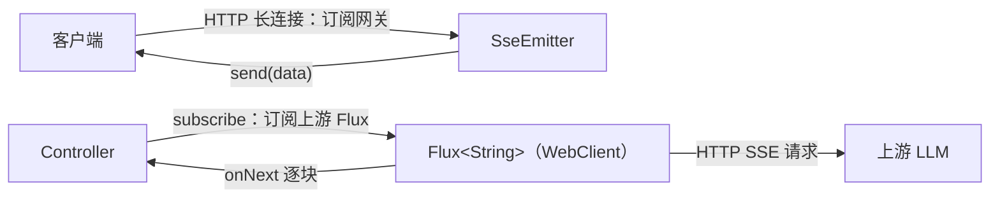
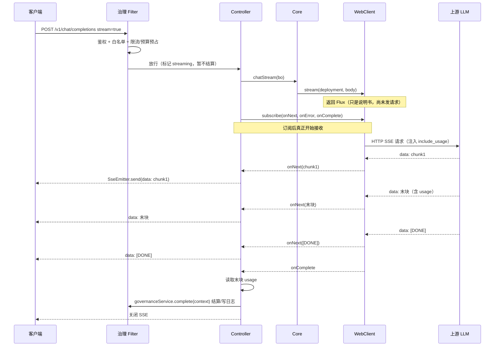

# REQ-1.7：流式（SSE）透传

- 日期：2026-11-02
- 状态：已完成
- 关联规格：无（单需求，按 REQ + TDD 执行）
- 依赖需求：REQ-1.1、REQ-1.6
- 需求来源：Vault `05-项目7-第1期-LLM网关核心.md` §REQ-1.7
- 接口：聊天补全新增 `stream=true` SSE 行为（原为 400 拒绝）

## 1. 是什么

`stream=true` 时，网关不等到整段回答生成完再返回，而是**上游每生成一小块，网关就转发一小块**（SSE，`text/event-stream`），客户端能尽快看到首字。流结束后用最后一块里的 `usage` 计一次价、写一条日志；客户端中途断开时取消上游请求。

### 1.1 "订阅"到底在订阅什么

这个词容易吓人，拆开就两句话：

1. **WebClient 调上游后得到的不是数据，而是 `Flux<String>`（数据流说明书）**。它本身不会发请求；只有调用 `subscribe(...)` 注册回调，才真正开始 HTTP 请求并逐块收数据。这个动作叫"订阅"。
2. **客户端也在订阅网关**：`POST ... stream=true` 的 HTTP 连接不会立刻结束，网关用 `SseEmitter` 保持连接，每收到一块就 `send()` 给客户端。客户端逐行读 `data:`。

所以一次流式请求有**两段订阅**：



`subscribe` 注册三个回调：

| 回调 | 什么时候触发 | 网关做什么 |
|---|---|---|
| `onNext(data)` | 上游每来一块 | 用 `emitter.send()` 写给客户端 |
| `onError(error)` | 上游/网络出错 | 写 SSE `error` 事件，标记治理失败 |
| `onComplete()` | 上游发完 `[DONE]` 并关闭 | 读取末块 usage，结算/写日志，关闭 SSE |

**为什么要用 Flux**：异步（不占用请求线程等上游）、支持取消传播（客户端断开 → `dispose()` → 取消上游 HTTP 连接，避免连接泄漏）、天然按块处理（不缓冲整包）。

## 2. 有什么用

- 业务价值：对话类应用需要首字延迟体验；流式是网关从「请求-响应」走向「实时交互」的基础能力。
- 对应参照行为：B-13（待补测）LiteLLM `stream:true` 分块、`data: [DONE]`、usage 末块。
- 面试叙事点：SSE 透传与缓冲、流式计量的结算时机、断开与连接释放、流中错误无法改状态码时的协议处理。

## 3. 怎么实现的

- 分层落点：`integration`（WebClient 流式上游调用）→ `core`（流式编排与 usage 提取）→ `service`（流式请求校验）→ `start`（SseEmitter + 治理收尾）。
- 核心类：`UpstreamClient`、`ChatCompletionCore`、`ChatCompletionController`。

### 3.1 完整时序（谁在什么时候做什么）



### 3.2 治理为什么"延迟收尾"

普通请求：Filter 包住 Controller，Controller 返回时 Filter 就能结算。流式请求：Controller 很快返回 `SseEmitter`，但数据还在异步流动，此时 usage 还没产生。所以：

1. Filter 检测到 `stream=true` → `context.setStreaming(true)`，做完预占后**不执行**同步结算；
2. Controller 在 `onComplete` / `onError` 回调里调用 `GatewayGovernanceService.complete/fail`，用末块 usage 结算并写日志。

### 3.3 关键实现点

| 点 | 做法 | 原因 |
|---|---|---|
| 上游请求 | `WebClient` + `Accept: text/event-stream`，`bodyToFlux(String.class)` | 逐块接收 data，不缓冲整包 |
| usage | 请求改写时强制注入 `stream_options.include_usage=true` | 不注入则末块可能没有 usage，无法计费 |
| model 回写 | 每个 chunk 的 `model` 改成请求别名 | 客户端始终看到自己的模型名 |
| 断开 | `SseEmitter.onCompletion/onError` → `Disposable.dispose()` | 取消上游 HTTP 连接，避免泄漏 |
| 流内错误 | 写 `event:error` + `data:{...}` 后结束 | SSE 已发 200，无法再改 HTTP 状态码 |
| 流前错误 | Controller 调 service 时抛异常 → 由 Filter 返回标准 JSON | 还没有开始 SSE，可以正常返回错误码 |

### 3.4 请求链路（代码视角）

```text
AuthFilter（不变）
→ GatewayGovernanceFilter（预占；检测 stream=true → 标记 streaming，跳过同步结算）
→ Controller.chat（同一入口，按 stream 参数分派）
→ Service.chatStream → Core.chatStream（选部署 + rewriteStreamRequest 注入 include_usage）
→ UpstreamClient.stream（WebClient 返回 Flux）
→ Controller.subscribe（onNext 写 SseEmitter；onComplete 结算；onError 写 error 事件）
→ Filter 治理服务按最终 usage 结算/写日志
```

## 4. 影响面

> 实现前填写；分级门禁依据：`additive` 自动通过，`extension` / `breaking` 必须用户确认后动手。

```yaml
capability:
  type: business
  entry_point: Controller + Core + Integration（流式透传）；治理收尾复用 GatewayGovernanceFilter/Service
  interface_agnostic: false
modules:
  add: []
  change: [api, integration, core, service, start]
interfaces:
  add: []
  change:
    - "POST /v1/chat/completions、/chat/completions：stream=true 由 400 拒绝改为 text/event-stream 流式响应"
  remove: []
tables:
  add: []
  change: []
config:
  - gateway.upstream.stream-timeout-seconds（可选）
depends_on: [REQ-1.1, REQ-1.6]
compat: extension
gate: confirm
regression:
  - REQ-1.1 非流式聊天链路
  - REQ-1.2 路由与 /models
  - REQ-1.3 鉴权与虚拟 Key
  - REQ-1.4 限流与预算
  - REQ-1.5 日志与计量
  - REQ-1.6 重试/fallback/冷却
```

## 5. 关键决策

| 决策 | 理由 | 日期 |
|---|---|---|
| 用 Spring MVC `SseEmitter` + WebClient 流式客户端，不引入 WebFlux Server | 项目是 Spring MVC；PROJECT.md 已声明 RestClient/WebClient；只加客户端依赖，避免两套 Web 栈冲突 | 2026-11-02 |
| 请求改写时注入 `stream_options.include_usage=true`，保证末块有 usage | 流式计量依赖末块 usage；DeepSeek/OpenAI 兼容上游支持该参数；不注入则只能记 0 成本 | 2026-11-02 |
| 流式治理延迟收尾：Filter 只预占，Controller 在流完成/失败时回调治理服务 | 同步 Filter 无法感知异步流结束；复用 GatewayGovernanceService，避免核心业务重复计价/日志逻辑 | 2026-11-02 |
| 流开始前的错误返回标准 JSON；流开始后的错误写 `data: {"error":...}` 并结束 | HTTP 状态码已发送后无法修改；SSE 协议内传达错误 | 2026-11-02 |
| 客户端断开取消上游订阅（doOnCancel/emitter 回调） | 避免连接与线程泄漏；上游不再产生无主费用 | 2026-11-02 |
| 流式不做请求内重试/fallback，只在选择时过滤冷却部署 | 一旦开始 SSE 无法切换部署；重试会引入重复输出风险。流开始前的错误仍走标准错误路径 | 2026-11-02 |
| 流式请求的 usage 用 AtomicReference 单次请求上下文承载 | 流异步结束才知道 usage；不属于跨请求共享状态 | 2026-11-02 |
| 请求改写强制覆盖 `stream_options.include_usage=true` | 客户端可能不传该参数；没有 usage 就无法计量与预算结算 | 2026-11-02 |

## 6. 执行摘要

> 每会话 1-2 行 + commit；详细过程留在对话、plan/tasks 与提交历史，不在此复制。

### 2026-11-02

- 进展：完成 integration WebClient SSE 客户端、协议层流式改写（model 回写 + include_usage 注入）、core 流式编排与 usage 累积、api/service 流式契约、Controller SseEmitter 透传与治理延迟收尾；新增 UpstreamClient/协议/核心/集成测试；`mvn -Pquality verify` 全绿。
- 真实链路：`curl -N` 逐块输出 40 个 SSE 事件（39 chunk + `[DONE]`），model 全部回写 chat-default，末块 usage 31/39/70；`call_logs` 记录 usage、cost=0.00005127、status=200；验证后已停止应用。
- 下一步：一期毕业验收（白板/对照/失败演示）→ 二期建设方案。

## 7. 复盘

- 做对了什么：先验证 WebClient 对 SSE 的解析行为，再基于 data 流实现；治理延迟收尾复用 GatewayGovernanceService，没有在 Controller 重复计价/日志逻辑。
- 踩了什么坑：Spring Boot 4 未自动提供 WebClient.Builder（未引入 WebFlux starter），需在 start/config 显式提供 bean；流式可空 usage 需防御 null。
- 下次改进：流式超时应做成配置项（当前常量 5 分钟）；流式错误场景可再补客户端断开/超时的集成测试。

## 8. 多实例检查

- [x] 是否有可变成员变量？`ChatCompletionCore` 无成员可变状态；流式 usage 引用属于单次请求
- [x] 计数器/限流/预算/冷却是否在 Redis/数据库？流式预占/结算复用 Redis 治理；日志在 PostgreSQL
- [x] 锁是否分布式？本期无锁
- [x] 定时任务是否只执行一次？本期无定时任务
- [x] 本地缓存是否可容忍过期/不一致？无本地缓存
