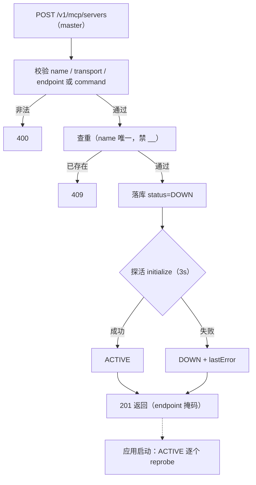

# REQ-2.1：MCP Server 注册与发现

- 日期：2026-11-03
- 状态：已完成
- 关联规格：无（需求卡 `11-项目7-第2期-MCP与Prompt中心.md` §REQ-2.1 + `18-项目7-第2期需求拆解.md` 2.1.1-2.1.4）
- 依赖需求：无（第 2 期首卡）
- 需求来源：外部需求卡 REQ-2.1
- 提交：02caa77

## 1. 是什么

MCP 集群需要统一登记各 Server 的地址、传输方式与状态，供网关与 Agent 发现。
本期提供 MCP Server 的注册、列表、注销、手动重探能力：HTTP 与 stdio 两种传输，
注册时探活（MCP `initialize`），不可达时状态为 `DOWN` 且错误可查。

## 2. 有什么用

- 业务价值：能力开放中台的第一块拼图——没有注册表，就没有工具发现（2.2）与调用代理（2.3）
- 对应参照行为（LiteLLM B-14）：
  - 注册 201 / 列表 / 注销 202；但 Java 版改为同名 **409**、删除不存在 **404**（需求卡）
  - LiteLLM 注册不探活、单 Server 故障拖垮全局（500）——均为反例，不采用
  - LiteLLM Server 名禁 `-`（SEP-986）；本方案工具分隔符为 `__`，故 name 禁含 `__`
- 面试叙事点：MCP 集群注册中心；懒探活 vs 主动探活；故障隔离（单个 Server 不可达不影响注册表）

## 3. 怎么实现的

- 分层落点：`common/mcp`（TransportType/McpServerStatus/McpProbeTarget）、`dal`（V5 迁移 + McpServerDO/Mapper）、`manager/mcp`（McpServerManager/McpServerBO）、`integration/mcp`（McpServerProbe/StdioProcessRegistry/ProbeResult）、`api`（McpServerService + Req/Res DTO）、`service`（McpServerServiceImpl + service/mcp/McpServerStartupLoader）、`start`（McpServerController + AuthFilter 管理面扩展）
- 核心类（≤3）：`McpServerServiceImpl`（校验/查重/探活编排/掩码）、`McpServerProbe`（HTTP JSON/SSE + stdio 进程探活）、`McpServerManager`（BO↔DO + JSON 编解码）
- 请求链路（Mermaid）：



## 4. 影响面

> 实现前填写；分级门禁依据：`additive` 自动通过，`extension` / `breaking` 必须用户确认后动手。

```yaml
capability:
  type: business            # MCP Server 注册是业务能力（非横切治理）；管理面接口仅 master
  entry_point: "Service"
  interface_agnostic: false
modules:
  add: [common/mcp, dal, manager/mcp, integration/mcp, api, service, start/controller]
  change: [start/filter/AuthFilter（管理面仅 master 路径扩展）]
interfaces:
  add: ["POST /v1/mcp/servers", "GET /v1/mcp/servers", "DELETE /v1/mcp/servers/{serverId}", "POST /v1/mcp/servers/{serverId}/reprobe"]
  change: []
  remove: []
tables:
  add: [mcp_servers]
  change: []
config: []
depends_on: []
compat: additive
gate: auto
regression: ["/key/* 管理面 master-only 逻辑（AuthFilter 扩展回归）"]
```

## 5. 关键决策

| 决策 | 理由 | 日期 |
|---|---|---|
| 管理接口（/v1/mcp/servers）仅 master key | 与 /key/* 管理面一致：注册/注销属于管理操作，虚拟 Key 只消费数据面 | 2026-11-03 |
| 注册即探活（同步 3s 超时），失败记 DOWN + lastError | 需求卡要求；比 LiteLLM 懒探活更直观，注册返回即可见状态 | 2026-11-03 |
| server name 禁含 `__`（工具分隔符） | 对外工具名 `{serverName}__{toolName}`；避免命名歧义（T1 校准：LiteLLM 同样限制 `-`） | 2026-11-03 |
| endpoint 输出一律掩码（userinfo + 敏感 query 值） | endpoint 可能含密钥；列表/详情不泄露 | 2026-11-03 |
| 启动加载 ACTIVE 并重新探活（同步遍历） | 需求卡 2.1.4；多实例各自探活、结果写 DB，无本地状态 | 2026-11-03 |
| stdio 探活进程用 ProcessBuilder + 超时 kill + shutdown hook 清理 | 防子进程泄漏（需求卡常见坑） | 2026-11-03 |
| SSE 传输保留枚举、暂不实现（400 明确报错） | 需求卡验收只要求 HTTP + stdio；避免复杂度 | 2026-11-03 |

## 6. 执行摘要

> 每会话 1-2 行 + commit；详细过程留在对话、plan/tasks 与提交历史，不在此复制。

### 2026-11-03

- 进展：T1 基线补测完成（B-14/B-15）；REQ-2.1 实现完成（V5 迁移 + 注册/列表/注销/重探 + HTTP/stdio 探活 + 启动加载 + 掩码），门禁全绿（39 + 模块级测试）；真实链路验证通过。
- 踩坑：stdio 探活请求最初是多行 JSON（Java 文本块），严格 JSON-RPC Server（Python mock）无法解析 → 3s 超时；修复为单行并让测试 mock 严格解析。另：启动加载器最初放 start 层触发 ArchUnit 违规（start 不可依赖 manager），移到 service。
- 下一步：REQ-2.2（工具发现与聚合）。

## 7. 复盘

- 做对了什么：先做 T1 基线补测再写代码，命名限制（禁 `-`）与"不可达拖垮全局"的反例提前暴露；测试 mock 改为严格 JSON 解析后能防住多行协议帧问题。
- 踩了什么坑：stdio 单行协议帧（多行文本块）；ArchUnit 分层（start 不能依赖 manager）；Windows 下 curl 中文编码问题（改 Python 脚本）。
- 下次改进：涉及文本协议（SSE/JSON-RPC/stdio）先写最小严格对端 mock，再实现客户端。

## 8. 多实例检查

- [x] 是否有可变成员变量？是否线程安全、跨实例一致？——无业务可变状态；`StdioProcessRegistry` 只保存本实例子进程，互不影响
- [x] 计数器/限流/预算/冷却是否在 Redis/数据库？——Server 注册与健康状态全部在 PostgreSQL
- [x] 锁是否分布式？是否有超时、防死锁、幂等？——无锁；注销按 server_id 幂等（重复 404）
- [x] 定时任务是否只执行一次？——无定时任务
- [x] 本地缓存是否可容忍过期/不一致？——无缓存（2.2 引入 TTL 60s 只读工具目录快照）
