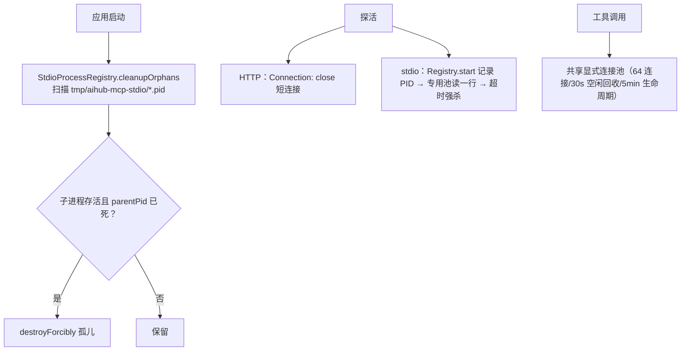

# REQ-2.10：MCP 客户端资源治理（探活与连接泄漏防护）

- 日期：2026-11-04
- 状态：已完成
- 关联规格：验收反馈（探活资源泄漏探讨）
- 依赖需求：REQ-2.1、2.2、2.3
- 需求来源：与主人确认的 5 项真实风险点
- 提交：—

## 1. 是什么

对 MCP 探活与调用的三类资源（HTTP 连接、stdio 子进程、IO 线程）做显式治理：
连接池可配置与回收、stdio 读取专用线程池、孤儿进程启动清理、探活短连接、
运行时可观测计数。

## 2. 有什么用

- 业务价值：避免长期运行时的连接/进程泄漏；崩溃场景（JVM 崩溃、服务器崩溃）有明确行为
- 对应风险：HTTP 池默认无回收、commonPool 被阻塞、stdio 孤儿进程、探活占用业务池、缺观察性
- 面试叙事点：资源生命周期与故障模式分析（进程崩溃 vs 机器崩溃）

## 3. 怎么实现的

- 分层落点：`integration/mcp/McpHttpClientFactory`（连接池）、`McpIoExecutor`（线程池）、`StdioProcessRegistry`（PID 记录/孤儿清理）、`McpServerProbe`/`McpToolClient`（接入 + 计数）、`service/McpRuntimeStatsService`、`start/McpServerController`（stats 端点）
- 核心链路：



## 4. 影响面

```yaml
capability:
  type: cross-cutting（资源治理）
  entry_point: "Integration（MCP 客户端）"
  interface_agnostic: true
modules:
  add: [integration/mcp/McpHttpClientFactory, integration/mcp/McpIoExecutor, service/McpRuntimeStatsService]
  change: [integration/mcp/McpServerProbe, McpToolClient, StdioProcessRegistry, start/controller/McpServerController, start/filter/AuthFilter]
interfaces:
  add: ["GET /v1/mcp/runtime/stats（master）"]
  change: []
  remove: []
tables: {add: [], change: []}
config: []
depends_on: [REQ-2.1, 2.2, 2.3]
compat: additive
gate: auto
regression: ["REQ-2.1 探活（HTTP/stdio）", "REQ-2.2/2.3 工具发现与调用"]
```

## 5. 关键决策

| 决策 | 理由 | 日期 |
|---|---|---|
| 显式 ConnectionProvider（64/5s/30s/5min/30s 回收） | 默认池无空闲回收；30s 空闲短于常见服务端 keep-alive | 2026-11-04 |
| 探活 `Connection: close` | 探活低频，不占用业务池、不复用可能已被对端关闭的连接 | 2026-11-04 |
| stdio 读取用专用有界池 | commonPool 被阻塞 readLine 占用会拖垮全局并行流 | 2026-11-04 |
| PID 记录 + parentPid 校验清理 | JVM 崩溃（kill -9）时 shutdown hook 不执行；只杀父进程已死的孤儿，避免误杀滚动重启/多实例 | 2026-11-04 |
| 统计用自维护计数器（不引 Micrometer） | 轻量观察性；第 4 期统一接 Actuator | 2026-11-04 |

## 6. 执行摘要

### 2026-11-04

- 进展：5 项全部实现（连接池/线程池/孤儿清理/短连接/统计端点）；门禁全绿（新增孤儿清理测试 2 个、stats 端点测试）。
- 下一步：第 4 期可观测性统一接入 Micrometer。

## 7. 复盘

- 做对了什么：先分析故障模式（进程崩溃 vs 机器崩溃）再改代码；孤儿清理用 parentPid 校验避免误杀。
- 踩了什么坑：Checkstyle MagicNumber / SpotBugs EI_EXPOSE_REP2（按项目规范处理）。
- 下次改进：资源类改动先列出"获取-释放-异常-崩溃"四条路径。

## 8. 多实例检查

- [x] 可变状态：Registry 只保存本实例子进程（Set），PID 文件区分 parentPid
- [x] 计数/限流：无
- [x] 锁：无
- [x] 定时任务：连接池后台 evict（reactor-netty，每实例各自执行，幂等）
- [x] 本地缓存：无业务缓存
