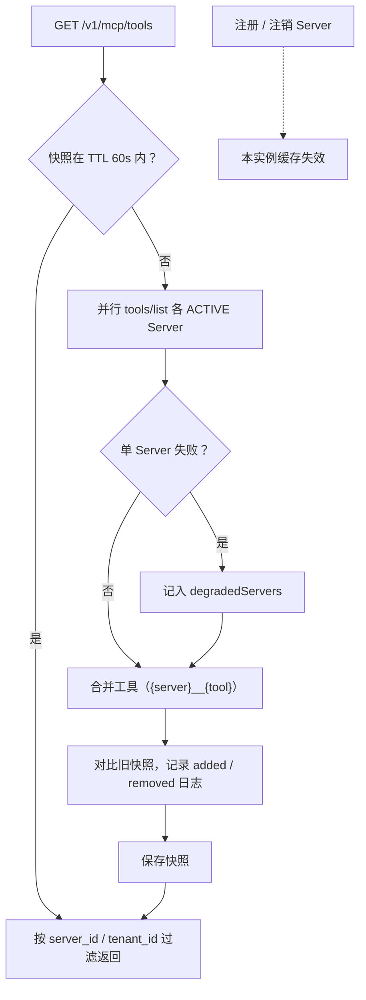

# REQ-2.2：MCP 工具发现与聚合

- 日期：2026-11-03
- 状态：已完成
- 关联规格：无（需求卡 `11-项目7-第2期-MCP与Prompt中心.md` §REQ-2.2 + `18-项目7-第2期需求拆解.md` 2.2.1-2.2.4）
- 依赖需求：REQ-2.1
- 需求来源：外部需求卡 REQ-2.2
- 提交：384f2b5

## 1. 是什么

Agent 需要一份统一的工具目录，而不是逐 Server 查询。本需求聚合所有 `ACTIVE` MCP
Server 的 `tools/list`，用 `{serverName}__{toolName}` 作为对外唯一名，提供过滤、
缓存（TTL 60s）、手动刷新与单 Server 超时降级。

## 2. 有什么用

- 业务价值：工具发现是 MCP 调用代理（2.3）与 Agent 适配层（2.6）的前置
- 对应参照行为（LiteLLM B-14）：
  - LiteLLM 工具名 `{server}-{tool}`，本方案用 `__`；保留原始映射
  - LiteLLM 单 Server 故障会拖垮列表（500）——本需求强制降级返回其余结果
- 面试叙事点：并行聚合 + 局部降级；读写分离的本地快照缓存（TTL + 显式失效）

## 3. 怎么实现的

- 分层落点：`common/mcp`（RawTool/McpToolDescriptor/ToolAggregationResult）、`integration/mcp`（McpToolClient：HTTP/stdio tools-list）、`core/mcp`（McpToolAggregator：并行聚合 + 降级）、`manager/mcp`（McpToolCatalog：volatile 快照 + TTL）、`api`（McpToolService + DTO）、`service`（McpToolServiceImpl：缓存编排/过滤/变更日志）、`start`（McpToolController）
- 核心类（≤3）：`McpToolAggregator`（有界线程池并行、单 Server 失败降级）、`McpToolCatalog`（不可变快照整体替换、TTL 判定、失效）、`McpToolServiceImpl`（新鲜度编排、过滤、added/removed 日志）
- 请求链路（Mermaid）：



## 4. 影响面

```yaml
capability:
  type: business
  entry_point: "Service（缓存编排）+ Core（并行聚合）"
  interface_agnostic: false
modules:
  add: [common/mcp, core/mcp, manager/mcp, integration/mcp, api, service, start/controller]
  change: [service/McpServerServiceImpl（注册/注销时失效工具缓存）]
interfaces:
  add: ["GET /v1/mcp/tools", "POST /v1/mcp/tools/refresh"]
  change: []
  remove: []
tables:
  add: []
  change: []
config: []
depends_on: [REQ-2.1]
compat: additive
gate: auto
regression: ["REQ-2.1 注册/注销链路（缓存失效钩子）"]
```

## 5. 关键决策

| 决策 | 理由 | 日期 |
|---|---|---|
| 本地快照 + TTL 60s（多实例可容忍 60s 不一致） | 工具目录是只读配置类数据；避免每次请求都打上游 | 2026-11-03 |
| 注册/注销时显式失效本实例缓存 | 本实例立即一致；其他实例最多 60s 延迟 | 2026-11-03 |
| 并行聚合（有界线程池，单 Server 3s 超时） | 串行 N×3s 不可接受；单点故障不影响整体 | 2026-11-03 |
| 刷新时对比新旧快照记录变更日志 | 满足 2.2.4 审计要求（后续 4.x 接审计表） | 2026-11-03 |
| stdio 工具列表每次临时拉起进程 | 首版简单可靠；常驻连接池留到 2.3 按需演进 | 2026-11-03 |

## 6. 执行摘要

### 2026-11-03

- 进展：实现完成（聚合/缓存/刷新/降级/过滤/变更日志），门禁全绿；真实链路验证通过（3 工具聚合、过滤、刷新、注销失效）。
- 踩坑：测试类共享 Spring 上下文与 H2 库 → 工具聚合扫到其他测试注册的 Server；给聚合测试独立内存库隔离。
- 下一步：REQ-2.3（MCP 调用代理）。

## 7. 复盘

- 做对了什么：缓存与聚合分层清晰（catalog 纯存储 / aggregator 纯聚合 / service 编排）；降级用工具调用失败（而非注册失败）构造，符合真实语义。
- 踩了什么坑：测试间共享上下文污染聚合结果；TTL 缓存让"刷新"必须显式测试。
- 下次改进：跨测试类的共享资源（H2/静态 mock）默认隔离。

## 8. 多实例检查

- [x] 是否有可变成员变量？是否线程安全、跨实例一致？——`McpToolCatalog` volatile 快照整体替换；聚合线程池为本地无状态
- [x] 计数器/限流/预算/冷却是否在 Redis/数据库？——工具目录非计数类数据；Server 状态在 DB
- [x] 锁是否分布式？是否有超时、防死锁、幂等？——无锁；刷新幂等
- [x] 定时任务是否只执行一次？——无定时任务（TTL 懒刷新）
- [x] 本地缓存是否可容忍过期/不一致？——是，只读配置类数据，TTL 60s；注册/注销本实例立即失效
