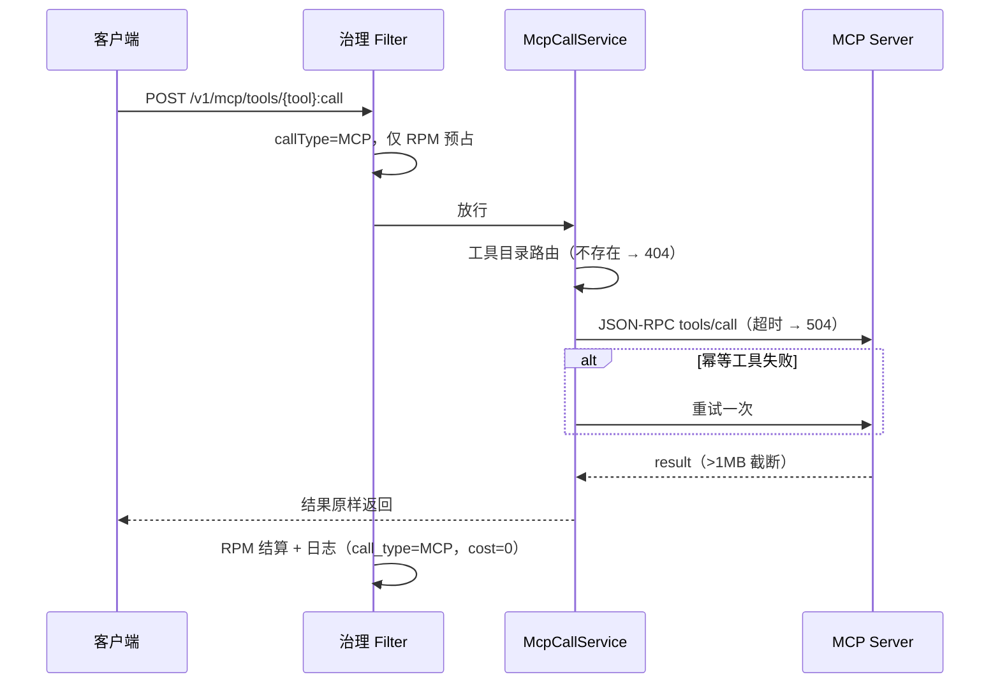

# REQ-2.3：MCP 调用代理

- 日期：2026-11-03
- 状态：已完成
- 关联规格：无（需求卡 `11-项目7-第2期-MCP与Prompt中心.md` §REQ-2.3 + `18-项目7-第2期需求拆解.md` 2.3.1-2.3.4）
- 依赖需求：REQ-2.1、REQ-2.2
- 需求来源：外部需求卡 REQ-2.3
- 提交：5ba30bc

## 1. 是什么

业务方不直连各 MCP Server，而是经网关统一鉴权、限流、日志与错误归一。本需求提供
`POST /v1/mcp/tools/{server}__{tool}:call`：解析对外工具名 → JSON-RPC `tools/call`
转发 → 原样返回结果；复用 Auth/RPM 治理，日志记录 `call_type=MCP`/`target_name`，成本 0。

## 2. 有什么用

- 业务价值：MCP 集群的"数据面"入口，任何 Agent/业务统一消费工具能力
- 对应参照行为（LiteLLM B-14）：
  - LiteLLM 提供 `/mcp-rest/tools/call`（`server_id + name + arguments`）；本方案用路径编码工具名，调用更直接
  - LiteLLM 未知工具返回 500；本方案按需求卡返回 404
- 面试叙事点：横切治理接入新数据面（接口无关）；错误归一；大结果保护；幂等重试策略

## 3. 怎么实现的

- 分层落点：`integration/mcp`（McpToolClient.callTool：HTTP/stdio tools-call）、`api`（McpCallService）、`service`（McpCallServiceImpl：路由/参数/重试/截断）、`start`（McpCallController + GatewayGovernanceFilter 路径扩展）、`service/gateway`（MCP 治理分支）、`manager`（CallLogBO callType/targetName）、`dal`（call_logs 新列映射）
- 核心类（≤3）：`McpCallServiceImpl`（工具路由/错误归一/幂等重试/截断）、`McpToolClient.callTool`（JSON-RPC 双向传输）、`GatewayGovernanceService`（MCP 治理分支：RPM + 日志，cost=0）
- 请求链路（Mermaid）：



## 4. 影响面

```yaml
capability:
  type: cross-cutting（治理复用）+ business（调用代理）
  entry_point: "GatewayGovernanceFilter（/v1/mcp/tools/*:call 纳入统一治理）"
  interface_agnostic: true（治理逻辑按上下文 callType 分支，不复制到新接口）
modules:
  add: [common/mcp, integration/mcp, api, service, start/controller]
  change: [start/filter/GatewayGovernanceFilter（治理路径与 callType）, service/gateway（MCP 分支）, manager（CallLogBO 扩展）, dal（call_logs 新列映射）]
interfaces:
  add: ["POST /v1/mcp/tools/{toolName}:call"]
  change: []
  remove: []
tables:
  add: []
  change: ["call_logs：使用 V5 已有 call_type/target_name 列"]
config: []
depends_on: [REQ-2.1, REQ-2.2]
compat: extension
gate: confirm
regression: ["REQ-1.4 限流（Filter 治理扩展）", "REQ-1.5 日志（CallLogBO 扩展）", "REQ-2.2 工具目录"]
```

## 5. 关键决策

| 决策 | 理由 | 日期 |
|---|---|---|
| MCP 调用复用同一 GatewayGovernanceFilter，按 callType 分支 | 横切治理统一入口（STANDARDS §2.6）；不复制 RPM/日志逻辑 | 2026-11-03 |
| MCP 只做 RPM，不做 TPM/预算（cost=0） | 工具调用不消耗 Token；预算语义为模型费用 | 2026-11-03 |
| 结果 >1MB 截断并记录原始大小 | 防止撑爆内存/响应；审计保留大小信息 | 2026-11-03 |
| 仅 `_meta.idempotent=true` 的工具失败重试一次 | 非幂等工具重试可能重复副作用 | 2026-11-03 |
| stdio 调用每次临时拉起进程 | 与 2.2 一致；常驻进程池作为后续优化 | 2026-11-03 |

## 6. 执行摘要

### 2026-11-03

- 进展：实现完成（调用路由/错误归一/治理接入/截断/幂等重试），门禁全绿；真实链路验证通过（echo/add 200、404/400 中文错误、call_logs 留痕 call_type=MCP/cost=0）。
- 踩坑：WebClient 默认 256KB 缓冲上限导致大结果 502 → 提高到 8MB；dal 测试 schema 未同步新列。
- 下一步：REQ-2.4（Prompt 模板管理）。

## 7. 复盘

- 做对了什么：治理通过 callType 分支复用同一 Filter，没有复制逻辑；错误映射集中。
- 踩了什么坑：WebClient 缓冲上限；测试/scen schema 双份维护（dal 与 tests 各有一份 H2 schema）。
- 下次改进：新增表字段时同时更新 Flyway、主 resources H2 schema、测试 schema 三处（清单化）。

## 8. 多实例检查

- [x] 是否有可变成员变量？是否线程安全、跨实例一致？——服务无状态；调用客户端无共享会话
- [x] 计数器/限流/预算/冷却是否在 Redis/数据库？——RPM 在 Redis；日志在 DB
- [x] 锁是否分布式？是否有超时、防死锁、幂等？——无锁；重试仅幂等工具
- [x] 定时任务是否只执行一次？——无
- [x] 本地缓存是否可容忍过期/不一致？——工具目录 TTL 60s（同 REQ-2.2）
