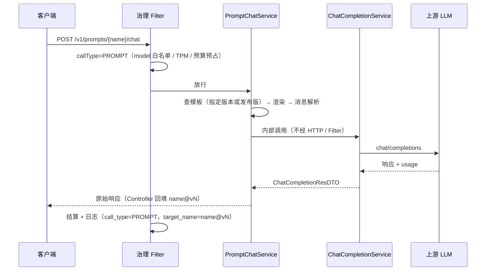

# REQ-2.5：Prompt 渲染接入网关

- 日期：2026-11-03
- 状态：已完成
- 关联规格：无（需求卡 `11-项目7-第2期-MCP与Prompt中心.md` §REQ-2.5 + `18-项目7-第2期需求拆解.md` 2.5.1-2.5.3）
- 依赖需求：REQ-2.4、REQ-1.1
- 需求来源：外部需求卡 REQ-2.5
- 提交：96a6b29

## 1. 是什么

模板必须能变成真实模型调用，否则只是文档库。本需求提供：
`POST /v1/prompts/{name}/render`（渲染出 messages，不调用模型）与
`POST /v1/prompts/{name}/chat`（渲染 → 内部 chat 链路 → 返回模型响应）。

## 2. 有什么用

- 业务价值：Prompt 中心闭环的最后一步——模板配置直接可用
- 对应参照行为（B-15）：
  - LiteLLM 只有 `/prompts/test`（边渲染边调模型）；本方案 render/chat 分离，便于预览与组装
  - LiteLLM 通过 `dotprompt/<model>` 模型别名调用；本方案提供独立 Prompt 数据面端点
- 面试叙事点：内部服务调用绕开 HTTP 治理层；单次治理保证不重复计费；日志精确到模板版本

## 3. 怎么实现的

- 分层落点：`common/prompt`（PromptMessage）、`integration/prompt`（PromptMessageParser：System/User/Assistant 解析）、`api`（PromptChatService + DTO）、`service`（PromptChatServiceImpl：渲染→内部 chat 调用）、`start`（PromptRuntimeController + GatewayGovernanceFilter 路径扩展）
- 核心类（≤3）：`PromptChatServiceImpl`（渲染/内部调用/版本记录）、`PromptMessageParser`（文本→消息）、`GatewayGovernanceService`（PROMPT 分支复用 CHAT 计价/结算/日志）
- 请求链路（Mermaid）：



## 4. 影响面

```yaml
capability:
  type: business（数据面）+ cross-cutting 复用（治理 Filter 扩展 PROMPT 路径）
  entry_point: "GatewayGovernanceFilter（/v1/prompts/*/chat 纳入统一治理）"
  interface_agnostic: true（治理按 callType 分支复用）
modules:
  add: [common/prompt, integration/prompt, api, service, start/controller]
  change: [start/filter/GatewayGovernanceFilter（Prompt chat 路径分类）]
interfaces:
  add: ["POST /v1/prompts/{name}/render", "POST /v1/prompts/{name}/chat"]
  change: []
  remove: []
tables:
  add: []
  change: []
config: []
depends_on: [REQ-2.4, REQ-1.1]
compat: additive
gate: auto
regression: ["REQ-1.1 聊天链路（内部调用）", "REQ-2.4 Prompt 管理", "GatewayGovernanceFilter 路径分类"]
```

## 5. 关键决策

| 决策 | 理由 | 日期 |
|---|---|---|
| render/chat 分离 | 需求卡 2.5.1 明确 render 不调模型；预览与执行解耦 | 2026-11-03 |
| 内部 chat 直接调 Service（不走 HTTP/Filter） | 避免 RPM 双计、TPM/预算重复预占结算、日志双写 | 2026-11-03 |
| 日志 target_name 记 `name@vN` | 版本是模板行为关键变量；只记 name 无法定位版本 | 2026-11-03 |
| Prompt chat 复用 CHAT 的 model/TPM/预算/计价 | LLM 调用成本口径必须一致 | 2026-11-03 |
| render 不接入治理 | 纯内存操作，无上游调用与费用 | 2026-11-03 |

## 6. 执行摘要

### 2026-11-03

- 进展：实现完成（render/chat/治理串联），门禁全绿；真实链路验证通过（render 消息正确、缺变量 400、chat 真实 DeepSeek 200、日志 PROMPT/greet2@v1/cost 正常）。
- 下一步：REQ-2.6（Agent 适配层与 MCP Server 暴露）。

## 7. 复盘

- 做对了什么：内部 chat 直接调用 Service（不走 HTTP），外层治理只执行一次，避免双路径重复计量。
- 踩了什么坑：测试断言上游调用次数时忽略了测试间共享 MockWebServer 的累计计数（改为前后差值）。
- 下次改进：共享 mock 的计数断言统一用相对差值。

## 8. 多实例检查

- [x] 是否有可变成员变量？是否线程安全、跨实例一致？——无状态
- [x] 计数器/限流/预算/冷却是否在 Redis/数据库？——TPM/预算/RPM 复用 Redis；日志在 DB
- [x] 锁是否分布式？是否有超时、防死锁、幂等？——无新增锁
- [x] 定时任务是否只执行一次？——无
- [x] 本地缓存是否可容忍过期/不一致？——无缓存
