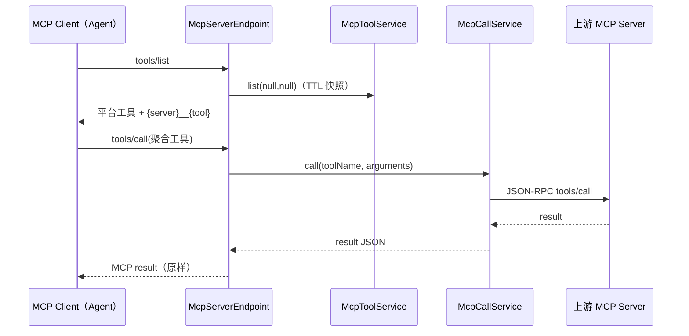

# REQ-2.7：网关统一 MCP 入口（MCP Client 连接池对外形态）

- 日期：2026-11-04
- 状态：已完成
- 关联规格：AI 中台架构图 Tier2「MCP Client 连接池（Streamable HTTP）」（2026-11-04 校准）
- 依赖需求：REQ-2.1、REQ-2.2、REQ-2.3
- 需求来源：架构对齐补强（与用户确认的偏差清单）
- 提交：—

## 1. 是什么

把 ai-hub 的 `/mcp` 从"只暴露平台 3 个工具"升级为**统一 MCP 入口**：
`tools/list` 合并平台工具与注册表工具目录（`{server}__{tool}`），`tools/call`
对聚合工具经调用代理路由到上游 MCP Server。对应架构图中 Tier2 网关的
「MCP Client 连接池」——Agent 只认一个 MCP 入口，即可复用全部 MCP 资产。

## 2. 有什么用

- 业务价值：Tier1/外部 Agent 用标准 MCP 协议即可消费中台注册的所有工具，不再需要逐个 REST 直调
- 对应架构：Tier2 MCP Client 连接池；LiteLLM `/mcp` 聚合行为
- 面试叙事点：一个入口 + 动态工具目录 + 内部路由；资产复用的关键一步

## 3. 怎么实现的

- 分层落点：`start/mcp/McpServerEndpoint`（tools/list 合并、tools/call 路由）；复用 `McpToolService`（工具目录）与 `McpCallService`（代理）
- 核心链路：



## 4. 影响面

```yaml
capability:
  type: business（Agent 适配层扩展）
  entry_point: "Start（/mcp）"
  interface_agnostic: false
modules:
  add: []
  change: [start/mcp/McpServerEndpoint]
interfaces:
  add: []
  change: ["POST /mcp：tools/list 合并注册工具；tools/call 支持聚合工具路由（平台工具行为不变）"]
  remove: []
tables:
  add: []
  change: []
config: []
depends_on: [REQ-2.1, REQ-2.2, REQ-2.3]
compat: additive
gate: auto
regression: ["REQ-2.6 平台工具 listTools/executeTool"]
```

## 5. 关键决策

| 决策 | 理由 | 日期 |
|---|---|---|
| `/mcp` 直接合并工具目录（而非只暴露平台工具） | 对齐架构图 MCP Client 连接池；Agent 一个入口复用全部资产 | 2026-11-04 |
| 聚合工具调用复用 McpCallService | 统一错误归一/截断/幂等重试/日志 | 2026-11-04 |
| 平台工具名与聚合工具名空间隔离 | 平台工具无 `__`；注册 Server 名禁 `__`，不会冲突 | 2026-11-04 |

## 6. 执行摘要

### 2026-11-04

- 进展：实现完成（tools/list 合并 + tools/call 路由），门禁全绿；LangChain4j 客户端实测：listTools 同时看到平台工具与 `mock_srv__echo/add`，executeTool 成功。
- 下一步：REQ-2.8。

## 7. 复盘

- 做对了什么：复用工具目录与代理，新增代码集中在入口层。
- 踩了什么坑：测试 mock 的响应队列与测试顺序耦合（改为 dispatcher 按请求内容响应）。
- 下次改进：mock 服务器统一用 dispatcher。

## 8. 多实例检查

- [x] 可变状态：无；工具目录沿用 TTL 快照
- [x] 计数/限流：沿用 Filter
- [x] 锁：无
- [x] 定时任务：无
- [x] 缓存：工具目录 TTL 60s（同 2.2）
