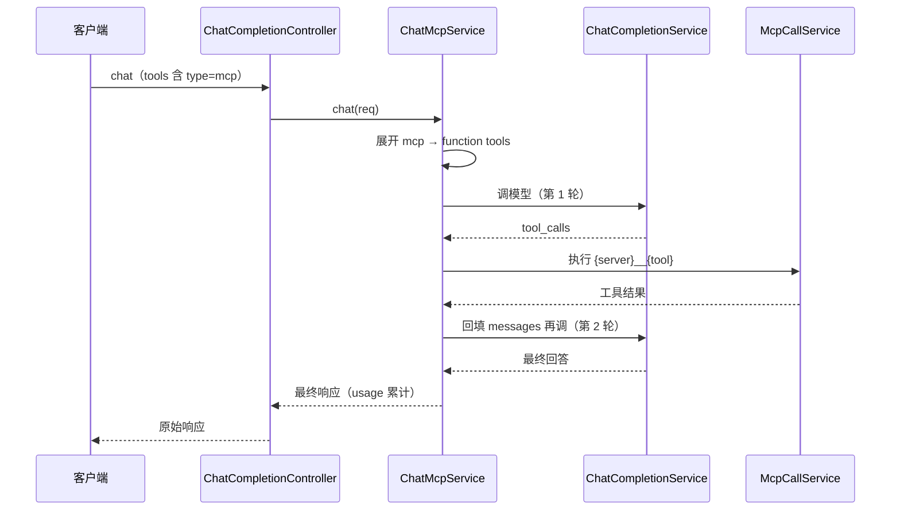

# REQ-2.8：chat 入口支持 MCP 工具自动调用

- 日期：2026-11-04
- 状态：已完成
- 关联规格：AI 中台架构图 Tier1「chat_completion + search_knowledge」消费形态（2026-11-04 校准）
- 依赖需求：REQ-2.7、REQ-1.1
- 需求来源：架构对齐补强（与用户确认的偏差清单）
- 提交：—

## 1. 是什么

业务项目不需要自己逐个调 MCP 工具：在 chat 请求里声明
`tools:[{"type":"mcp","server_name":"<注册的Server名>"}]`，网关会展开该 Server 的
工具目录为 OpenAI function tools，模型返回 `tool_calls` 时由网关执行 MCP 工具
并回填结果继续对话（最多 3 轮）。这就是架构图中 Tier1 使用
`chat_completion + search_knowledge` 的标准形态。

## 2. 有什么用

- 业务价值：业务 Agent 只写"对话 + 声明能力"，工具选择/调用交给模型与中台
- 对应架构：Tier1 消费形态 + Tier2 Router/工具路由
- 面试叙事点：服务端 agent loop；MCP 工具转 function calling；单次治理下的多轮工具执行

## 3. 怎么实现的

- 分层落点：`service/ChatMcpServiceImpl`（编排）；`start/controller/ChatCompletionController`（按 mcp 声明分流）；复用 `ChatCompletionService` / `McpToolService` / `McpCallService`
- 核心链路：



## 4. 影响面

```yaml
capability:
  type: business（Agent 编排）
  entry_point: "Service（ChatMcpServiceImpl）"
  interface_agnostic: false
modules:
  add: [service/ChatMcpServiceImpl, api/ChatMcpService]
  change: [start/controller/ChatCompletionController]
interfaces:
  add: []
  change: ["POST /v1/chat/completions：支持 tools:[{type:mcp,server_name}]（无该声明时行为不变）；流式 + mcp → 400"]
  remove: []
tables:
  add: []
  change: []
config: []
depends_on: [REQ-2.7, REQ-1.1]
compat: additive
gate: auto
regression: ["REQ-1.1/1.6 普通 chat（无 mcp 声明）", "REQ-1.7 流式"]
```

## 5. 关键决策

| 决策 | 理由 | 日期 |
|---|---|---|
| 网关内执行工具循环（require_approval=never 语义） | 对齐 Tier1"模型自动调工具"形态；业务无需自建 loop | 2026-11-04 |
| 循环上限 3 轮 | 防止模型死循环；超出返回最后一轮 | 2026-11-04 |
| usage 各轮累计 | 计量口径覆盖工具编排的真实消耗 | 2026-11-04 |
| 流式 + mcp → 400 | 首版不支持，显式拒绝避免静默错误 | 2026-11-04 |
| 工具执行复用 McpCallService | 截断/幂等/错误归一口径一致 | 2026-11-04 |

## 6. 执行摘要

### 2026-11-04

- 进展：实现完成（工具展开/模型调用/工具执行/回填循环/usage 累计），门禁全绿；集成测试 2/2（自动调用 + 普通 chat 不回归）。
- 下一步：二期毕业验收补真实链路演示。

## 7. 复盘

- 做对了什么：编排独立成 service，不污染 ChatCompletionService/Core；工具执行复用代理。
- 踩了什么坑：测试 mock 队列与用例顺序耦合（dispatcher 修复）。
- 下次改进：mock 服务器统一 dispatcher 按内容响应。

## 8. 多实例检查

- [x] 可变状态：无
- [x] 计数/限流：外层 Filter 一次治理
- [x] 锁：无
- [x] 定时任务：无
- [x] 缓存：工具目录 TTL 60s
