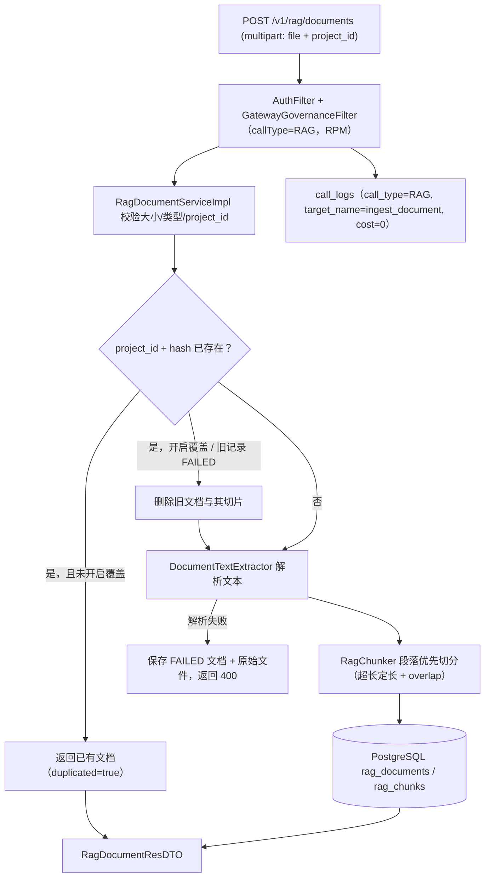

# REQ-3.1：文档接入（上传/解析/切分）

- 日期：2026-11-11
- 状态：已完成
- 关联规格：外部需求卡 `12-项目7-第3期-RAG与记忆服务.md` REQ-3.1 章节
- 依赖需求：无（文档接入是本批次第一个 RAG 需求）
- 需求来源：外部需求卡
- 提交：待回填

## 1. 是什么

给 AI 中台增加知识文档接入能力：业务方上传 txt / md / pdf，中台解析文本、按段落优先切分为
可检索切片，并把切片元数据（doc_id / chunk_id / project_id / source / created_at）持久化到
PostgreSQL。文档支持按项目列表、按 hash 去重（可配置覆盖）与删除；删除时级联清理切片。

## 2. 有什么用

- 业务价值：RAG 的第一步是把业务文档变成可检索切片；解析与切分质量决定召回上限。
- 对应参照行为：07 笔记 §2.3 RAG 服务 `ingest_document`；LiteLLM B-16（向量存储无本地实现，见基线 §九）。
- 面试叙事点：段落优先 + 定长 overlap、hash 去重与覆盖策略、解析失败保留原文、删除级联、解析大小与内存边界。

## 3. 怎么实现的

- 分层落点：
  - `common/rag`：文档接入的领域模型（切分结果、索引状态枚举）
  - `common/config/RagProperties`：`gateway.rag.*` 配置
  - `api/RagDocumentService` + Req/Res DTO：REST 契约（snake_case）
  - `service/RagDocumentServiceImpl`：参数校验、去重策略、DTO↔BO、删除事务边界
  - `core/rag`：段落优先切分器、文档接入编排
  - `integration/rag/DocumentTextExtractor`：PDFBox / UTF-8 文本解析（外部库封装）
  - `manager/rag/RagDocumentManager`、`RagChunkManager`：BO↔DO 与 Mapper 封装
  - `dal`：`rag_documents` / `rag_chunks` DDL、DO、Mapper 与 XML
  - `start/controller/RagDocumentController`：`/v1/rag/documents`
  - 治理：`GatewayGovernanceFilter` 识别 `RAG` 调用类型；上传为 multipart，不缓存请求体，仅做 RPM
    预占/结算并写 `call_logs`（cost=0，target_name=ingest_document / list_documents / delete_document）
- 核心类（≤3）：`RagDocumentServiceImpl`、`RagChunker`、`RagDocumentCore`
- 数据模型：
  - `rag_documents`：doc_id / project_id / source / content_type / size_bytes / hash /
    raw_content(原始文件) / chunk_count / index_status / error_message / created_at / updated_at
  - `rag_chunks`：chunk_id / doc_id / project_id / chunk_index / content / char_count /
    source / index_status / created_at（向量字段在 REQ-3.2 的表/列中）



## 4. 影响面

> 实现前填写；分级门禁依据：`additive` 自动通过，`extension` / `breaking` 必须用户确认后动手。

```yaml
capability:
  type: business            # 文档接入是业务能力；RPM/调用日志复用既有横切治理
  entry_point: "Service（RagDocumentServiceImpl）；治理在 GatewayGovernanceFilter + GatewayGovernanceService"
  interface_agnostic: false # 治理部分接口无关；文档接入业务绑定 /v1/rag/documents
modules:
  add: [common/rag, common/config/RagProperties, api/RagDocumentService, api/model/res/RagDocumentResDTO, api/model/res/RagDocumentListResDTO, api/model/res/RagDocumentDeleteResDTO, manager/rag/RagDocumentManager, manager/rag/RagChunkManager, manager/model/RagDocumentBO, manager/model/RagChunkBO, core/rag/RagChunker, core/rag/RagDocumentCore, integration/rag/DocumentTextExtractor, service/RagDocumentServiceImpl, start/controller/RagDocumentController, dal/model/RagDocumentDO, dal/model/RagChunkDO, dal/mapper/RagDocumentMapper, dal/mapper/RagChunkMapper]
  change: [common/constant/CallTypes, service/gateway/model/GatewayContext, service/gateway/GatewayGovernanceService, start/filter/GatewayGovernanceFilter, start/error/GatewayExceptionHandler, ai-hub-start/src/main/resources/application.yml, docker-compose.yml, ai-hub-integration/pom.xml, pom.xml]
interfaces:
  add: ["POST /v1/rag/documents", "GET /v1/rag/documents", "DELETE /v1/rag/documents/{docId}"]
  change: []
  remove: []
tables:
  add: [rag_documents, rag_chunks]
  change: []
config: [gateway.rag.upload.max-size-bytes, gateway.rag.chunk.max-chars, gateway.rag.chunk.overlap-chars, gateway.rag.chunk.persist-batch-size, gateway.rag.dedup.override, gateway.rag.list.default-limit, gateway.rag.list.max-limit]
depends_on: []
nfr:
  resources: ["PDF 解析在请求线程内完成，内存受 gateway.rag.upload.max-size-bytes 与 Spring multipart 上限双重约束", "原始文件以 BYTEA 落库，多实例一致；不依赖本机磁盘", "无新增线程池/连接池"]
  failure_modes:
    - "正常：单条 INSERT 文档 → 批量 INSERT 切片（分批），无跨语句事务；失败时状态 FAILED"
    - "超时/异常：解析失败返回 400 且保留 FAILED 文档与原始文件；数据库异常返回 500 中文错误"
    - "进程崩溃：已提交状态保持；未完成切片不产生半条记录（单批 INSERT）"
    - "机器崩溃：数据在 PostgreSQL 持久化；本地无状态可迁移"
  metrics: ["RAG 调用轨迹写 call_logs（DB，跨实例一致）", "文档大小/切片数/状态在 rag_documents / rag_chunks"]
compat: additive
gate: auto
regression: ["REQ-1.4 限流/RPM 预占与结算", "REQ-1.5 call_logs 写入", "REQ-2.3/2.5/3.5 call_type 分支（MCP/PROMPT/MEMORY）", "REQ-3.5 记忆接口与治理路径"]
```

## 5. 关键决策

| 决策 | 理由 | 日期 |
|---|---|---|
| 原始文件以 BYTEA 落库而非本机目录 | 多实例无共享磁盘；删除/保留语义一致；解析失败可追溯 | 2026-11-11 |
| hash 按 `project_id + hash` 唯一 | 同一文件在不同项目可独立存在；同项目内去重有确定性 | 2026-11-11 |
| 重复默认返回已有文档（duplicated=true），`gateway.rag.dedup.override=true` 时替换 | 默认幂等、避免误覆盖；覆盖是显式运维选项 | 2026-11-11 |
| 解析失败持久化 FAILED 文档并保存原始文件 | 满足“保留原始文件”；列表可见、可删除；同文件重新上传时自动替换重试 | 2026-11-11 |
| 切分采用段落贪心打包，超长段落再按定长 + overlap | 保留段落语义、减少碎片；超长段落仍受模型上下文约束 | 2026-11-11 |
| multipart 请求不进入治理体缓存 | 文件体积大，缓存会占内存；RAG 治理只需 RPM 与调用日志 | 2026-11-11 |
| 文档接入不自动向量化（REQ-3.2 接入） | 本需求只交付解析/切分/存储；向量化在下一需求独立验收 | 2026-11-11 |

## 6. 执行摘要

> 每会话 1-2 行 + commit；详细过程留在对话、plan/tasks 与提交历史，不在此复制。

### 2026-11-11

- 进展：影响面判定 additive 自动通过；冻结验收标准；实现 txt/md/pdf 上传解析、段落优先切分（超长定长 + overlap）、
  hash 去重/覆盖、列表与删除、RAG 治理接入（call_type=RAG、target_name、cost=0）。`mvn -Pquality verify` 全绿。
- 验证：文档/切片/服务/治理单测 + H2 端到端（6 个用例）通过；PDFBox 真实 PDF 文本提取通过；删除级联切片，
  向量级联在 REQ-3.2 落地后由同一接口复用。
- 下一步：REQ-3.2 在切片基础上增加 Embedding 与向量存储。

## 7. 复盘

- 做对了什么：原始文件以 BYTEA 落库，解析失败也能保留并可在列表追溯；hash 按项目唯一，默认幂等返回已有文档；
  multipart 不进入治理体缓存，避免大文件占内存；RAG 治理复用统一 Filter 的 RAG 分支，未复制限流/日志逻辑。
- 踩了什么坑：集成测试共享 H2 内存库导致列表计数互相污染，改为每个用例独立 project_id；
  PDFBox 3 的字体 API 与 2.x 不同，测试生成 PDF 需要使用 `Standard14Fonts`。
- 下次改进：为上传接口补一个“按 doc_id 下载原始文件”的能力（本期未做，原始文件已落库可用）。

## 8. 多实例检查

- [x] 是否有可变成员变量？无；Service/Core/Manager 只持有无状态依赖与不可变配置。
- [x] 计数器/限流/预算/冷却是否在 Redis/数据库？RAG 调用只做 Key RPM（Redis），调用日志与文档数据落 DB。
- [x] 锁是否分布式？无显式锁；`project_id + hash` 唯一约束保证并发重复上传只有一个文档，冲突时返回已有文档。
- [x] 定时任务是否只执行一次？无定时任务。
- [x] 本地缓存是否可容忍过期/不一致？无本地缓存；原始文件在 DB。
