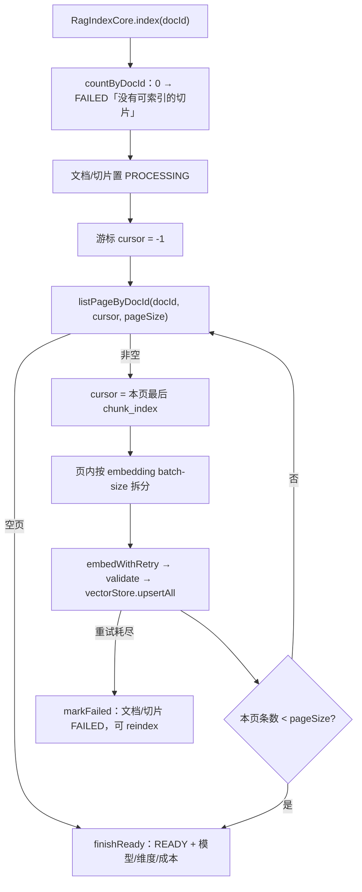

# REQ-3.10：索引分页加载与限制策略

- 日期：2026-11-12
- 状态：已完成
- 关联规格：生产化补强第 6 批简报（`task-20261111-pn0j3z`）
- 依赖需求：REQ-3.2、REQ-3.7
- 需求来源：主人验收反馈（ai-hub 对标企业生产级解决方案）
- 提交：待回填

## 1. 是什么

把 RAG 索引从「一次性加载整篇文档的全部切片」改为「按 chunk_index 游标分页，逐批 embedding
与 upsert」。索引过程的内存占用从「全文切片」降为「一页切片」，大文档不再因全量加载产生内存峰值。
分页大小可配置，默认与 embedding batch-size 对齐；重试语义、状态流转、reindex 行为保持不变。

## 2. 有什么用

- 业务价值：生产知识库单个文档可能有数千切片；全量 `listByDocId` 会在一次请求内把所有正文与
  切片对象放进堆，和并发上传叠加容易触发 OOM。分页后内存与文档大小解耦。
- 对应参照行为：企业 RAG 索引器普遍采用流式/分页读取 + 批量向量化；本项目在 MyBatis 层用
  游标分页实现，不引入额外中间件。
- 面试叙事点：游标分页（`chunk_index > cursor ORDER BY chunk_index LIMIT n`）与 offset 分页的差异；
  索引失败的可重入；分页大小与 embedding 批量上限的分层；用测试断言内存行为。

## 3. 怎么实现的

- 分层落点：
  - `dal/mapper/RagChunkMapper` + XML：新增 `selectPageByDocId(docId, afterChunkIndex, limit)`，
    保留原 `selectByDocId`
  - `manager/rag/RagChunkManager`：新增 `listPageByDocId` 门面（limit 至少 1）
  - `common/config/RagProperties`：新增 `gateway.rag.index.page-size`（0 = 按 embedding batch-size）
  - `core/rag/RagIndexCore`：`countByDocId` 判空 → 游标分页循环 → 每页按 embedding 批大小拆分 →
    embedding + upsert；失败重试与原逻辑一致
  - `ai-hub-start` / `ai-hub-tests`：`application.yml` / `application-test.yml` 配置示例
- 核心类（≤3）：`RagIndexCore`、`RagChunkMapper`、`RagChunkManager`
- 请求链路（Mermaid）：



- 分页大小：`pageSize = index.page-size > 0 ? index.page-size : max(1, embedding.batch-size)`。
- 页内拆分：即使 pageSize 大于供应商批量上限，仍按 embedding batch-size 拆批，保持重试粒度。
- 空文档：`countByDocId` 为 0 时直接 FAILED，与旧 `listByDocId().isEmpty()` 语义一致。
- 提前结束：页大小小于 pageSize 或空页即停止，避免多一次空查询。

## 4. 影响面

> 实现前填写；分级门禁依据：`additive` 自动通过，`extension` / `breaking` 必须用户确认后动手。

```yaml
capability:
  type: business
  entry_point: "Core/RagIndexCore（索引编排）；无新增对外接口与治理逻辑"
  interface_agnostic: true
modules:
  add: []
  change:
    - dal/mapper/RagChunkMapper
    - dal/resources/com/qtua/aihub/dal/mapper/RagChunkMapper.xml
    - manager/rag/RagChunkManager
    - core/rag/RagIndexCore
    - common/config/RagProperties
    - ai-hub-start/src/main/resources/application.yml
    - ai-hub-tests/src/test/resources/application-test.yml
    - config/spotbugs-exclude.xml
interfaces:
  add: []
  change: []
  remove: []
tables:
  add: []
  change: []
config:
  - gateway.rag.index.page-size
depends_on: [REQ-3.2, REQ-3.7]
nfr:
  resources:
    - "索引内存占用 = 一页切片（pageSize），不再与全文切片数成正比"
    - "数据库连接复用 Spring 数据源/MyBatis 连接池；每次分页查询短连接归还"
    - "无新增线程池/缓存/文件句柄"
  failure_modes:
    - "正常：分页查询 → 页内向量化 → upsert → 下一页 → READY"
    - "超时/异常：单批按 max-retries 退避重试；重试耗尽整篇 FAILED，已写向量幂等可 reindex"
    - "进程崩溃：文档停在 PROCESSING，可 reindex 重跑；向量按 chunk_id 幂等覆盖"
    - "机器崩溃：状态与向量在 PostgreSQL；无单机状态"
  metrics:
    - "日志记录 chunk 总数/模型/维度/token/cost/耗时，不记录正文"
    - "分页大小与 embedding 批大小可在配置中核对"
compat: additive
gate: auto
regression:
  - "REQ-3.1 文档接入/切分/去重"
  - "REQ-3.2 索引与向量存储"
  - "REQ-3.3 检索"
  - "REQ-3.4 回答"
  - "REQ-3.7 embedding 计量"
  - "REQ-3.8 上传限制"
```

## 5. 关键决策

| 决策 | 理由 | 日期 |
|---|---|---|
| 采用游标分页（`chunk_index > cursor`）而非 offset | `chunk_index` 在文档内单调且唯一，游标稳定；offset 在深页时扫描成本随偏移增大 | 2026-11-12 |
| 分页大小默认 0 = 与 embedding batch-size 对齐 | 单点配置、默认行为与向量化批量一致；需要更大页时显式配置 | 2026-11-12 |
| 页内仍按 embedding batch-size 拆分 | pageSize 可能大于供应商单次批量上限；保持每批重试与 usage 计量粒度 | 2026-11-12 |
| 用 `countByDocId` 判空替代全量 `listByDocId` | 走 `doc_id` 索引，避免为判空加载全部正文；语义与旧行为一致 | 2026-11-12 |
| 最后一页不足 pageSize 时提前结束 | 省一次空查询；空页也终止，防御 chunk_index 异常数据 | 2026-11-12 |
| 保留 `selectByDocId` 原方法 | 列表/调试等场景仍可能需要全量切片；不破坏既有调用方 | 2026-11-12 |
| 上传限制策略核对 | REQ-3.8 已实现按类型上限；本批无新代码，仅在 REQ/验收中同步说明 | 2026-11-12 |

## 6. 执行摘要

> 每会话 1-2 行 + commit；详细过程留在对话、plan/tasks 与提交历史，不在此复制。

### 2026-11-12

- 进展：`RagIndexCore` 改为游标分页逐批 embedding/upsert；Mapper/Manager 新增分页方法；
  新增 `gateway.rag.index.page-size`；补充 2000 切片分页测试与 DAL 游标分页测试。
- 提交：待回填；`mvn -Pquality verify` 全绿（434 测试，0 失败/0 错误/0 跳过；新增 2）。
- 验证：`RagIndexCoreTest` 断言不再调用 `listByDocId`、每页 limit=pageSize、分页次数与向量总数；
  `RagMapperTest` 验证游标分页边界（首页/中间/末页/空页）。

## 7. 复盘

- 做对了什么：用 `chunk_index` 游标避免 offset 深页扫描；页内继续按 embedding 批大小拆分，
  重试与用量计量粒度不变；用 mock 测试直接断言“每次查询条数 ≤ pageSize”。
- 踩了什么坑：断言 upsert 次数时按“总切片 / embedding 批量”计算，忽略了每页余数会单独成批
  （pageSize=32、batch=10 时每页 4 批），实际次数是 250 而非 200；改为按页累加计算后通过。
- 下次改进：涉及“页内再分批”的调用次数断言，先用与被测实现一致的分层公式计算；测试命名
  明确区分“分页次数”和“向量化批次数”。

## 8. 多实例检查

- [x] 是否有可变成员变量？`RagIndexCore` 无可变业务状态；游标为方法局部变量。
- [x] 计数器/限流/预算/冷却是否在 Redis/数据库？无新增计数；沿用统一治理。
- [x] 锁是否分布式？无新增锁；向量按 chunk_id 幂等覆盖。
- [x] 定时任务是否只执行一次？无定时任务。
- [x] 本地缓存是否可容忍过期/不一致？无本地缓存。
