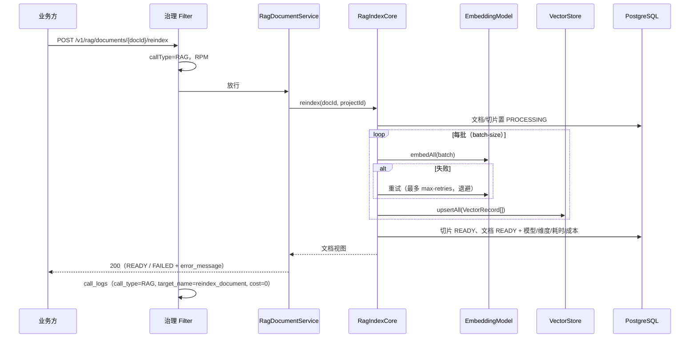

# REQ-3.2：Embedding 抽象 + 向量存储

- 日期：2026-11-11
- 状态：已完成
- 关联规格：外部需求卡 `12-项目7-第3期-RAG与记忆服务.md` REQ-3.2 章节
- 依赖需求：REQ-3.1
- 需求来源：外部需求卡
- 提交：22d46f1

## 1. 是什么

在 REQ-3.1 的切片基础上增加向量化与向量存储：`EmbeddingModel` 抽象默认接 LangChain4j 本地
AllMiniLmL6V2（384 维，可配置切换），`VectorStore` 抽象默认 PostgreSQL pgvector、测试用内存实现；
切片分批向量化并写入向量表，索引状态 PENDING/PROCESSING/READY/FAILED 可查询、可重试，模型版本、
维度、耗时与成本记录在文档元数据中。

## 2. 有什么用

- 业务价值：向量化是 RAG 的成本与质量核心；抽象 embedding 与向量存储避免绑定单一供应商，
  并为 REQ-3.3 检索/REQ-3.4 生成提供底座。
- 对应参照行为：LiteLLM B-16 实测其 vector stores 仅代理 OpenAI 托管向量库（无本地 pgvector），
  Java 版按需求卡自建 pgvector 存储（见基线 §九）。
- 面试叙事点：端口抽象、pgvector + HNSW、批量与重试、索引状态机、模型版本切换重建、维度隔离、
  成本/耗时可观测。

## 3. 怎么实现的

- 分层落点：
  - `common/rag`：`EmbeddingModel`、`VectorStore`、`VectorRecord`、`VectorMatch`、`VectorSearchQuery`、
    `RagIndexStatus`
  - `common/config/RagProperties`：`gateway.rag.embedding.*`、`gateway.rag.vector-store.*`
  - `integration/rag/LangChain4jEmbeddingModel`：LangChain4j 本地模型适配（专用有界线程池）
  - `integration/rag/DeterministicEmbeddingModel`：测试/离线确定性实现（不用于生产语义检索）
  - `manager/rag/PgVectorStore`：pgvector 实现（`rag_vectors`，cosine 距离，HNSW 索引）
  - `manager/rag/InMemoryVectorStore`：内存实现（测试 / 无 PG 场景）
  - `core/rag/RagIndexCore`：批量向量化 + 重试 + 状态流转 + 模型切换重建
  - `service/RagDocumentServiceImpl`：reindex 入口与文档删除级联向量
  - `start/controller/RagDocumentController`：`POST /v1/rag/documents/{docId}/reindex`
  - `dal`：`rag_vectors` DDL、`RagVectorDO`、`RagVectorMapper` 与 XML
- 核心类（≤3）：`RagIndexCore`、`PgVectorStore`、`LangChain4jEmbeddingModel`
- 数据模型：
  - `rag_vectors`：chunk_id / doc_id / project_id / embedding_model / embedding_dimension /
    embedding vector(384) / created_at；HNSW cosine 索引
  - `rag_documents` 增加：embedding_model / embedding_dimension / embedding_duration_ms /
    embedding_cost / error_message；`rag_chunks` 增加：index_status / embedding_model /
    embedding_dimension / error_message



## 4. 影响面

> 实现前填写；分级门禁依据：`additive` 自动通过，`extension` / `breaking` 必须用户确认后动手。

```yaml
capability:
  type: business            # 向量化与索引是 RAG 业务能力；RPM/调用日志复用既有横切治理
  entry_point: "Core（RagIndexCore）编排；治理在 GatewayGovernanceFilter + GatewayGovernanceService"
  interface_agnostic: false # 治理部分接口无关；索引业务绑定 RAG 文档接口
modules:
  add: [common/rag/EmbeddingModel, common/rag/VectorStore, common/rag/VectorRecord, common/rag/VectorMatch, common/rag/VectorSearchQuery, common/rag/RagIndexStatus, common/config/RagProperties, integration/rag/LangChain4jEmbeddingModel, integration/rag/DeterministicEmbeddingModel, manager/rag/PgVectorStore, manager/rag/InMemoryVectorStore, core/rag/RagIndexCore, dal/model/RagVectorDO, dal/mapper/RagVectorMapper]
  change: [common/constant/CallTypes, api/RagDocumentService, api/model/res/RagDocumentResDTO, manager/model/RagDocumentBO, manager/model/RagChunkBO, core/rag/RagDocumentCore, service/RagDocumentServiceImpl, start/controller/RagDocumentController, start/config/RagConfig, dal/model/RagDocumentDO, dal/model/RagChunkDO, dal/mapper/RagDocumentMapper, dal/mapper/RagChunkMapper, ai-hub-start/src/main/resources/application.yml, ai-hub-integration/pom.xml, pom.xml]
interfaces:
  add: ["POST /v1/rag/documents/{docId}/reindex"]
  change: []
  remove: []
tables:
  add: [rag_vectors]
  change: [rag_documents, rag_chunks]
config: [gateway.rag.embedding.provider, gateway.rag.embedding.model-id, gateway.rag.embedding.dimension, gateway.rag.embedding.batch-size, gateway.rag.embedding.max-retries, gateway.rag.embedding.retry-backoff-ms, gateway.rag.embedding.threads, gateway.rag.vector-store.type]
depends_on: [REQ-3.1]
nfr:
  resources: ["本地 embedding 使用专用有界 ThreadPoolExecutor（显式 core/max/队列/拒绝策略），Bean 销毁时 shutdown", "ONNX 模型常驻内存约数百 MB，单实例资源；模型只在 LangChain4j 本地 provider 下加载", "pgvector 连接复用 Spring 数据源/MyBatis 连接池"]
  failure_modes:
    - "正常：分批 embedAll → 批量 upsert 向量 → 状态 READY"
    - "超时/异常：批次重试；仍失败则文档/切片 FAILED 并记录 error_message，reindex 可重试"
    - "进程崩溃：已写入向量按 chunk_id 唯一约束幂等；文档可能停在 PROCESSING，reindex 可重跑覆盖"
    - "机器崩溃：向量与状态在 PostgreSQL；内存实现仅测试使用"
  metrics: ["embedding_duration_ms / embedding_cost 落 rag_documents", "RAG 调用轨迹与 indexing 调用写 call_logs（DB）", "本地模型线程池指标归每实例"]
compat: additive
gate: auto
regression: ["REQ-3.1 文档上传/切分/列表/删除", "REQ-1.4 限流/RPM", "REQ-1.5 call_logs", "REQ-2.3/2.5/3.5 call_type 分支", "REQ-3.5 记忆服务"]
```

## 5. 关键决策

| 决策 | 理由 | 日期 |
|---|---|---|
| `EmbeddingModel`/`VectorStore` 端口放 `common`，实现在 `integration`/`manager` | 业务只依赖端口；换模型/存储只换实现，符合依赖倒置 | 2026-11-11 |
| 默认本地 AllMiniLmL6V2（384 维），测试用确定性 embedding | 无外部 embedding 供应商；测试稳定且不加载 ONNX | 2026-11-11 |
| 向量表独立 `rag_vectors`，以 `chunk_id` 唯一 | 切片文本与向量解耦；删除/重建/模型版本隔离更清晰 | 2026-11-11 |
| 向量列固定 `vector(384)` + HNSW cosine 索引 | 默认模型维度固定；HNSW 适合在线低延迟检索；换不同维度模型需迁移列 | 2026-11-11 |
| 同步索引（请求内完成），状态机仍完整 | 避免后台线程与多实例调度；失败可 reindex，学习项目成本可控 | 2026-11-11 |
| 批次 `embedAll` + 指数退避重试；失败落 FAILED | 满足“批量 + 重试/可重试” | 2026-11-11 |
| 模型版本写入文档/切片/向量，检索按当前模型过滤 | 模型切换后旧向量不被新模型误用；list 返回 `reindex_required` 提示 | 2026-11-11 |
| 本地 embedding 用专用有界线程池并在销毁时关闭 | 避免 commonPool；满足资源生命周期（STANDARDS §2.7） | 2026-11-11 |

## 6. 执行摘要

> 每会话 1-2 行 + commit；详细过程留在对话、plan/tasks 与提交历史，不在此复制。

### 2026-11-11

- 进展：冻结验收标准；实现 Embedding 抽象、pgvector/内存 VectorStore、批量索引与 reindex。
- 提交：`22d46f1`（实现 + 文档）；`mvn -Pquality verify` 全绿（375 测试）；`RagVectorStoreIntegrationTest` Testcontainers 真库验证通过。
- 下一步：REQ-3.3 在向量检索之上实现 `/v1/rag/search`、过滤、阈值与重排。

## 7. 复盘

- 做对了什么：双端口抽象 + 内存实现让单测不依赖外部服务；索引状态机与 `reindex` 让失败可恢复；迁移含 HNSW 索引与幂等约束，过滤条件下推 SQL。
- 踩了什么坑：测试代码的 Mockito 用法错误（`any(Long.class)` 未导入、mock 被 stub 成抛异常后再次 `when()` 会重新触发异常）与分批调用次数断言不符；SpotBugs 排除清单漏了 `RagIndexCore`；这些问题在收尾全量门禁才暴露，拖慢了验证。
- 下次改进：测试写完先跑单模块 `test` 再接下一步；SpotBugs 排除清单随新类同步补全；Mockito 重新 stub 用链式 `thenAnswer` 或 `doAnswer` 规避。

## 8. 多实例检查

- [x] 是否有可变成员变量？无业务状态；`InMemoryVectorStore` 仅测试/显式配置使用，生产默认 pgvector。
- [x] 计数器/限流/预算/冷却是否在 Redis/数据库？RPM 在 Redis；索引状态与向量在 DB。
- [x] 锁是否分布式？无显式锁；`rag_vectors.chunk_id` 唯一 + reindex 覆盖写保证幂等。
- [x] 定时任务是否只执行一次？无定时任务；索引在请求内同步完成。
- [x] 本地缓存是否可容忍过期/不一致？无业务本地缓存；ONNX 模型为只读资源。
