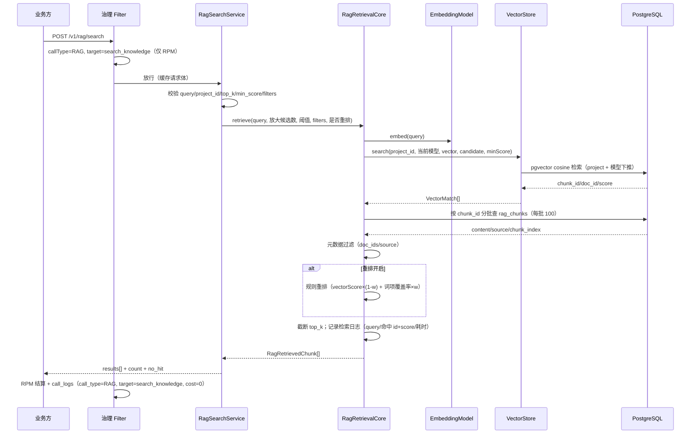

# REQ-3.3：检索与重排

- 日期：2026-11-11
- 状态：已完成
- 关联规格：外部需求卡 `12-项目7-第3期-RAG与记忆服务.md` REQ-3.3 章节
- 依赖需求：REQ-3.2
- 需求来源：外部需求卡
- 提交：63f2b28

## 1. 是什么

在 REQ-3.2 的向量索引之上提供知识检索入口：业务方提交 query、项目、条数、元数据过滤与相似度阈值，
中台把 query 向量化、按 `project_id + 模型版本` 检索 pgvector，批量补齐切片正文与来源，按需做规则重排，
返回切片内容、来源、score 与 `doc_id`/`chunk_id`。无命中时返回空列表并标记 `no_hit`，不抛错。
检索过程记录 query、召回 id + score 与耗时，供 Badcase 归因。

## 2. 有什么用

- 业务价值：检索质量直接决定 RAG 效果；阈值、条数、元数据过滤与重排需要组合可调，且必须保证项目隔离。
- 对应参照行为：07 笔记 §2.3 RAG 服务 `search_knowledge`（按 project_id 隔离）；B-16 实测 LiteLLM
  无本地向量库，检索能力按需求卡自建。
- 面试叙事点：端口之上的检索编排、阈值/条数收敛、过滤后候选不足的放大召回、
  可配置规则重排（向量分 + 词项覆盖）、无命中语义、检索日志与隐私边界。

## 3. 怎么实现的

- 分层落点：
  - `common/rag/RagSearchFilter`：元数据过滤值对象（`doc_ids` / `source`），构造时防御性复制
  - `common/config/RagProperties.Search`：`gateway.rag.search.*` 条数、阈值、候选放大、重排开关与权重
  - `core/rag/RagRetrievalCore`：query 向量化 → 放大召回 → 切片批量补齐 → 元数据过滤 → 可选规则重排 → 截断
  - `core/rag/RagLexicalReranker`：规则重排（向量分与 query 词项覆盖率加权）
  - `core/rag/RagRetrievedChunk`：检索命中的领域对象（core 不依赖 api DTO）
  - `api/RagSearchService` + Req/Res DTO：`POST /v1/rag/search` 契约（snake_case，与 RAG MCP 对齐）
  - `service/RagSearchServiceImpl`：参数校验、范围收敛、DTO↔BO、检索日志
  - `start/controller/RagSearchController`：数据面入口
  - `manager/rag/RagChunkManager` + `RagChunkMapper.selectByChunkIds`：按 chunk_id 批量补齐正文（每批 100 条）
  - 治理：`GatewayGovernanceFilter` 复用 `callType=RAG`，`target_name=search_knowledge`，只做 RPM、cost=0
- 核心类（≤3）：`RagRetrievalCore`、`RagLexicalReranker`、`RagSearchServiceImpl`
- 数据模型：无新增/修改表；检索读取 REQ-3.2 的 `rag_vectors` 与 REQ-3.1 的 `rag_chunks`



## 4. 影响面

> 实现前填写；分级门禁依据：`additive` 自动通过，`extension` / `breaking` 必须用户确认后动手。

```yaml
capability:
  type: business            # 检索是 RAG 业务能力；RPM/调用日志复用既有横切治理
  entry_point: "Service（RagSearchServiceImpl）→ Core（RagRetrievalCore）；治理在 GatewayGovernanceFilter + GatewayGovernanceService"
  interface_agnostic: false # 治理部分接口无关；检索业务绑定 /v1/rag/search
modules:
  add: [common/rag/RagSearchFilter, common/rag/RagSearchRequest, core/rag/RagRetrievalCore, core/rag/RagLexicalReranker, core/rag/RagRetrievedChunk, api/RagSearchService, api/model/req/RagSearchReqDTO, api/model/req/RagSearchFilterDTO, api/model/res/RagSearchResDTO, api/model/res/RagSearchHitResDTO, service/RagSearchServiceImpl, start/controller/RagSearchController]
  change: [common/config/RagProperties, manager/rag/RagChunkManager, dal/mapper/RagChunkMapper, ai-hub-dal/src/main/resources/com/qtua/aihub/dal/mapper/RagChunkMapper.xml, start/filter/GatewayGovernanceFilter, ai-hub-start/src/main/resources/application.yml, ai-hub-tests/src/test/resources/application-test.yml, config/spotbugs-exclude.xml]
interfaces:
  add: ["POST /v1/rag/search"]
  change: []
  remove: []
tables:
  add: []
  change: []
config: [gateway.rag.search.default-top-k, gateway.rag.search.max-top-k, gateway.rag.search.default-min-score, gateway.rag.search.candidate-multiplier, gateway.rag.search.max-candidates, gateway.rag.search.max-query-chars, gateway.rag.search.rerank-enabled, gateway.rag.search.rerank-lexical-weight]
depends_on: [REQ-3.2]
nfr:
  resources: ["无新增线程池/连接池；query 向量化复用 REQ-3.2 的 embedding 专用有界线程池", "切片批量补齐每批 100 条，候选上限 200，避免 SQL IN 过长与内存放大"]
  failure_modes:
    - "正常：单次 query embedding → 向量检索 → 切片批量补齐 → 过滤/重排 → 返回"
    - "超时/异常：embedding 或向量检索异常向上返回 500 中文错误，不返回半成品结果；日志记录 request_id 与类型"
    - "进程崩溃：检索是只读操作，无本地状态；崩溃不产生脏数据"
    - "机器崩溃：向量与切片在 PostgreSQL 持久化；检索无本地缓存，重启可继续"
  metrics: ["检索日志（query、命中 id+score、耗时、no_hit）经 SLF4J 输出，含 request_id", "RAG 调用轨迹写 call_logs（target_name=search_knowledge, cost=0）"]
compat: additive
gate: auto
regression: ["REQ-3.1 文档上传/切分/列表/删除", "REQ-3.2 reindex/向量存储", "REQ-1.4 限流/RPM", "REQ-1.5 call_logs", "REQ-2.3/2.5/3.5 call_type 分支", "REQ-3.5 记忆服务"]
```

## 5. 关键决策

| 决策 | 理由 | 日期 |
|---|---|---|
| 检索编排放 `core/RagRetrievalCore`，Service 只做校验/日志/DTO | 业务编排归 core；REQ-3.4 可直接复用检索，不复制召回逻辑 | 2026-11-11 |
| 元数据过滤在向量召回后按切片字段执行，召回条数按 `top_k × multiplier` 放大 | 不改动 REQ-3.2 的 `VectorSearchQuery` 契约；过滤后候选不足的风险由放大召回 + 上限 200 控制 | 2026-11-11 |
| 重排只做规则重排（向量分 + query 词项覆盖率加权），不做 LLM 重排 | 需求允许二选一；规则重排零额外模型成本、可解释、可离线测试 | 2026-11-11 |
| 服务端 `rerank-enabled` 是总开关，请求只能关不能越权打开 | 防止调用方绕过成本/延迟控制 | 2026-11-11 |
| `top_k` 超上限收敛、非法值 400；`min_score` 限 [-1,1] | 与既有 list limit 收敛策略一致；阈值语义明确 | 2026-11-11 |
| 无命中返回 200 + 空数组 + `no_hit=true` | 需求明确不抛错；便于调用方区分“无知识”与“服务异常” | 2026-11-11 |
| 检索日志只记 query、chunk_id/score、长度与耗时，不记切片正文 | 满足 Badcase 归因，同时遵守隐私约束 | 2026-11-11 |
| 查询切片正文走 `selectByChunkIds` 分批查询 | 向量结果不含正文；批量 IN 控制在 100 条以内 | 2026-11-11 |

## 6. 执行摘要

> 每会话 1-2 行 + commit；详细过程留在对话、plan/tasks 与提交历史，不在此复制。

### 2026-11-11

- 进展：影响面判定 additive 自动通过；冻结验收标准；实现 `RagSearchFilter`/`RagSearchRequest`、
  `RagRetrievalCore`（放大召回 + 分批补齐 + 元数据过滤 + 可选规则重排）、`RagLexicalReranker`、
  `POST /v1/rag/search` 与 RAG 治理登记（`target_name=search_knowledge`）。
- 验证：新增 13 个 core 测试（检索编排 9 + 规则重排 4）、10 个 service 测试、8 个 H2 端到端测试；
  `mvn -Pquality verify` 全绿（347 个测试、0 失败，含 pgvector Testcontainers 回归）。
- 提交：63f2b28（实现 + 文档）
- 下一步：REQ-3.4 在检索之上实现 `/v1/rag/answer`、引用编号与无召回兜底。

## 7. 复盘

- 做对了什么：检索编排收口在 core，REQ-3.4 直接复用；候选放大 + 上限 200 + 分批 IN 控制在
  不改变 REQ-3.2 端口契约的前提下兼顾过滤正确性与资源边界；服务端重排总开关防止调用方绕过成本控制；
  检索日志只记 query 与 id/score，不落正文。
- 踩了什么坑：SpotBugs 把 `RagSearchFilter` 的静态 `EMPTY` 识别为单例（`SING_SINGLETON_HAS_NONPRIVATE_CONSTRUCTOR`），
  改为工厂方法返回新实例；新增 DTO/filter 的集合字段需要补 `EI_EXPOSE_REP/REP2` 排除；
  Checkstyle 拦截 `== null` 与 `1.0d` 魔法值，需用 `Objects.isNull` 与常量。
- 下次改进：离线确定性 embedding 无语义能力，集成测试只能让查询与目标切片文本一致来保证可重复命中；
  真实语义命中需要真实模型链路演示（随 REQ-3.4 完成）。后续若检索量增大，可评估把 doc_id 过滤下推
  `VectorStore` 端口，减少放大召回。

## 8. 多实例检查

- [x] 是否有可变成员变量？无；Core/Service 只持有无状态依赖与不可变配置；检索为只读操作。
- [x] 计数器/限流/预算/冷却是否在 Redis/数据库？RAG 检索只做 Key RPM（Redis），调用日志落 DB。
- [x] 锁是否分布式？无显式锁；检索只读，无需互斥。
- [x] 定时任务是否只执行一次？无定时任务。
- [x] 本地缓存是否可容忍过期/不一致？无本地缓存；向量/切片均来自 PostgreSQL 或测试用内存实现。
