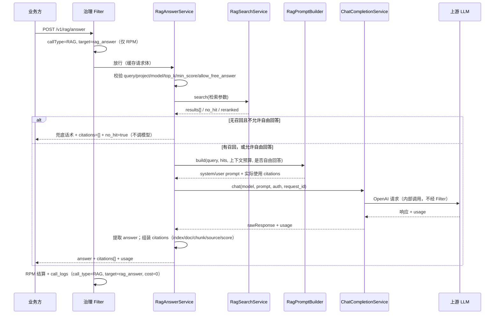

# REQ-3.4：RAG 生成 + 引用溯源

- 日期：2026-11-11
- 状态：已完成
- 关联规格：外部需求卡 `12-项目7-第3期-RAG与记忆服务.md` REQ-3.4 章节
- 依赖需求：REQ-3.3、REQ-1.1
- 需求来源：外部需求卡
- 提交：待回填

## 1. 是什么

在 REQ-3.3 检索之上提供“检索增强回答”入口：业务方提交问题、项目与模型，中台检索知识切片、
按编号构造带引用的 prompt、通过内部 chat 服务调用模型，返回 `answer + citations[]`。citations 携带
`index`（与答案/prompt 中的 `[1][2]` 对应）、`doc_id`、`chunk_id`、`source`、`score`。
无召回时返回可配置的兜底话术且不调用模型（可配置允许自由回答）；同一 `request_id` 记录
query → 召回 → prompt → 模型 → 引用的全链路摘要，并预留黄金问题集回归入口。

## 2. 有什么用

- 业务价值：只有答案没有引用，业务无法核验；引用溯源是企业 RAG 的必需项，也能抑制模型编造。
- 对应参照行为：07 笔记 RAG 主链路（search_knowledge → 组装上下文 → chat → 引用）；B-16 实测
  LiteLLM 无本地 RAG 生成链路，按需求卡自建。
- 面试叙事点：检索与生成分层的复用、引用编号与 citations 的强对应、prompt 长度预算、
  无召回兜底与自由回答开关、内部 chat 不经治理避免双重计量、全链路日志与离线黄金问题集。

## 3. 怎么实现的

- 分层落点：
  - `api/RagAnswerService` + Req/Res DTO：`POST /v1/rag/answer` 契约（snake_case）
  - `common/config/RagProperties.Answer`：`gateway.rag.answer.*`（默认条数、上下文预算、兜底话术、自由回答开关）
  - `core/rag/RagPromptBuilder`：按检索命中构造 system/user prompt，分配 `[n]` 编号并按上下文预算截断
  - `core/rag/RagAnswerPrompt`：prompt 与“实际使用到的引用”值对象
  - `service/RagAnswerServiceImpl`：校验 → 复用 `RagSearchService` 检索 → 构造 prompt → 内部
    `ChatCompletionService` 调用 → 提取 answer/usage → 组装 citations；无召回时兜底
  - `start/controller/RagAnswerController`：数据面入口，透传认证与 `request_id`
  - 治理：`GatewayGovernanceFilter` 复用 `callType=RAG`，`target_name=rag_answer`，只做 RPM、cost=0；
    内部 chat 不再经过 Filter，避免双重治理
  - 测试资源 `rag/golden-questions.yml` + `RagGoldenQuestionRegressionTest`：黄金问题集回归入口
- 核心类（≤3）：`RagAnswerServiceImpl`、`RagPromptBuilder`、`RagAnswerPrompt`
- 数据模型：无新增/修改表；读取 REQ-3.2/3.3 的向量与切片



## 4. 影响面

> 实现前填写；分级门禁依据：`additive` 自动通过，`extension` / `breaking` 必须用户确认后动手。

```yaml
capability:
  type: business            # RAG 生成是业务能力；RPM/调用日志复用既有横切治理
  entry_point: "Service（RagAnswerServiceImpl）；治理在 GatewayGovernanceFilter + GatewayGovernanceService"
  interface_agnostic: false # 治理部分接口无关；生成业务绑定 /v1/rag/answer
modules:
  add: [api/RagAnswerService, api/model/req/RagAnswerReqDTO, api/model/res/RagAnswerResDTO, api/model/res/RagCitationResDTO, api/model/res/RagUsageResDTO, core/rag/RagPromptBuilder, core/rag/RagAnswerPrompt, service/RagAnswerServiceImpl, start/controller/RagAnswerController]
  change: [common/config/RagProperties, start/filter/GatewayGovernanceFilter, ai-hub-start/src/main/resources/application.yml, ai-hub-tests/src/test/resources/application-test.yml, config/spotbugs-exclude.xml]
interfaces:
  add: ["POST /v1/rag/answer"]
  change: []
  remove: []
tables:
  add: []
  change: []
config: [gateway.rag.answer.default-top-k, gateway.rag.answer.max-context-chars, gateway.rag.answer.allow-free-answer, gateway.rag.answer.fallback-message, gateway.rag.answer.empty-answer-message]
depends_on: [REQ-3.3, REQ-1.1]
nfr:
  resources: ["无新增线程池/连接池；内部 chat 复用既有上游 HTTP 连接池", "prompt 上下文受 max-context-chars 约束，避免超长请求"]
  failure_modes:
    - "正常：检索 → prompt → chat → 提取 answer/usage → citations"
    - "超时/异常：检索或 chat 异常向上返回标准错误；不返回半成品 answer/citations"
    - "进程崩溃：无本地状态；请求级数据只在内存，崩溃不影响持久数据"
    - "机器崩溃：知识数据在 PostgreSQL；生成链路可重试"
  metrics: ["全链路日志（query/召回/prompt 摘要/模型 usage/引用）经 SLF4J 输出，含 request_id", "RAG 调用轨迹写 call_logs（target_name=rag_answer, cost=0）"]
compat: additive
gate: auto
regression: ["REQ-3.1 文档接入", "REQ-3.2 向量存储", "REQ-3.3 检索与重排", "REQ-1.1 chat 补全", "REQ-1.4/1.5 治理与日志", "REQ-2.3/2.5/3.5 call_type 分支"]
```

## 5. 关键决策

| 决策 | 理由 | 日期 |
|---|---|---|
| 生成服务复用 `RagSearchService`，不复制检索校验与日志 | 检索语义（隔离、阈值、过滤、重排）只有一处实现，避免两条链路漂移 | 2026-11-11 |
| 内部直接调用 `ChatCompletionService`，不经 HTTP/Filter | 与 REQ-2.5 一致：治理只在 Filter 做一次，避免双重计量/限流 | 2026-11-11 |
| citations 的 `index` 从 1 开始，与 prompt 中 `[n]` 强对应 | 业务可核验；prompt 只放实际使用的引用，避免“编号错位” | 2026-11-11 |
| 上下文按 `max-context-chars` 预算，按检索顺序纳入引用，至少保留第一条 | 防止 prompt 超长；宁可少给资料也不截断出无来源上下文 | 2026-11-11 |
| 无召回默认不调用模型，返回可配置兜底话术；自由回答需服务端开关 + 请求显式开启 | 不编造引用；自由回答属高风险能力，默认关闭 | 2026-11-11 |
| 有召回时 `no_hit=false`；无召回但自由回答时 `no_hit=true` + `free_answer=true` | `no_hit` 只表示“知识库是否召回”，不因自由回答改变事实 | 2026-11-11 |
| 引用 `score` 取最终排序分（重排开启时为 rerank 分） | 与返回顺序一致，便于解释排序 | 2026-11-11 |
| 全链路日志只记摘要（长度/hash/usage/id），不记 prompt 与正文 | 满足“可还原链路”，同时遵守文档隐私约束 | 2026-11-11 |
| 黄金问题集用 YAML + JUnit 测试入口，不建评测平台 | 需求只要求预留回归入口；离线可跑、可扩展 | 2026-11-11 |

## 6. 执行摘要

> 每会话 1-2 行 + commit；详细过程留在对话、plan/tasks 与提交历史，不在此复制。

### 2026-11-11

- 进展：影响面判定 additive 自动通过；冻结验收标准；实现 `RagPromptBuilder`（引用编号 + 上下文预算）、
  `RagAnswerServiceImpl`（复用检索 → 内部 chat → answer/citations/usage，无召回兜底与自由回答开关）、
  `POST /v1/rag/answer` 与 RAG 治理登记（`target_name=rag_answer`）；新增黄金问题集 YAML 与回归测试入口。
- 验证：新增 5 个 prompt 测试、9 个 service 测试、7 个端到端测试、1 个黄金问题集回归；
  `mvn -Pquality verify` 全绿（369 个测试、0 失败）。
- 真实链路演示（pgvector 容器 + Redis + 本地 all-minilm + DeepSeek `chat-default`）：
  “年假有多少天”→ 命中 demo-hr.md，答案“入职满一年 5 天、满三年 10 天 [1]”；
  “出差住宿标准是多少”→ 命中 demo-fin.md，答案“一线城市每晚不超过 600 元 [1]”并明确资料不足；
  无召回问题在 `min_score=0.6` 时返回兜底话术、`usage=0`（未调模型）；请求 `allow_free_answer=true`
  在服务端开关关闭时仍走兜底；同一 `request_id` 的日志可还原 query → 召回 → prompt → 模型 → 引用，
  `call_logs` 记录 `RAG/rag_answer/cost=0`。
- 提交：待回填
- 下一步：REQ-3.6（RAG/记忆 MCP 暴露）不在本批范围。

## 7. 复盘

- 做对了什么：答案生成完全复用检索服务，检索语义只有一处；citations 与 prompt 编号同源生成，
  从结构上杜绝编号错位；无召回默认不调模型，自由回答双开关；prompt 上下文有预算；日志只记摘要。
- 踩了什么坑：初版把 `lastUsage` 放在 Service 成员变量中承载请求用量，违反无状态约束，改为私有
  `ModelResult` 随调用返回；SpotBugs 需要补 `RagAnswerPrompt`/`RagAnswerResDTO` 的集合排除；
  Checkstyle 发现未使用导入。
- 下次改进：MockWebServer 的响应队列是全局的，多个测试类共享静态 server 时需要按用例清理请求/响应，
  或统一改为每类独立 server；黄金问题集当前以“问题文本 = 目标切片文本”保证确定性 embedding 可重复命中，
  接入真实语义模型后应改为同义改写问题并补充阈值分布统计。

## 8. 多实例检查

- [x] 是否有可变成员变量？无；Service 不保存请求级用量（`ModelResult` 随调用返回）；PromptBuilder 无状态。
- [x] 计数器/限流/预算/冷却是否在 Redis/数据库？RAG answer 只做 Key RPM（Redis），调用日志落 DB。
- [x] 锁是否分布式？无显式锁；检索/生成均为请求内流程。
- [x] 定时任务是否只执行一次？无定时任务。
- [x] 本地缓存是否可容忍过期/不一致？无本地缓存。
