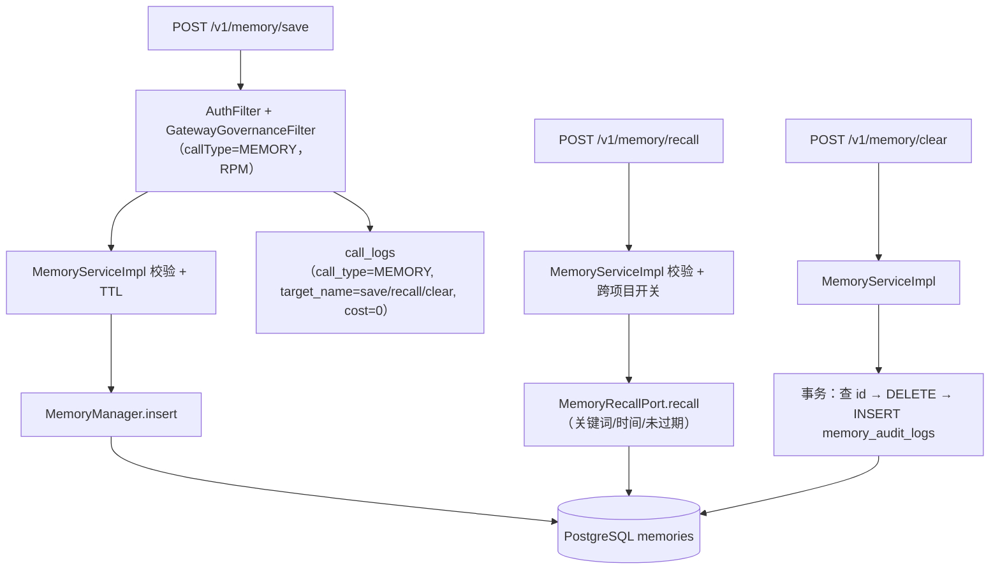

# REQ-3.5：记忆服务（session/user）

- 日期：2026-11-11
- 状态：已完成
- 关联规格：外部需求卡 `12-项目7-第3期-RAG与记忆服务.md` REQ-3.5 章节
- 依赖需求：REQ-2.1（需求卡前置；本期实现不感知 MCP，MCP 暴露在 REQ-3.6）
- 需求来源：外部需求卡
- 提交：c692b9c

## 1. 是什么

给 AI 中台增加 session / user 两级记忆：业务项目按 `tenant_id + project_id + user_id + session_id`
保存对话记忆或用户画像，按关键词与时间范围召回，按用户/会话删除并留下物理删除审计。
记忆持久化在 PostgreSQL，默认项目隔离，跨项目共享需显式开启。

## 2. 有什么用

- 业务价值：跨会话/跨项目的个性化能力；用户删除权与租户隔离是合规硬约束。
- 对应参照行为：07 笔记 §2.3 记忆服务 9003（`save_memory` / `recall_memory` / `clear_memory`）；
  对话记忆按 `project_id + session_id`，用户画像按 `user_id` 跨项目共享。
- 面试叙事点：两级记忆模型、TTL 惰性失效、物理删除审计、跨项目共享开关、隐私字段不落日志。

## 3. 怎么实现的

- 分层落点：
  - `common/memory`：`MemoryRecallPort`（召回端口，向量检索预留）、`MemoryQuery`、`MemoryEntry`、`MemoryScope`
  - `common/constant/CallTypes`：CHAT / MCP / PROMPT / MEMORY 统一常量
  - `dal`：`memories` / `memory_audit_logs` DDL、`MemoryDO` / `MemoryAuditDO`、Mapper 与 XML
  - `manager/memory/MemoryManager`：BO↔DO、metadata JSON 编解码、召回端口实现、物理删除 + 审计事务
  - `api/MemoryService` + Req/Res DTO：REST 契约
  - `service/MemoryServiceImpl`：参数校验、授权（跨项目开关）、TTL 计算、DTO↔BO、clear 事务边界
  - `start/controller/MemoryController`：`/v1/memory/save|recall|clear`
  - 治理：`GatewayGovernanceFilter` 识别 MEMORY 调用类型；`GatewayGovernanceService` 按工具类调用
    只做 RPM 预占/结算并写 `call_logs`（cost=0，target_name=save/recall/clear）
- 核心类（≤3）：`MemoryServiceImpl`、`MemoryManager`、`GatewayGovernanceFilter`
- 数据模型：
  - `memories`：memory_id / tenant_id / project_id / user_id / session_id / memory_type(SESSION/USER) /
    content / metadata(JSONB) / expires_at / created_at
  - `memory_audit_logs`：audit_id / 作用域 / operation / deleted_count / memory_ids(JSONB) /
    operator_key / reason / created_at



## 4. 影响面

> 实现前填写；分级门禁依据：`additive` 自动通过，`extension` / `breaking` 必须用户确认后动手。

```yaml
capability:
  type: business            # 记忆服务是业务能力；RPM 与调用日志复用既有横切治理
  entry_point: "Service（MemoryServiceImpl）；治理在 GatewayGovernanceFilter + GatewayGovernanceService"
  interface_agnostic: false # 治理部分接口无关；记忆业务本身绑定 /v1/memory/*
modules:
  add: [common/memory, common/constant/CallTypes, manager/memory, manager/model/MemoryBO, manager/model/MemoryAuditBO, manager/model/MemoryClearResult, api/MemoryService, service/MemoryServiceImpl, start/controller/MemoryController]
  change: [start/filter/GatewayGovernanceFilter, service/gateway/GatewayGovernanceService, service/gateway/model/GatewayContext, dal/model/CallLogDO, manager/model/CallLogBO, common/exception/ChatCompletionException]
interfaces:
  add: ["POST /v1/memory/save", "POST /v1/memory/recall", "POST /v1/memory/clear"]
  change: []
  remove: []
tables:
  add: [memories, memory_audit_logs]
  change: []
config: [gateway.memory.cross-project-sharing-enabled, gateway.memory.max-ttl-seconds, gateway.memory.max-content-length, gateway.memory.max-metadata-length, gateway.memory.default-recall-limit, gateway.memory.max-recall-limit]
depends_on: [REQ-2.1]
nfr:
  resources: ["PostgreSQL 连接：复用 Spring 数据源 / MyBatis 连接池，无新增池"]
  failure_modes:
    - "正常：save 单条写入；clear 单事务提交（先取 id，再 DELETE，再写审计）"
    - "超时/异常：clear 事务整体回滚，不会出现删除成功而审计缺失；接口返回 500 中文错误"
    - "进程崩溃：未提交事务由数据库回滚，无半删除状态"
    - "机器崩溃：连接由服务端回收，未提交事务回滚；记忆数据在 PostgreSQL 持久化"
  metrics: ["无新增本地资源计数；调用轨迹写 call_logs（DB，跨实例一致）", "TTL 失效用查询时过滤，不依赖单机定时器"]
compat: additive
gate: auto
regression: ["REQ-1.4 限流/RPM 预占与结算", "REQ-1.5 call_logs 写入与异步日志", "REQ-2.1 鉴权与治理 Filter 路径匹配", "REQ-2.3/2.5 call_type 分支（MCP/PROMPT）"]
```

## 5. 关键决策

| 决策 | 理由 | 日期 |
|---|---|---|
| 会话级/用户级由 `session_id` 是否为空区分 | 两级模型直观，无需额外 type 入参；DB 仍落 `memory_type` 便于过滤与审计 | 2026-11-11 |
| 有 session 只召回该会话；无 session 只召回用户级 | 避免会话记忆混入用户画像召回，语义可预测 | 2026-11-11 |
| 跨项目共享默认关闭；开启后仍需显式 `cross_project=true`，且仅用户级记忆 | 隐私优先；会话内容不跨项目；未开启时显式请求返回 403（不静默降级） | 2026-11-11 |
| TTL 查询时惰性过滤，不做定时清理任务 | 多实例无状态；避免定时任务重复执行、额外锁与删除审计歧义 | 2026-11-11 |
| 物理删除 + `memory_audit_logs` 同事务 | 满足用户删除权举证；不会出现“删了但无审计”或反之 | 2026-11-11 |
| 审计最多记录 1000 个 `memory_id`，另存实际 `deleted_count` | 大范围删除时避免单行 JSON 过大；条数以实际 DELETE 为准 | 2026-11-11 |
| 关键词转义 `%` / `_` / `\` 后再拼 LIKE | 防止用户输入扩大匹配范围 | 2026-11-11 |
| 召回收敛到 `MemoryRecallPort` 端口，本期只做结构化实现 | 为后续向量检索预留，Service 不绑定存储细节 | 2026-11-11 |
| `call_type` 统一到 `CallTypes`，记忆调用只做 RPM、cost=0 | 复用统一治理，新接口零复制；集中常量消除魔法值 | 2026-11-11 |
| 请求/响应 JSON 使用 snake_case，时间用 ISO-8601 `Instant` | 与记忆服务 MCP 契约（REQ-3.6）保持一致 | 2026-11-11 |
| API Key 视为应用身份，`user_id` 由调用方声明 | 本阶段尚无终端用户身份体系（REQ-4.1 多租户再把 Key 绑定 tenant/project）；中台强制 tenant/project/user 作用域与跨项目开关，越出作用域即空结果或 403；终端用户鉴权归业务方 Tier1 | 2026-11-11 |

## 6. 执行摘要

> 每会话 1-2 行 + commit；详细过程留在对话、plan/tasks 与提交历史，不在此复制。

### 2026-11-11

- 进展：影响面判定 additive 自动通过；冻结验收标准；TDD 完成 save/recall/clear、TTL、隔离、跨项目开关、物理删除审计与 MEMORY 治理接入；`mvn -Pquality verify` 全绿。
- 收尾：复检存量实现与 §1 验收项；修复损坏 metadata 解析异常可能把 JSON 片段带入日志的问题（改为记录长度），补 `MemoryManagerTest` 断言隐私字段不落日志；acceptance §1 全部勾选、§5 回填；STATUS 重新生成。
- 下一步：REQ-3.6 将 save_memory / recall_memory / clear_memory 暴露为 MCP 工具。

## 7. 复盘

- 做对了什么：先冻结验收再写测试；作用域三要素（tenant/project/user）在 SQL 与 Service 双层强制；复用 `MemoryRecallPort` 预留向量检索；治理只加 MEMORY 分支，未复制限流/日志逻辑。
- 踩了什么坑：集成测试共享同一个 H2 内存库，早期用例数据互相污染（改为每个用例独立 project/user）；本机 Redis 未启动导致 RPM 断言不可依赖（该用例移除，治理由 `call_logs` 集成断言 + 治理单测覆盖）；SpotBugs 对 record 的 Map/List 防御性拷贝误报，需要排除；损坏 metadata 的 JSON 解析异常默认带解析上下文，收尾时改为只记录长度，避免隐私字段随异常栈入日志。
- 下次改进：集成测试类默认使用独立 H2 URL，且每个用例使用唯一作用域；依赖外部中间件的断言放到 Testcontainers 专用测试。

## 8. 多实例检查

- [x] 是否有可变成员变量？无；`MemoryManager` / `MemoryServiceImpl` 只持有无状态依赖与不可变配置。
- [x] 计数器/限流/预算/冷却是否在 Redis/数据库？记忆本身无计数；Key RPM 仍走 Redis，`call_logs` 落 DB。
- [x] 锁是否分布式？无锁；clear 为单事务 + 幂等删除，多实例并发清理结果一致（审计条数以实际 DELETE 为准）。
- [x] 定时任务是否只执行一次？无定时任务；TTL 查询时过滤。
- [x] 本地缓存是否可容忍过期/不一致？无本地缓存。
