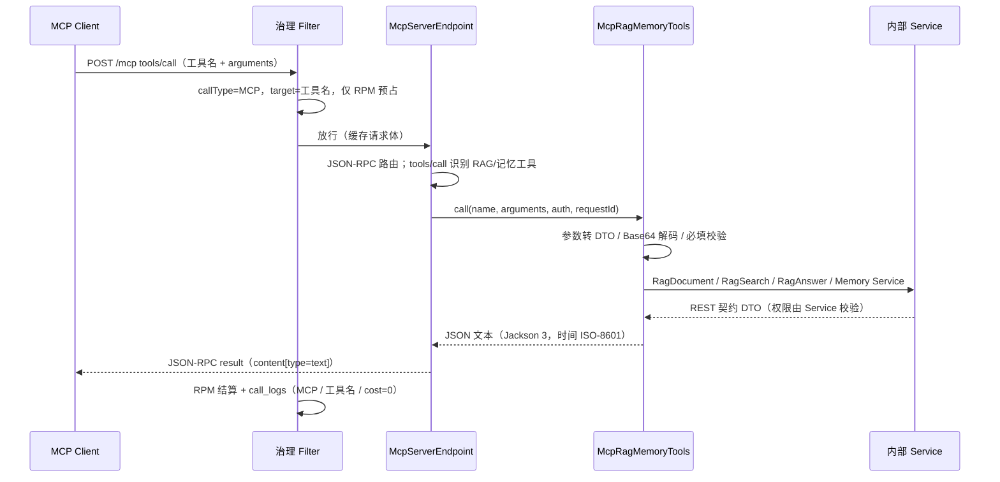

# REQ-3.6：RAG/记忆 MCP Server 暴露

- 日期：2026-11-11
- 状态：已完成
- 关联规格：外部需求卡 `12-项目7-第3期-RAG与记忆服务.md` REQ-3.6 章节
- 依赖需求：REQ-3.1、REQ-3.2、REQ-3.3、REQ-3.4、REQ-3.5、REQ-2.6
- 需求来源：外部需求卡
- 提交：待回填

## 1. 是什么

把第三期已完成的 RAG 与记忆能力从 REST 数据面扩展到 MCP 协议面：在既有 `/mcp`
（原生 JSON-RPC 2.0）上新增 6 个工具——RAG 的 `ingest_document`、`search_knowledge`、
`rag_answer`，记忆的 `save_memory`、`recall_memory`、`clear_memory`。Agent 类消费方
（Cursor / Claude Desktop / 自研 Runtime）通过标准 MCP 客户端即可发现并调用这些能力，
无需逐个直连 REST 接口。

工具入参字段与 REST 契约一致（snake_case）；租户 / 项目 / 用户由工具入参显式透传，
记忆权限完全复用 REQ-3.5 的作用域与跨项目开关规则，不重复实现。MCP 调用统一经
`GatewayGovernanceFilter` 治理，`call_logs` 记录 `call_type=MCP`、`target_name=工具名`，
`request_id` 从入口贯穿到内部 Service。

## 2. 有什么用

- 业务价值：项目 7「中台化」的关键一步——RAG 与记忆像共享服务一样被业务项目和 Agent 复用；
  MCP 是 Agent 生态的标准入口，REST 仍是业务应用主路径。
- 对应参照行为：07 笔记 §2.3 RAG 9002（`ingest_document` / `search_knowledge`）与
  记忆 9003（`save_memory` / `recall_memory` / `clear_memory`）；`search_knowledge` 按
  `project_id` 隔离，用户画像按 `user_id` 跨项目共享。
- 面试叙事点：同一能力双协议出口（REST + MCP）且零业务逻辑复制；MCP schema 与 REST
  契约对齐；租户上下文在工具层透传；MCP 调用复用统一治理与调用日志。

## 4. 影响面

> 实现前填写；分级门禁依据：`additive` 自动通过，`extension` / `breaking` 必须用户确认后动手。

```yaml
capability:
  type: business            # Agent 适配层扩展；RPM/调用日志复用既有横切治理
  entry_point: "Start（/mcp 的 tools/list 与 tools/call）；治理在 GatewayGovernanceFilter + GatewayGovernanceService"
  interface_agnostic: false # 治理部分接口无关；MCP 工具绑定 RAG/记忆业务能力
modules:
  add: [start/mcp/McpRagMemoryTools]
  change: [start/mcp/McpServerEndpoint]
interfaces:
  add: ["POST /mcp：新增 MCP 工具 ingest_document / search_knowledge / rag_answer / save_memory / recall_memory / clear_memory"]
  change: []
  remove: []
tables:
  add: []
  change: []
config: []
depends_on: [REQ-3.1, REQ-3.2, REQ-3.3, REQ-3.4, REQ-3.5, REQ-2.6]
nfr:
  resources: ["无新增线程池/连接池；向量化复用 REQ-3.2 embedding 专用有界线程池，存储复用 MyBatis 连接池", "PDF 内容经 base64 进入请求体，受 multipart/请求体上限与 gateway.rag.upload.max-size-bytes 双重约束"]
  failure_modes:
    - "正常：tools/call → 参数 JSON 转 DTO → 复用内部 Service → 结果按 REST 契约序列化为 text content"
    - "超时/异常：Service 异常转 JSON-RPC error（中文 message）；不返回半成品结构"
    - "进程崩溃：MCP 端点无本地状态；RAG/记忆数据均在 PostgreSQL"
    - "机器崩溃：持久数据在 PostgreSQL；MCP 调用可重试（工具语义由业务能力决定）"
  metrics: ["call_logs 写 call_type=MCP、target_name=工具名、request_id（DB，跨实例一致）", "工具入口日志只记工具名/request_id/作用域标识与内容长度，不打印记忆正文或文档全文"]
compat: additive
gate: auto
regression: ["REQ-2.6/2.7 既有 MCP 工具（chat_completion / list_models / prompts_get）与聚合工具", "REQ-3.1~3.4 RAG REST 接口", "REQ-3.5 记忆 REST 接口与跨项目开关", "REQ-1.4/1.5 MCP 治理与 call_logs", "REQ-2.3/2.5/3.5 call_type 分支"]
```

## 3. 怎么实现的

- 分层落点：
  - `start/mcp/McpRagMemoryTools`：6 个工具的 JSON Schema、参数转换（Jackson 3）、调用内部 Service、
    结果序列化为与 REST 一致的 JSON 文本；工具入口日志只带 request_id 与作用域/长度
  - `start/mcp/McpServerEndpoint`：`tools/list` 追加 RAG/记忆工具；`tools/call` 优先分发给
    `McpRagMemoryTools`，其余保持平台工具/聚合工具逻辑；JSON-RPC 信封继续用 Jackson 2
  - 复用服务：`RagDocumentService`（ingest）、`RagSearchService`（search）、`RagAnswerService`（answer，
    携带认证与 request_id）、`MemoryService`（save/recall/clear，clear 携带 API Key 哈希）
  - 治理：无需改动；`GatewayGovernanceFilter` 已按 `/mcp` 的 `tools/call.params.name` 记录
    `call_type=MCP`、`target_name=工具名`，并写 `call_logs`（cost=0、request_id 贯穿）
- 核心类（≤3）：`McpRagMemoryTools`、`McpServerEndpoint`、`GatewayGovernanceFilter`
- 数据模型：无新增/修改表；RAG/记忆数据沿用 REQ-3.1~3.5



## 5. 关键决策

| 决策 | 理由 | 日期 |
|---|---|---|
| 6 个工具集中到 `McpRagMemoryTools`，Endpoint 只做路由与挂载 | Endpoint 保持 JSON-RPC 职责；工具 schema/参数/日志集中一处，避免入口类膨胀 | 2026-11-11 |
| 工具直接调用内部 Service，不经过 HTTP/Filter | 与 REQ-2.5/3.4 一致：业务逻辑只有一份；治理在入口 Filter 只做一次，避免双重限流/日志 | 2026-11-11 |
| 工具入参字段与 REST 契约一致（snake_case） | Agent 与业务方看到同一套字段，降低契约漂移；DTO 直接复用 | 2026-11-11 |
| `ingest_document` 用 `content` / `content_base64` 承载文件 | JSON-RPC 无法传 multipart；文本走 UTF-8，PDF 等二进制走 Base64，服务端复用同一 `ingest` | 2026-11-11 |
| 记忆权限完全复用 REQ-3.5，不新增开关或规则 | 越权判定只有一处；MCP 只是传输层，跨项目/会话级规则保持一致 | 2026-11-11 |
| 结果序列化用 Jackson 3（内置 java.time），JSON-RPC 信封仍用 Jackson 2 | REST 层同为 Jackson 3，时间字段格式一致；避免为 Jackson 2 引入 jsr310 依赖 | 2026-11-11 |
| 工具业务错误以 JSON-RPC error 返回（HTTP 200） | 符合 JSON-RPC 2.0 语义；`message` 为中文，客户端按 error 处理 | 2026-11-11 |
| 工具入口日志只记工具名/request_id/作用域/长度 | 满足链路排障，同时不打印记忆正文与文档全文 | 2026-11-11 |
| MCP 调用在 `call_logs` 统一记为 `MCP/工具名/cost=0` | 复用既有治理口径；工具内部不再产生第二条治理日志 | 2026-11-11 |

## 6. 执行摘要

> 每会话 1-2 行 + commit；详细过程留在对话、plan/tasks 与提交历史，不在此复制。

### 2026-11-11

- 进展：影响面判定 additive 自动通过；冻结验收标准；实现 6 个 MCP 工具（schema 与 REST 一致、
  租户/项目/用户透传、复用内部 Service 与 REQ-3.5 授权规则），MCP 调用复用统一治理与 `call_logs`。
- 验证：新增 10 个集成测试（工具发现/schema、ingest+search 命中与项目隔离、Base64 接入、
  rag_answer 引用、记忆 save/recall/clear、跨项目/跨租户/会话级拒绝、无凭证 401、call_logs 贯通）；
  `mvn -Pquality verify` 全绿（379 个测试）。
- 真实链路演示（pgvector + all-minilm + DeepSeek）：MCP Client 调用 `search_knowledge` 命中
  `demo-hr.md`（0.736）、`rag_answer` 返回答案与 citations；无召回兜底 `usage=0`；项目 B 默认
  读不到项目 A 记忆，开关关闭时 `cross_project=true` 被拒；开关开启后用户级记忆跨项目可读、
  会话级仍被拒；跨租户召回为空；模型切换未重建时 `reindex_required=true` 且检索无命中。
- 下一步：三期毕业验收文档（`acceptance/THIRD-PHASE.md`）。

## 7. 复盘

- 做对了什么：工具实现全部复用内部 Service，业务规则零复制；记忆授权矩阵用集成测试覆盖
  （默认隔离 / 开关关闭拒绝 / 开关开启用户级共享 / 会话级拒绝 / 跨租户为空）；入口日志与
  `call_logs` 使用同一 `request_id`，链路可还原。
- 踩了什么坑：LangChain4j `ToolSpecification` 读取 schema 用 `parameters()` 而非 `inputSchema()`；
  Jackson 3 的 `WRITE_DATES_AS_TIMESTAMPS` 移到 `DateTimeFeature`；SpotBugs 对新注入的 ObjectMapper
  报 `EI_EXPOSE_REP2`，需补排除；跨租户测试若同时传 `cross_project=true` 会先被开关拒绝，
  只能在不传 cross_project 时验证“空结果”。
- 下次改进：JSON-RPC 业务错误在 `call_logs` 中仍记 HTTP 200（协议语义），4.x Trace 可增加
  JSON-RPC error code 字段，便于按工具错误率统计；MCP 工具 schema 可抽公共构造器减少样板。

## 8. 多实例检查

- [x] 是否有可变成员变量？无；`McpRagMemoryTools` 只持有无状态 Service、只读 ObjectMapper/JsonMapper（线程安全）与常量。
- [x] 计数器/限流/预算/冷却是否在 Redis/数据库？MCP 调用 RPM 在 Redis，`call_logs` 在 DB。
- [x] 锁是否分布式？无新增锁；工具调用依赖内部 Service 的事务/幂等语义。
- [x] 定时任务是否只执行一次？无定时任务。
- [x] 本地缓存是否可容忍过期/不一致？无本地缓存。
