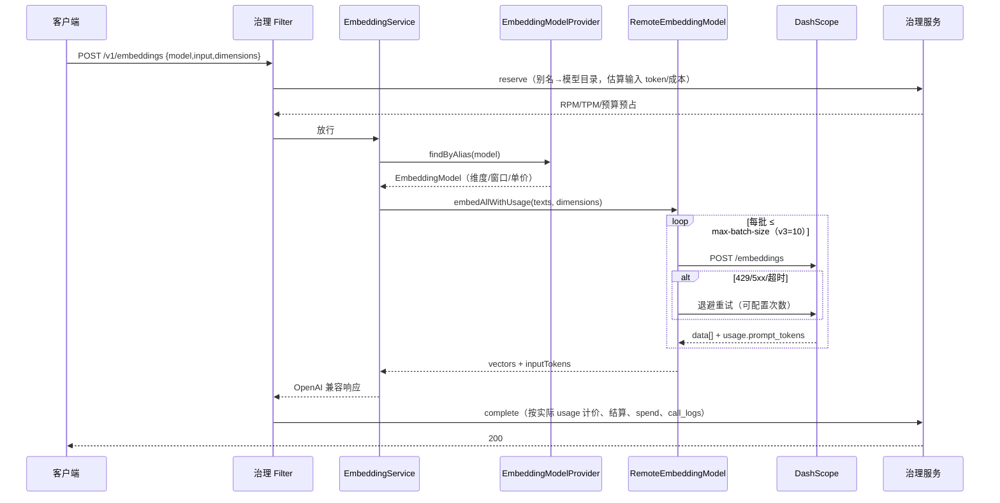

# REQ-3.7：Embedding 一等能力（阿里 text-embedding-v3）

- 日期：2026-11-12
- 状态：已完成
- 关联规格：生产化补强第 5 批简报（`task-20261111-pn0j3z`）
- 依赖需求：REQ-3.1、REQ-3.2、REQ-3.3、REQ-3.4
- 需求来源：主人验收反馈（ai-hub 对标企业生产级解决方案）
- 提交：<待回填>

## 1. 是什么

把 embedding 从“RAG 内部实现细节”提升为一等模型能力：模型目录支持多个 embedding 模型条目
（别名、供应商、真实模型、维度、最大输入 token、输入单价、base-url、API Key 环境变量），
默认接入阿里 DashScope `text-embedding-v3`（OpenAI 兼容模式）；新增 `/v1/embeddings` 统一入口，
与聊天共用同一套限流/预算/计价/计量/日志治理；RAG 索引/检索/回答产生的 embedding 成本写入
文档或调用成本字段，不再固定为 0。

## 2. 有什么用

- 业务价值：embedding 是 RAG 的成本与质量核心，必须可切换、可计量、可计价、可预算控制；
  阿里 v3 的 8192 token 窗口同时修复 all-minilm 256 token 下 800 字切片的截断缺陷。
- 对应参照行为：LiteLLM 的 embedding 通过同一 proxy 入口计量与计价；本项目沿用统一治理入口，
  不复制限流/预算/日志逻辑。
- 面试叙事点：模型目录端口化、OpenAI 兼容远端实现、批量/重试/超时/维度校验、供应商 usage 优先
  与本地估算兜底、RAG 内部成本归集、零填充兼容多维度 pgvector。

## 3. 怎么实现的

- 分层落点：
  - `common/rag`：扩展 `EmbeddingModel`（最大窗口、单价、带 usage 的批量接口）、
    `EmbeddingResult`、`EmbeddingModelProvider` 端口
  - `common/metering/EmbeddingTokenEstimator`：供应商无 usage 时的确定性估算规则
  - `common/config/RagProperties`：`gateway.rag.embedding.models.*` 模型目录（兼容旧单模型字段）
  - `integration/rag/RemoteEmbeddingModel`：OpenAI 兼容 `POST {base-url}/embeddings`
  - `integration/rag/ConfigurableEmbeddingModelProvider`：按目录构建模型并选出 RAG 主模型
  - `api` + `service` + `start`：`EmbeddingService` / `EmbeddingServiceImpl` /
    `EmbeddingController`（`POST /v1/embeddings`）
  - `start/filter/GatewayGovernanceFilter` + `service/gateway/GatewayGovernanceService`：
    新增 `CallTypes.EMBEDDING`，复用统一治理
  - `core/rag/RagIndexCore`、`RagRetrievalCore`：使用带 usage 的 embedding 并归集成本
  - `manager/rag/PgVectorStore`：向量列固定 1024，低维模型零填充后写入/检索
- 核心类（≤3）：`RemoteEmbeddingModel`、`ConfigurableEmbeddingModelProvider`、
  `GatewayGovernanceService`（EMBEDDING 分支）
- 请求链路（Mermaid）：



## 4. 影响面

> 实现前填写；分级门禁依据：`additive` 自动通过，`extension` / `breaking` 必须用户确认后动手。

```yaml
capability:
  type: cross-cutting      # 新增模型能力 + 复用统一治理；计价/计量/限流/日志仍由治理入口完成
  entry_point: "GatewayGovernanceFilter + GatewayGovernanceService；业务执行在 EmbeddingService/Core"
  interface_agnostic: true # 治理按 callType=EMBEDDING 分支，新增接口不复制治理逻辑
modules:
  add: [common/rag/EmbeddingResult, common/rag/EmbeddingModelProvider, common/metering/EmbeddingTokenEstimator, integration/rag/RemoteEmbeddingModel, integration/rag/ConfigurableEmbeddingModelProvider, integration/rag/EmbeddingModelConfig, api/EmbeddingService, api/model/req/EmbeddingReqDTO, api/model/res/EmbeddingResDTO, api/model/res/EmbeddingDataResDTO, api/model/res/EmbeddingUsageResDTO, service/EmbeddingServiceImpl, start/controller/EmbeddingController, dal/migration/V9__rag_vectors_dimension.sql]
  change: [common/rag/EmbeddingModel, common/config/RagProperties, common/constant/CallTypes, integration/rag/LangChain4jEmbeddingModel, integration/rag/DeterministicEmbeddingModel, core/rag/RagIndexCore, core/rag/RagRetrievalCore, core/rag/RagRetrievalResult, manager/rag/PgVectorStore, service/gateway/GatewayGovernanceService, service/gateway/model/GatewayContext, start/filter/GatewayGovernanceFilter, service/RagSearchServiceImpl, service/RagAnswerServiceImpl, api/model/res/RagSearchResDTO, api/model/res/RagAnswerResDTO, start/controller/RagSearchController, start/controller/RagAnswerController, ai-hub-start/src/main/resources/application.yml, ai-hub-tests/src/test/resources/application-test.yml, config/spotbugs-exclude.xml]
interfaces:
  add: ["POST /v1/embeddings"]
  change: []
  remove: []
tables:
  add: []
  change: [rag_vectors]
config: [gateway.rag.embedding.model, gateway.rag.embedding.models, gateway.rag.embedding.max-inputs, gateway.rag.embedding.provider, gateway.rag.embedding.model-id, gateway.rag.embedding.dimension, gateway.rag.embedding.batch-size, gateway.rag.embedding.max-retries, gateway.rag.embedding.retry-backoff-ms, gateway.rag.embedding.threads]
depends_on: [REQ-3.2, REQ-3.3, REQ-3.4]
nfr:
  resources: ["远端 embedding 使用 JDK HttpClient（连接超时 + 读超时），无应用自管常驻连接池；每个模型实例复用一个 RestClient", "本地 embedding 保留专用有界 ThreadPoolExecutor，Bean 销毁时关闭", "批次上限 max-batch-size（阿里 v3=10），单条文本受 max-input-tokens 约束", "pgvector 复用 Spring 数据源/MyBatis 连接池"]
  failure_modes:
    - "正常：按批调用 → 供应商 usage → 聚合向量与 token → 写索引/返回"
    - "超时/异常：按 max-retries 退避重试；仍失败抛中文上游错误，文档索引置 FAILED 可 reindex"
    - "进程崩溃：向量按 chunk_id 幂等覆盖；文档停在 PROCESSING 时可 reindex 重跑"
    - "机器崩溃：向量与状态在 PostgreSQL；远端模型无本地状态"
  metrics: ["call_logs.call_type=EMBEDDING + usage + cost", "rag_documents.embedding_cost（索引）", "call_logs.cost（RAG 检索/回答的 embedding 成本）", "本地模型线程池指标归每实例"]
compat: additive
gate: auto
# additive 说明：仅新增接口/配置/模型实现；rag_vectors 为内部派生数据表，V9 将向量列放宽到
# vector(1024)（低维模型零填充，cosine 语义不变），旧向量删除后由 reindex 重建，REST 契约不变。
regression: ["REQ-1.1~1.8 聊天/限流/预算/日志/容错/流式", "REQ-2.x MCP/Prompt", "REQ-3.1~3.6 RAG/记忆/MCP", "ARCH 依赖方向与无环"]
```

## 5. 关键决策

| 决策 | 理由 | 日期 |
|---|---|---|
| embedding 模型目录放在 `gateway.rag.embedding.models`，保留旧单模型字段兼容 | 单点配置、可切换多模型；测试仍可用确定性实现，不用改历史配置 | 2026-11-12 |
| 默认模型 `text-embedding-v3`（DashScope OpenAI 兼容） | 主人决策：接阿里云 API，不自托管；8192 token 窗口修复截断 | 2026-11-12 |
| v3 批量上限 10（官方文档确认），按 `max-batch-size` 拆分 | 超过 10 条会返回 InvalidParameter；配置化便于其他供应商 | 2026-11-12 |
| usage 优先取供应商 `usage.prompt_tokens`，缺失时按「CJK 1 字≈1 token，其他 4 字符≈1 token」估算 | 计量口径可解释；供应商 usage 为真源 | 2026-11-12 |
| 向量列固定 `vector(1024)`，低维模型零填充；cosine 距离不变 | 单列兼容 384/512/768/1024；避免每种维度建表；HNSW 索引保留 | 2026-11-12 |
| `/v1/embeddings` 复用统一治理（RPM/TPM/预算/计价/日志） | 横切治理统一入口，禁止为单接口复制逻辑 | 2026-11-12 |
| RAG 搜索/文档接口仍只做 RPM 预占，但记录 embedding 成本到 call_logs/文档 | 满足成本可观测；不改变既有预算语义 | 2026-11-12 |
| 无 API Key 时应用可启动，调用返回中文配置错误；真实联调列为待确认 | 不阻塞交付，测试用 MockWebServer/确定性模型 | 2026-11-12 |
| 上游响应结构/维度/JSON 非法标记为不可重试 | 重试无法修复响应级错误，只会放大延迟与配额消耗 | 2026-11-12 |

## 6. 执行摘要

> 每会话 1-2 行 + commit；详细过程留在对话、plan/tasks 与提交历史，不在此复制。

### 2026-11-12

- 进展：完成 embedding 模型目录、DashScope OpenAI 兼容远端实现、`/v1/embeddings` 统一治理、
  RAG embedding 成本回填与 pgvector 多维度兼容（V9）；新增 24 个测试。
- 提交：`<待回填>`（功能 + 文档）；`mvn -Pquality verify` 全绿（453 测试，0 失败/0 错误/0 跳过；
  Checkstyle 0、SpotBugs 0、覆盖率达标、ArchUnit 通过、pgvector Testcontainers 回归通过）。
- 真实联调：直连 DashScope `compatible-mode/v1/embeddings` 返回 401（环境 `DASHSCOPE_API_KEY`
  存在但被拒），列为主人待确认项；应用内远端调用由 MockWebServer 单测覆盖，不阻塞交付。

## 7. 复盘

- 做对了什么：模型目录端口化 + 旧配置兼容，测试仍用确定性模型；远端实现的批量/重试/维度/
  usage 解析都有 MockWebServer 覆盖；向量列用零填充兼容 384/512/768/1024，避免按维度建表。
- 踩了什么坑：测试 profile 与基础 `application.yml` 的 models 映射合并，导致确定性主模型未生效、
  误用远端 v3；远端响应非法被标记为可重试，触发无意义重试与超时；这些在全量测试才暴露。
- 下次改进：配置合并类问题先用启动日志确认 `primary/aliases`；响应级错误一律标记不可重试；
  新测试先跑单模块再全量。

## 8. 多实例检查

- [x] 是否有可变成员变量？模型实例不可变；provider 目录只读；无请求级成员状态。
- [x] 计数器/限流/预算/冷却是否在 Redis/数据库？复用现有 Redis 治理与预算计数。
- [x] 锁是否分布式？无新增锁；向量按 chunk_id 唯一幂等。
- [x] 定时任务是否只执行一次？无定时任务。
- [x] 本地缓存是否可容忍过期/不一致？无业务本地缓存；本地模型为只读资源。
