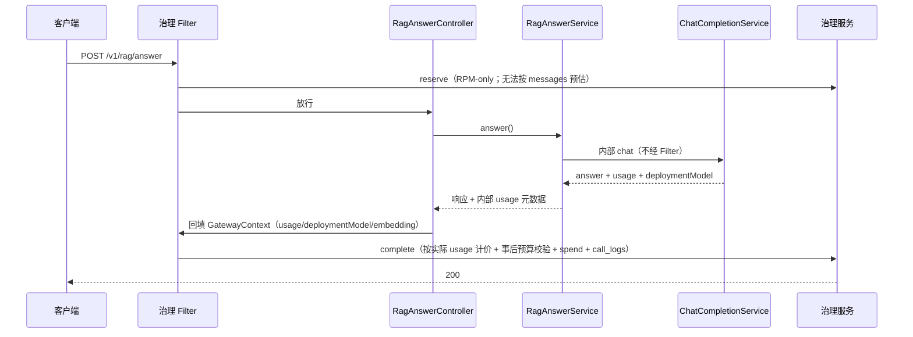

# REQ-3.8：计费与边界补强（RAG answer 计费 / chunk 推导 / 上传限制）

- 日期：2026-11-12
- 状态：已完成
- 关联规格：生产化补强第 5 批简报（`task-20261111-pn0j3z`）
- 依赖需求：REQ-3.4、REQ-3.7
- 需求来源：主人验收反馈（ai-hub 对标企业生产级解决方案）
- 提交：647f998

## 1. 是什么

修复三处生产化边界：① RAG answer 内部 chat 的 usage 与 deploymentModel 回填到治理上下文，
按实际 usage 计价、扣预算、累计 spend，不再出现 cost=0；② chunk 大小按 embedding 模型最大
输入窗口 × 0.8 安全系数推导并校验，避免超窗截断；③ 文档上传按文件类型差异化限制
（如 pdf 50MB / txt 20MB），默认保持 10MB 安全值，并同步说明 multipart 硬上限。

## 2. 有什么用

- 业务价值：RAG 是付费能力，回答必须真实计入成本与预算；切片大小与模型窗口匹配保证召回质量；
  上传限制防止大文件打爆内存与解析线程。
- 对应参照行为：LiteLLM 内部调用同样计量；本项目在统一治理层按实际 usage 事后结算。
- 面试叙事点：无法预估 token 的复合接口如何“入口 RPM + 事后结算”；模型窗口驱动的参数推导；
  分类型上传限制与 multipart 硬上限的分层。

## 3. 怎么实现的

- 分层落点：
  - `GatewayContext`：新增 embedding 用量/模型字段；RAG answer 回填 chat usage + deploymentModel
  - `GatewayGovernanceService`：`rag_answer` 按 chat usage + embedding 成本计价，事后预算校验并扣 spend；
    其他 RAG 接口保持 RPM 预占，仅记录 cost
  - `GatewayGuard` / `RedisRateLimiter`：新增事后预算扣减（检查上限 + 原子累计）
  - `RagAnswerServiceImpl` + `RagAnswerController`：回填 usage/deploymentModel/embedding 用量
  - `core/rag/RagChunkSettings`：按 embedding 窗口推导/校验 chunk 大小（warn/fail 可配置）
  - `core/rag/RagChunker`：使用解析后的有效 chunk 大小
  - `RagProperties.Upload` + `RagDocumentServiceImpl`：按扩展名解析上限
  - `application.yml`：上传类型上限、multipart 硬上限、chunk 自动推导配置
- 核心类（≤3）：`GatewayGovernanceService`、`RagChunkSettings`、`RagDocumentServiceImpl`
- 请求链路（Mermaid）：



## 4. 影响面

> 实现前填写；分级门禁依据：`additive` 自动通过，`extension` / `breaking` 必须用户确认后动手。

```yaml
capability:
  type: cross-cutting      # 计费/预算是横切治理；chunk/上传属于 RAG 业务校验
  entry_point: "GatewayGovernanceFilter + GatewayGovernanceService；RAG 业务校验在 Core/Service"
  interface_agnostic: true
modules:
  add: [core/rag/RagChunkSettings]
  change: [service/gateway/model/GatewayContext, service/gateway/GatewayGovernanceService, service/gateway/GatewayGuard, service/gateway/DefaultGatewayGuard, integration/ratelimit/RedisRateLimiter, service/RagAnswerServiceImpl, start/controller/RagAnswerController, core/rag/RagChunker, common/config/RagProperties, service/RagDocumentServiceImpl, ai-hub-start/src/main/resources/application.yml, ai-hub-tests/src/test/resources/application-test.yml, config/spotbugs-exclude.xml]
interfaces:
  add: []
  change: []
  remove: []
tables:
  add: []
  change: []
config: [gateway.rag.chunk.max-chars, gateway.rag.chunk.overflow-policy, gateway.rag.upload.max-size-bytes, gateway.rag.upload.type-limits, spring.servlet.multipart.max-file-size, spring.servlet.multipart.max-request-size]
depends_on: [REQ-3.4, REQ-3.7]
nfr:
  resources: ["RAG answer 内部 chat 复用现有 UpstreamClient/RestClient 与超时", "Redis 预算 counter 原子操作；故障保持 fail-open", "上传在 multipart 解析后按类型校验大小（受 multipart 硬上限约束）"]
  failure_modes:
    - "正常：answer 完成后回填 usage，治理计价/扣预算/写日志"
    - "超时/异常：内部 chat 失败走既有失败路径，治理释放 RPM 预占"
    - "进程崩溃：call_logs 异步写失败由既有兜底处理；预算 Redis 原子操作"
    - "机器崩溃：预算/限流在 Redis，跨实例一致"
  metrics: ["call_logs.cost/usage 含 RAG answer 实际用量", "rag_documents.embedding_cost", "chunk 越界启动 WARN/失败", "上传拒绝中文错误"]
compat: additive
gate: auto
regression: ["REQ-3.1 上传（默认 10MB 行为）", "REQ-3.3 检索 RPM-only", "REQ-3.4 回答链路", "REQ-1.4 预算/限流", "REQ-1.5 call_logs"]
```

## 5. 关键决策

| 决策 | 理由 | 日期 |
|---|---|---|
| RAG answer 采用「入口 RPM + 事后按实际 usage 结算/预算校验」 | answer 的 prompt 由检索结果动态拼装，进入前无法按 messages 预估 token；先保住 RPM 防滥用，事后按真实用量结算 | 2026-11-12 |
| 检索/文档接口保持 RPM-only | 与既有语义一致，避免对文档操作引入预算拒绝；embedding 成本仍记录到 call_logs/文档供观测 | 2026-11-12 |
| 事后预算扣减采用“检查上限 + 无条件原子累计” | 响应已成功，不能回滚；但必须让后续请求看到真实 spend，避免预算持续被穿透 | 2026-11-12 |
| chunk 默认 max-chars=0 表示按模型窗口自动推导：`min(800, floor(maxInputTokens×0.8))` | 中文按 1 字≈1 token；v3 下推导为 800，本地 256 token 下推导为 204，修复截断 | 2026-11-12 |
| chunk 越界策略可配置 warn/fail，默认 warn | 生产可逐步收紧；本地小模型历史配置不阻断启动 | 2026-11-12 |
| 上传限制按扩展名配置，默认 10MB 兜底；multipart 硬上限设为最大类型值 | 业务限制在 Service 精确执行；multipart 只做防打爆硬边界 | 2026-11-12 |

## 6. 执行摘要

> 每会话 1-2 行 + commit；详细过程留在对话、plan/tasks 与提交历史，不在此复制。

### 2026-11-12

- 进展：RAG answer 回填内部 chat usage/deploymentModel 与查询 embedding 用量，治理层按实际成本
  计价、事后预算校验并累计 spend；chunk 按模型窗口自动推导/校验；上传限制按扩展名差异化。
- 提交：`647f998`（功能 + 文档）；`mvn -Pquality verify` 全绿（453 测试，0 失败/0 错误/0 跳过）。
- 验证：`RagAnswerIntegrationTest` 断言 `call_logs` 记录 chat usage/cost 与 upstream deployment；
  `GatewayGovernanceServiceTest` 覆盖 answer/检索的计价与预算分支；`RagChunkSettingsTest` 覆盖
  800/204 推导与 warn/fail；`RagDocumentServiceTest` 覆盖类型上限。

## 7. 复盘

- 做对了什么：把“无法预估 token”的复合接口拆成入口 RPM + 事后实际结算；事后预算用
  “检查上限 + 无条件累计”避免预算被持续穿透；chunk 推导同时兼容 v3 与本地小窗口。
- 踩了什么坑：`RagAnswerResDTO` 增加内部字段需要兼容构造器，否则历史测试全量编译失败；
  维度校验加入后，测试 mock 的 dimension 默认 0 触发误报，需要显式 stub。
- 下次改进：内部计量字段优先用独立结果对象而不是响应 DTO；mock 依赖新增方法时先补默认 stub。

## 8. 多实例检查

- [x] 是否有可变成员变量？RagChunkSettings 只读；治理上下文为请求级。
- [x] 计数器/限流/预算/冷却是否在 Redis/数据库？复用 Redis 预算计数器与 Lua 原子脚本。
- [x] 锁是否分布式？无新增锁。
- [x] 定时任务是否只执行一次？无定时任务。
- [x] 本地缓存是否可容忍过期/不一致？无新增本地缓存。
