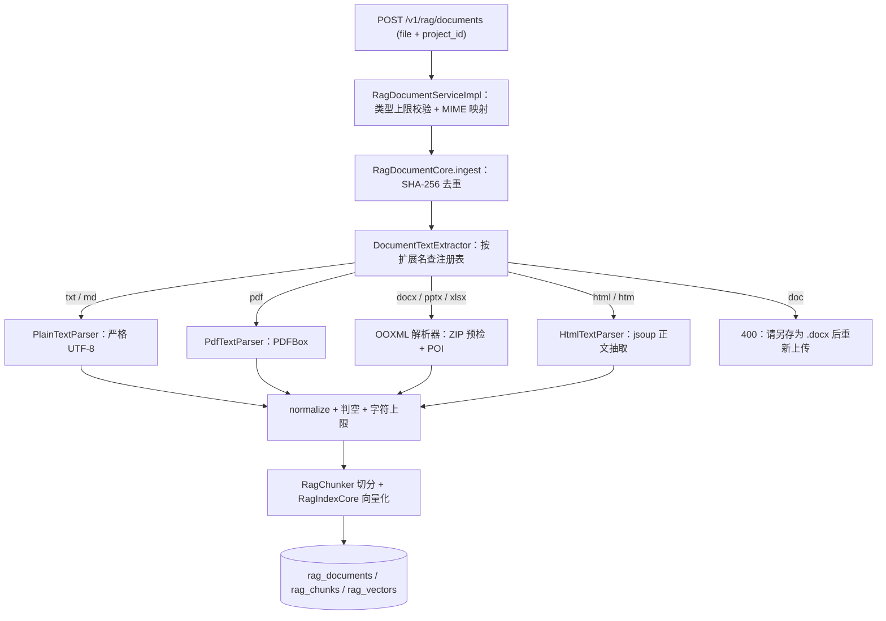

# REQ-3.9：文档解析扩展（docx / pptx / xlsx / html）

- 日期：2026-11-12
- 状态：已完成
- 关联规格：生产化补强第 6 批简报（`task-20261111-pn0j3z`）
- 依赖需求：REQ-3.1、REQ-3.8
- 需求来源：主人验收反馈（ai-hub 对标企业生产级解决方案）
- 提交：待回填

## 1. 是什么

把 RAG 文档接入从「txt / md / pdf」扩展到企业常见办公文档：`.docx`（Word）、`.pptx`（PowerPoint）、
`.xlsx`（Excel）、`.html` / `.htm`。现有文本提取器改造为「格式 → 解析器」注册表，新增格式只需增加
一个解析器 Bean；老 `.doc` 明确拒绝并给出「另存为 .docx」的中文指引。

## 2. 有什么用

- 业务价值：知识库的真实语料大量来自 Office 文档与网页；缺解析能力会让 RAG 只能吃纯文本，
  无法落地企业场景。
- 对应参照行为：企业 RAG 平台（Dify / FastGPT / LangChain 文档加载器）均内置 Office/HTML 解析；
  本期补齐这一层，并同步落实解压炸弹、加密文档、超大表格等安全边界。
- 面试叙事点：解析器插件化（开闭原则）、OOXML 解压炸弹双层防护、POI 全量 DOM 与限制策略、
  HTML 正文抽取与编码探测、解析失败的 400 中文错误与 FAILED 文档留存。

## 3. 怎么实现的

- 分层落点：
  - `integration/rag`：`DocumentTextExtractor` 保留公开方法，内部改为注册表 + 统一归一化/判空/字符上限
  - `integration/rag/parse`：`DocumentTextParser` 接口、`ParseLimits`、`LimitPolicy`、
    `DocumentFormatDetector`、`PlainTextParser`、`PdfTextParser`、`DocxTextParser`、
    `PptxTextParser`、`XlsxTextParser`、`HtmlTextParser`、`PoiSecurityConfig`
  - `common/config/RagProperties`：新增 `gateway.rag.parse.*` 限制配置
  - `service/RagDocumentServiceImpl`：新增 OOXML/HTML 的 MIME 映射
  - `ai-hub-start` / `ai-hub-tests`：`application.yml` / `application-test.yml` 上传类型上限与解析限制
- 核心类（≤3）：`DocumentTextExtractor`、`DocxTextParser`、`XlsxTextParser`
- 请求链路（Mermaid）：



- OOXML 预检：`DocumentFormatDetector` 把字节写入临时文件，用 `ZipFile` 读中央目录统计条目数与
  声明解压大小，再按 `word/document.xml` / `ppt/presentation.xml` / `xl/workbook.xml` 识别子类型；
  声明大小可伪造，实际解压由 POI `ZipSecureFile` 全局限制兜底。
- 加密文档：加密 OOXML 是 OLE2 容器（不是 ZIP），预检通过 `EncryptionInfo` / `EncryptedPackage`
  条目识别后返回中文错误，避免被误判为「老 .doc 改名」。
- 字符上限：门面统一执行 `gateway.rag.parse.max-chars`；默认 `fail`，可配置 `truncate`。

## 4. 影响面

> 实现前填写；分级门禁依据：`additive` 自动通过，`extension` / `breaking` 必须用户确认后动手。

```yaml
capability:
  type: business
  entry_point: "Integration/DocumentTextExtractor（解析能力）；上传限制在 Service，治理仍在 GatewayGovernanceFilter"
  interface_agnostic: true
modules:
  add:
    - integration/rag/parse/DocumentTextParser
    - integration/rag/parse/ParseLimits
    - integration/rag/parse/DocumentFormatDetector
    - integration/rag/parse/PlainTextParser
    - integration/rag/parse/PdfTextParser
    - integration/rag/parse/DocxTextParser
    - integration/rag/parse/PptxTextParser
    - integration/rag/parse/XlsxTextParser
    - integration/rag/parse/HtmlTextParser
    - integration/rag/parse/PoiSecurityConfig
  change:
    - integration/rag/DocumentTextExtractor
    - common/config/RagProperties
    - service/RagDocumentServiceImpl
    - ai-hub-start/src/main/resources/application.yml
    - ai-hub-tests/src/test/resources/application-test.yml
    - ai-hub-integration/pom.xml
    - pom.xml
    - config/spotbugs-exclude.xml
interfaces:
  add: []
  change: []
  remove: []
tables:
  add: []
  change: []
config:
  - gateway.rag.parse.max-chars
  - gateway.rag.parse.max-rows-per-sheet
  - gateway.rag.parse.max-cells-per-sheet
  - gateway.rag.parse.max-sheets
  - gateway.rag.parse.max-columns
  - gateway.rag.parse.max-table-rows
  - gateway.rag.parse.max-table-cells
  - gateway.rag.parse.max-slides
  - gateway.rag.parse.max-shapes-per-slide
  - gateway.rag.parse.max-zip-entries
  - gateway.rag.parse.max-zip-entry-bytes
  - gateway.rag.parse.max-zip-total-bytes
  - gateway.rag.parse.include-headers-footers
  - gateway.rag.parse.include-notes
  - gateway.rag.parse.limit-policy
  - gateway.rag.upload.type-limits.pptx
  - gateway.rag.upload.type-limits.xlsx
  - gateway.rag.upload.type-limits.html
  - gateway.rag.upload.type-limits.htm
depends_on: [REQ-3.1, REQ-3.8]
nfr:
  resources:
    - "POI 解析持有 OPCPackage / XWPFDocument / XMLSlideShow / XSSFWorkbook，均 try-with-resources 关闭"
    - "ZIP 预检使用临时文件 + java.util.zip.ZipFile 读中央目录，finally 删除；进程崩溃残留由系统临时目录清理"
    - "POI 全局 ZipSecureFile 限制：minInflateRatio=0.01、单条目 64MB、文本节点 10M 字符、内存字节数组上限 256MB"
    - "无新增线程池/常驻连接；解析为请求内同步执行"
  failure_modes:
    - "正常：格式检测 → 解析 → 归一化 → 返回文本"
    - "超时/异常：外部库异常统一转 DocumentParseException；文档落 FAILED 并返回 400 中文错误"
    - "进程崩溃：解析无外部资源租约；临时文件残留由系统清理；已落库文档可 reindex"
    - "机器崩溃：文档与切片在 PostgreSQL；无单机状态"
  metrics:
    - "日志只记录文件名/大小/格式/耗时/字符数/超限项，不记录正文"
    - "解析失败在 rag_documents.error_message 留存截断后的中文原因"
compat: additive
gate: auto
regression:
  - "REQ-3.1 上传/切分/去重/删除级联/解析失败留存"
  - "REQ-3.2 索引与向量存储"
  - "REQ-3.3 检索"
  - "REQ-3.4 回答"
  - "REQ-3.7 embedding 计量"
  - "REQ-3.8 上传类型限制"
```

## 5. 关键决策

| 决策 | 理由 | 日期 |
|---|---|---|
| 保留 `DocumentTextExtractor` 公开契约，内部改注册表 | `RagDocumentCore` / `RagDocumentServiceImpl` 无需改动；新增格式只加一个 Bean（开闭原则） | 2026-11-12 |
| 依赖 POI 6.0.0（`poi-ooxml` + `poi-ooxml-full`）与 jsoup 1.24.1 | 按调研设计版本；full 覆盖少见 schema；不引入 `poi-scratchpad`（老格式不做） | 2026-11-12 |
| `.doc` / `.xls` / `.ppt` 明确拒绝并给另存为指引 | 旧二进制解析质量差、OLE2 攻击面大；错误文案直接告诉用户下一步 | 2026-11-12 |
| ZIP 预检用临时文件 + `ZipFile` 读中央目录 | Java 标准库无法从字节流直接读中央目录；临时文件避免预检阶段解压，条目数/声明大小可前置拒绝 | 2026-11-12 |
| OOXML 预检 + POI `ZipSecureFile` 双层防护 | 中央目录声明大小可被伪造；POI 全局限制兜底实际解压 | 2026-11-12 |
| 加密 OOXML 在 OLE2 层识别（`EncryptionInfo`） | 加密 OOXML 不是 ZIP，若只按 ZIP 检测会误报「不是有效 docx」 | 2026-11-12 |
| 超限策略默认 `fail`，可配置 `truncate` | 知识库场景避免「看起来成功但内容不完整」；截断必须 WARN 并带标记 | 2026-11-12 |
| 页眉页脚默认包含、PPT 备注默认不包含 | 页眉页脚常含标题/页码等上下文；备注容易污染正文 | 2026-11-12 |
| 不做解析超时 | POI 内部不保证响应中断，超时线程无法可靠回收；上限（字符/行/列/页）已覆盖主要风险 | 2026-11-12 |
| HTML 优先 `article` / `main`，否则 `body` | 去除导航/页脚/广告；本期不做 Readability 算法 | 2026-11-12 |
| 不额外设置全局 JAXP 外部实体属性 | JDK 21 默认禁用外部 DTD/实体，POI/XmlBeans 不解析外部实体；设置全局属性会波及其他组件 | 2026-11-12 |
| xlsx 使用 `DataFormatter(Locale.CHINA)` + 缓存值 | 公式单元格直接取值会抛异常；按显示格式输出对 RAG 更可读 | 2026-11-12 |

## 6. 执行摘要

> 每会话 1-2 行 + commit；详细过程留在对话、plan/tasks 与提交历史，不在此复制。

### 2026-11-12

- 进展：完成解析器插件化（6 个解析器 + 格式检测 + 解析限制）与 docx/pptx/xlsx/html 提取；
  `.doc` 拒绝并给出另存为指引；OOXML 解压预检与 POI 全局安全限制；配置、MIME 映射、上传类型上限同步。
- 提交：`b2dca87`；`mvn -Pquality verify` 全绿（432 测试，0 失败/0 错误/0 跳过；新增 26）。
- 验证：`DocumentTextExtractorTest` 16 例、`DocumentParseSecurityTest` 8 例、
  `RagDocumentIntegrationTest` 新增 docx 端到端与 `.doc` 文案用例。

## 7. 复盘

- 做对了什么：预检只读 ZIP 中央目录，不在解析前解压；加密 OOXML 在 OLE2 层单独识别；
  格式检测与解析器分层，门面契约不变，回归成本低。
- 踩了什么坑：`ZipOutputStream` 与 `ByteArrayOutputStream` 同时 try-with-resources 时 `return` 在
  资源关闭前求值，测试拿到不完整 ZIP；POI 6 的幻灯片备注 API 是 `getNotes()` 而非
  `getNotesSlide()`；解析限制在门面构造时冻结，测试修改配置后必须重建门面。
- 下次改进：二进制夹具先在 helper 中关闭流再取字节；POI API 变动先用 `javap` 确认；
  涉及构造期配置的测试同步重建被测对象。

## 8. 多实例检查

- [x] 是否有可变成员变量？解析器无状态；门面只保存不可变 Map 与 ParseLimits record。
- [x] 计数器/限流/预算/冷却是否在 Redis/数据库？无新增计数；上传治理沿用统一入口。
- [x] 锁是否分布式？无新增锁。
- [x] 定时任务是否只执行一次？无定时任务。
- [x] 本地缓存是否可容忍过期/不一致？无本地缓存；ZIP 临时文件为请求级并在 finally 删除。
