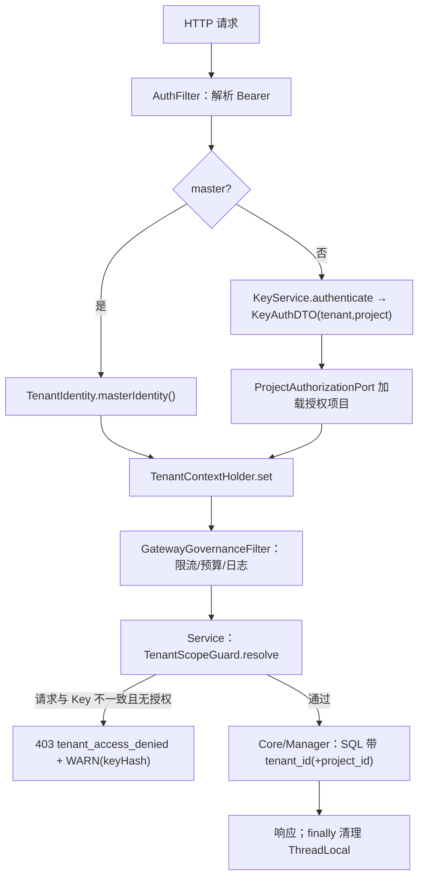

# REQ-4.1：多租户贯穿与隔离

- 日期：2026-11-16
- 状态：已完成（待主人验收）
- 关联规格：`13-项目7-第4期-治理收尾.md` REQ-4.1 + 三期验收遗留第 1/2/3 项
- 依赖需求：REQ-1.3、REQ-2.1、REQ-2.4、REQ-3.1~3.5
- 提交：e64a6d3

## 1. 是什么

把「Key 只是一个额度凭证」升级为「Key 是租户边界的唯一来源」：

- 虚拟 Key 绑定 `(tenant_id, project_id)`；请求参数里的 `tenant_id/project_id` 只做显式声明校验，
  不一致直接 403，永不覆盖 Key 绑定。
- 所有租户资源（RAG 文档/切片/向量、记忆、Prompt、MCP Server、调用日志）查询强制带
  `tenant_id`（必要时再加 `project_id`）；RAG 向量检索同样先按租户/项目过滤再排序。
- 跨项目共享改为显式授权表 `project_authorizations`（project 级，默认隔离）；授权后同租户
  项目可读写记忆/知识库。
- 模型别名与部署实例从 YAML 迁到数据库：`model_aliases` / `model_deployments` /
  `model_alias_deployments` / `model_alias_keys`；启动时若库为空从 YAML 灌入一次。
- 调用日志补 `tenant_id/project_id/trace_id`，为 4.3 用量与 4.4 管理端提供隔离维度。

## 2. 有什么用

- 业务价值：AI 中台对外复用的前提是「A 租户的 Key 拿不到 B 租户的任何东西」。此前
  `MemoryRecallReqDTO.tenant_id/project_id/user_id` 全部来自请求体，只要知道别人的 tenant/project
  就能读；本期从鉴权源头堵住这个口子。
- 对应参照行为：LiteLLM Teams/Keys 的团队边界；企业多租户 SaaS 的「Key 绑定作用域 +
  服务端派生上下文」模式。
- 面试叙事点：租户上下文从哪来（Key），为什么不信任请求参数，越权为什么用 403，
  过滤器/ThreadLocal/MDC 的清理，授权表与默认隔离的取舍，YAML 配置迁 DB 后的多实例一致性。

## 3. 怎么实现的

- 分层落点：
  - `common/tenant`：`TenantIdentity`（Key 绑定 + 授权项目）、`TenantContextHolder`
    （请求级 ThreadLocal）、`TenantScopeGuard`（解析/校验/403 + WARN 日志）、
    `ProjectAuthorizationPort`
  - `start/filter/AuthFilter`：鉴权成功后写入 `TenantContextHolder`，虚拟 Key 加载授权项目；
    请求结束 `finally` 清理；`/v1/admin*`、`/v1/audit-logs` 对虚拟 Key 返回 403
  - `service`：Memory / RAG 文档 / RAG 检索 / Prompt / MCP 服务在入口处调用
    `TenantScopeGuard`，把生效 `tenant_id/project_id` 传给 core/manager
  - `dal`：V10 迁移 + Mapper 租户条件；`ProjectAuthorizationMapper`；`ModelCatalogMapper`
  - `manager`：`DbModelCatalog`（@Primary）每次请求读库，多实例一致；`ModelCatalogSeeder`
    在空库时从 YAML 灌入；`SecretCipher` 加密上游凭证（AES-256-GCM）
- 核心类（≤3）：`TenantScopeGuard`、`AuthFilter`、`DbModelCatalog`
- 请求链路（Mermaid）：



- 默认作用域：新 Key 未显式传 `tenant_id/project_id` 时绑定 `default/default`；历史未绑定 Key
  访问租户资源返回 403（禁止「默认全局可见」）。
- 主数据面：RAG 文档去重唯一键改为 `(tenant_id, project_id, content_hash)`；Prompt/MCP 名称
  唯一键改为租户内唯一；向量检索 SQL 先 `tenant_id + project_id` 过滤再 cosine 排序。
- 模型目录：读路径每请求联表查询（数据量小、换取多实例一致）；写路径由 4.4 管理 API 负责。
  `gateway.catalog-seed-mode`：`init`（生产，仅空库灌入）/`refresh`（测试，按 YAML 覆盖）。

## 4. 影响面

```yaml
capability:
  type: cross-cutting
  entry_point: "AuthFilter + TenantScopeGuard（统一入口/切面，接口无关）"
  interface_agnostic: true
modules:
  add: [common/tenant, common/crypto, manager/catalog/DbModelCatalog, manager/catalog/ModelCatalogManager,
        manager/catalog/ModelCatalogSeeder, manager/tenant, dal mapper (ProjectAuthorization/ModelCatalog)]
  change: [AuthFilter, MemoryService, RAG Service/Core, Prompt Service/Chat, MCP Services,
           KeyService/KeyAuthDTO/ApiKeyMapper, GatewayGovernanceService, application(-test).yml]
interfaces:
  add: []
  change:
    - "POST /key/generate：可选 tenant_id/project_id；响应回显绑定"
    - "GET /v1/prompts：按调用方租户过滤；Prompt render/chat 按租户解析"
tables:
  add: [tenants, projects, project_authorizations, model_aliases, model_deployments,
        model_alias_deployments, model_alias_keys]
  change: [api_keys(+tenant_id,project_id), call_logs(+project_id,trace_id),
           rag_documents/rag_chunks/rag_vectors(+tenant_id), prompt_templates/mcp_servers(租户内唯一)]
config:
  - gateway.secret-key
  - gateway.catalog-seed-mode
depends_on: [REQ-1.3, REQ-2.1, REQ-2.4, REQ-3.1, REQ-3.2, REQ-3.5]
nfr:
  resources:
    - "无新增线程池/连接池；模型目录读为单表/联表短查询"
    - "ThreadLocal 在请求 finally 清理，避免线程复用串租户"
  failure_modes:
    - "正常：Key → 上下文 → SQL 过滤 → 响应"
    - "越权：403 + WARN(keyHash/请求值/绑定值)，不泄露对方是否存在"
    - "数据库异常：鉴权失败返回 500，不静默放行"
    - "多实例：目录读库；授权表持久化，无单机状态"
  metrics:
    - "越权 WARN 日志含 keyHash 与作用域；调用日志落 tenant_id/project_id"
compat: extension
gate: confirmed
regression:
  - "REQ-1.3 Key 生成/封禁/白名单"
  - "REQ-2.x MCP / Prompt"
  - "REQ-3.x RAG / 记忆"
```

## 5. 关键决策

| 决策 | 理由 | 日期 |
|---|---|---|
| 租户上下文用 ThreadLocal，入口写入、finally 清理 | 不改动全部 Service 签名；过滤器是唯一可靠入口；异步线程不继承，避免误用 | 2026-11-16 |
| 请求声明与 Key 冲突直接 403，不静默覆盖 | 静默覆盖会掩盖调用方错误，也让越权尝试不可见；403 + WARN 可审计 | 2026-11-16 |
| 未绑定 Key 禁止访问租户资源 | 「默认全局可见」是多租户事故根源；历史 Key 需管理员重新签发 | 2026-11-16 |
| 跨项目共享用授权表而非配置开关 | 配置开关仍需要“谁能跨”，授权表可审计、可撤销、按项目粒度 | 2026-11-16 |
| 模型目录每请求读库 | 配置量小；DB 为多实例唯一真源，避免本地缓存不一致 | 2026-11-16 |
| 上游凭证 AES-256-GCM，密钥缺失时弱编码 + WARN | 生产要求密文；本地无密钥不阻断启动，但显式告警 | 2026-11-16 |
| 测试库按上下文随机命名（`aihub-${random.uuid}`） | 多 Spring 上下文共享同一 H2 会让 DB 目录指向已关闭的 MockWebServer | 2026-11-16 |

## 6. 执行摘要

- 2026-11-16：V10 迁移（租户/项目/授权/模型目录）、AuthFilter 上下文、Memory/RAG/Prompt/MCP
  租户过滤、模型目录 DB 化与种子、租户隔离集成测试 6 例；`mvn test` 全绿。
- 提交：e64a6d3。

## 7. 复盘

- 上下文只放入口过滤器，Service 依赖 `TenantScopeGuard`；单元测试用兼容构造器注入无上下文守卫，
  避免为隔离改造重写全部单测。
- 共享 H2 + DB 目录导致跨测试类污染，用随机库名从根上隔离，比在每个测试里清表更可靠。
- 遗留：日志/用量查询的租户过滤在 4.3/4.4 的管理 API 暴露；别名 CRUD 在 4.4。

## 8. 多实例检查

- 目录、Key、授权、日志均在 DB；无本地业务状态。
- ThreadLocal 仅请求生命周期；异步日志线程不回读上下文。
- 目录种子并发启动由 `alias` 唯一约束兜底。
