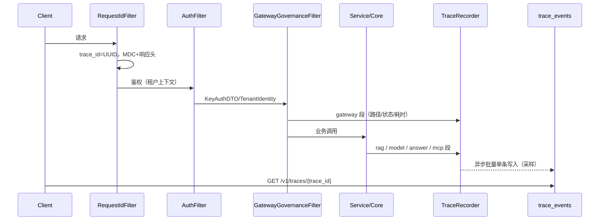

# REQ-4.2：全链路 Trace

- 日期：2026-11-16
- 状态：已完成（待主人验收）
- 关联规格：`13-项目7-第4期-治理收尾.md` REQ-4.2
- 依赖需求：REQ-1.5、REQ-2.3、REQ-3.4、REQ-4.1
- 提交：4f08a79

## 1. 是什么

一次请求的 `request_id` 同时作为 `trace_id`：入口生成，写 MDC 与响应头 `X-Trace-Id`；
网关、模型、RAG、MCP、回答各段把摘要异步写入 `trace_events`；`GET /v1/traces/{trace_id}`
按时间顺序返回分段事件。虚拟 Key 只能看到自己租户的 trace。

## 2. 有什么用

- 排障：一次 RAG 回答能同时看到入口耗时、召回命中、模型用量、引用 id，不用在多个日志文件里拼。
- 对应参照行为：LiteLLM Logs/Audit 的请求轨迹；OpenTelemetry 的 span 语义。
- 面试叙事点：MDC 与异步线程、采样、trace 与 request_id 的关系、分段事件的字段设计、
  为什么先写库聚合而不是强依赖外部 APM。

## 3. 怎么实现的

- 分层：
  - `common/trace`：`TraceEvent`、`TraceRecorder`（含 `NOOP`）
  - `start/filter/RequestIdFilter`：MDC `request_id/trace_id`，响应头 `X-Request-Id`/`X-Trace-Id`
  - `service/TraceRecorderImpl`：按 trace_id 确定性采样、`traceExecutor` 异步写、饱和兜底同步
  - `start/config/TraceExecutorConfig`：`ThreadPoolExecutor(2,4,60s,ArrayBlockingQueue(2000))`
  - 记录点：`GatewayGovernanceFilter`（gateway）、`GatewayGovernanceService`（model）、
    `RagSearchServiceImpl`（rag）、`RagAnswerServiceImpl`（model+answer）、`McpCallServiceImpl`（mcp）
  - `service/TraceServiceImpl` + `TraceController`：`GET /v1/traces/{traceId}`，租户过滤
  - V11 `trace_events`：trace_id/tenant/project/key/segment/name/status/latency/payload
- 核心类：`TraceRecorderImpl`、`TraceServiceImpl`、`GatewayGovernanceFilter`
- 链路（Mermaid）：



- 采样：按 `trace_id.hashCode` 取模，同一 trace 的所有段同留同弃；`gateway.trace.sample-rate` 默认 1.0。
- 字段：payload 只存摘要（查询长度、chunk id/score、tokens、cost、引用 id），不存正文与密钥。
- 失败：写入异常只打 ERROR，不影响业务；`NOOP` 实现便于单测。

## 4. 影响面

```yaml
capability:
  type: cross-cutting
  entry_point: "RequestIdFilter + TraceRecorder（接口无关）"
  interface_agnostic: true
modules:
  add: [common/trace, service/TraceRecorderImpl, service/TraceServiceImpl, start/config/TraceExecutorConfig,
        start/controller/TraceController, dal TraceEventMapper]
  change: [RequestIdFilter, GatewayGovernanceFilter, GatewayGovernanceService,
           RagSearchServiceImpl, RagAnswerServiceImpl, McpCallServiceImpl]
interfaces:
  add: ["GET /v1/traces/{traceId}"]
  change: ["响应头新增 X-Trace-Id（与 X-Request-Id 同值）"]
tables:
  add: [trace_events]
  change: []
config:
  - gateway.trace.sample-rate
depends_on: [REQ-1.5, REQ-2.3, REQ-3.4, REQ-4.1]
nfr:
  resources:
    - "traceExecutor：核心 2/峰值 4、队列 2000、守护线程；Spring 关闭时 shutdown"
    - "单事件单行写入；payload 只存摘要，避免大对象"
  failure_modes:
    - "正常：各段异步落库，查询按 id 升序"
    - "队列饱和：调用线程同步兜底"
    - "写库失败：ERROR 日志，业务不受影响"
    - "重启：事件已持久化；trace_id 由入口生成，不依赖内存"
  metrics:
    - "trace_events 行数可按 tenant/created_at 聚合；采样率配置可查"
compat: additive
gate: auto
regression:
  - "REQ-1.5 调用日志"
  - "REQ-2.3 MCP 调用"
  - "REQ-3.4 RAG 回答"
```

## 5. 关键决策

| 决策 | 理由 | 日期 |
|---|---|---|
| trace_id 复用 request_id | 现有 Filter/日志已贯通 request_id，避免双 ID 体系 | 2026-11-16 |
| 按 trace 确定性采样 | 逐事件随机会把一次请求的段采样成残缺轨迹 | 2026-11-16 |
| 写 DB 聚合而非强依赖 OTel | 本期以可查询为主；`TraceRecorder` 端口为后续接入 OTel 留扩展点 | 2026-11-16 |
| 采样/写入失败不阻断业务 | 排障数据不能反过来影响可用性 | 2026-11-16 |

## 6. 执行摘要

- 2026-11-16：V11、RequestId 双头、TraceRecorder 异步/采样、5 个分段记录点、Trace 查询 API；
  新增 `TraceIntegrationTest`（RAG 全分段 + 跨租户 404）与 `McpCallServiceTraceTest`。
- 提交：4f08a79。

## 7. 复盘

- 分段字段先定 payload 摘要口径，避免把 prompt/正文写进 trace。
- 异步写入沿用日志的「饱和同步兜底」思路，响应耗时不受影响。
- 遗留：TTFT 需流式链路回填；本期模型段记录 tokens/cost/耗时，TTFT 在后续流式增强中接入。

## 8. 多实例检查

- 事件持久化在 DB；无本地状态。
- 采样按 trace_id 确定性计算，多实例一致。
- 线程池为本地资源，指标归属每实例。
