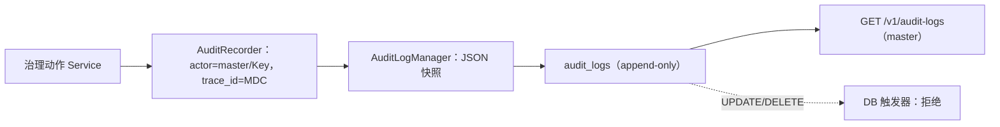

# REQ-4.5：审计日志 + 项目总验收

- 日期：2026-11-16
- 状态：已完成（待主人验收）
- 关联规格：`13-项目7-第4期-治理收尾.md` REQ-4.5 + 四期毕业验收
- 依赖需求：REQ-4.1~4.4
- 提交：45afd42

## 1. 是什么

新增只追加的 `audit_logs`：治理动作（Key 生成/封禁/解封、Prompt 发布、MCP 注册/注销、
模型别名与部署变更、项目授权）写 `actor/action/target/before/after/trace_id/created_at`；
`GET /v1/audit-logs` 仅 master 可查，支持动作/目标/租户/时间与分页。
同时产出项目 7 总验收材料：白板、差异对照 ≥10 条、失败演示 ≥5 个、3 分钟讲述稿
（见 `acceptance/REQ-4.5.md`）。

## 2. 有什么用

- 治理动作必须可追溯：谁在什么时候把哪个 Key 封了、哪个 Prompt 发布了、给谁授权了。
- 对应参照行为：LiteLLM Audit Logs；企业合规要求「不可篡改 + 可检索」。
- 面试叙事点：只追加表的实现（无 update/delete + DB 触发器）、脱敏快照、trace 关联、
  审计与业务动作的一致性、保留周期。

## 3. 怎么实现的

- 分层：
  - V13 `audit_logs` + PostgreSQL `BEFORE UPDATE OR DELETE` 触发器（H2 测试不做触发器）
  - `common/audit/AuditRecorder` + `service/AuditRecorderImpl`：actor 由上下文派生
    （master/Key 哈希），trace_id 取 MDC；失败只打日志
  - `manager/audit/AuditLogManager`：JSON 快照编解码，只有 append/查询
  - `service/AuditQueryServiceImpl` + `AuditLogController`：`GET /v1/audit-logs`（master）
  - 记录点：KeyService（生成/封禁/解封）、PromptService（发布/回滚）、McpServerService
    （注册/注销）、AdminService（别名/部署/项目授权/Key 封禁）
- 核心类：`AuditRecorderImpl`、`AuditLogManager`、`V13__audit_logs.sql`
- 链路（Mermaid）：



- 脱敏：before/after 只放业务标识/状态（blocked、name、version、serverId、alias、
  source/target），绝不放明文 Key 或上游 api-key。
- 不可篡改：Mapper 只声明 insert/select；PostgreSQL 触发器拒绝更新/删除。
- 保留周期：`gateway.audit.retention-days` 配置预留（默认 365）；本期不自动清理，
  由运维按合规策略执行（清理也应走受控流程）。

## 4. 影响面

```yaml
capability:
  type: cross-cutting
  entry_point: "AuditRecorder（接口无关）+ AuditLogController（master）"
  interface_agnostic: true
modules:
  add: [common/audit, service/AuditRecorderImpl, service/AuditQueryServiceImpl,
        start/AuditLogController, manager/audit, dal AuditLogMapper/DO, DTOs]
  change: [KeyService, PromptService, McpServerService, AdminService, AuthFilter(已有 4.4),
           application.yml]
interfaces:
  add: ["GET /v1/audit-logs"]
  change: []
tables:
  add: [audit_logs（含 PostgreSQL 不可变触发器）]
  change: []
config:
  - gateway.audit.retention-days
depends_on: [REQ-4.1, REQ-4.2, REQ-4.4]
nfr:
  resources:
    - "单行追加；无新增线程池"
  failure_modes:
    - "正常：动作完成即写审计"
    - "审计写失败：ERROR 日志，业务不回滚（可人工补录）"
    - "非 master 查询：403"
    - "篡改：DB 触发器报错"
  metrics:
    - "audit_logs 按 action/tenant/时间可聚合"
compat: additive
gate: auto
regression:
  - "REQ-1.3 Key 管理"
  - "REQ-2.1/2.4 MCP/Prompt 管理"
  - "REQ-4.1/4.4 租户与管理面"
```

## 5. 关键决策

| 决策 | 理由 | 日期 |
|---|---|---|
| 只追加，无 update/delete API | 审计价值在于不可篡改；应用层根本不应有篡改入口 | 2026-11-16 |
| PostgreSQL 触发器兜底 | 应用层约束可被新代码绕过，DB 层是最后一道闸 | 2026-11-16 |
| 审计写失败不回滚业务 | 治理动作（如封禁）不应因为日志失败而失效；记录 ERROR 供补录 | 2026-11-16 |
| 快照脱敏 | before/after 可能被长期保留，不能含密钥 | 2026-11-16 |
| 保留周期只做配置 | 自动清理本身是删除操作，需合规流程；本期不擅自实现 | 2026-11-16 |

## 6. 执行摘要

- 2026-11-16：V13、AuditRecorder/Manager/Query API、5 类动作接入；
  `AuditLogIntegrationTest` 覆盖字段完整性与非管理员 403；总验收材料写入 acceptance。
- 提交：45afd42。

## 7. 复盘

- 审计字段以「动作 + 目标 + 前后快照」为核心，避免把整个实体序列化进库（泄露与膨胀）。
- 触发器只做 PG，H2 测试以「无 update/delete 方法」保证同等语义。
- 需求卡第 0 步 LiteLLM UI 实测（B-17）当前机器无法打开 UI，标注待补，不阻塞。

## 8. 多实例检查

- 审计只追加到 DB；无本地状态。
- 触发器在数据库层，所有实例一致。
