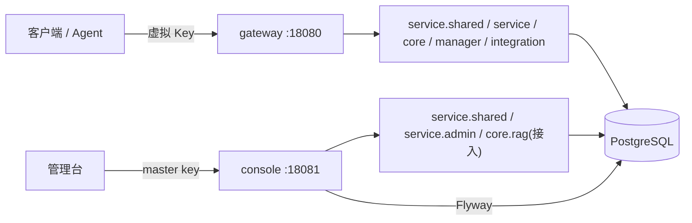

# REQ-5.1：数据面 / 控制面拆分

- 日期：2026-11-16
- 状态：已完成（待主人验收）
- 关联规格：见 `docs/PROJECT.md`「外部文档源」；第 5 期需求卡 REQ-5.1 + 同目录 `15-网关治理解耦设计.md` §7
- 依赖需求：REQ-4.1 ~ REQ-4.5
- 提交：a3882e5

## 1. 是什么

把第 4 期完成的单体拆成两个可独立部署的应用：

- `ai-hub-gateway`（:18080，数据面）：请求路径上的全部能力与虚拟 Key 鉴权/治理链。
- `ai-hub-console`（:18081，控制面）：低频管理能力与 admin 鉴权；唯一执行 Flyway 的进程。

两应用共享 `common` / `api` / `dal` / `manager` / `integration` / `core` / `service` 与同一数据库。
17 个 Controller 按需求卡归属迁出，`ai-hub-start` 降级为公共壳。

## 2. 有什么用

- 管理台跑报表或重启不再连带转发路径；故障域分开。
- 管理接口与虚拟 Key 鉴权物理隔离，消除「复用业务鉴权导致越权」这一类问题。
- 为第 6 期可能的 Tier3 独立进程留出同类切法。

## 3. 怎么实现的

- 模块：
  - 新增 `ai-hub-gateway`、`ai-hub-console`，各自 `GatewayApplication` / `ConsoleApplication`；
    组件扫描显式列出包，不用根包扫描。
  - `ai-hub-start` 保留共享配置、`RequestIdFilter`、异常处理、Jackson/WebClient/线程池配置；
    删除 `AiHubApplication` 与全部 Controller/鉴权 Filter，不再产出可执行包。
- 归属（与需求卡一致）：
  - gateway（9）：ChatCompletion、Embedding、Model、McpCall、McpTool、PromptRuntime、
    RagSearch、RagAnswer、Memory；另有 `/mcp` JSON-RPC 端点。
  - console（8）：Admin、Key、McpServer、Prompt、RagDocument、Trace、Usage、AuditLog。
- 服务包按面归属：`service.admin`（7 个管理服务 + MCP 启动探活）、`service.shared`
  （Key 鉴权、审计、Trace 写入、RAG 文档核心）、其余网关服务留在 `service` 根包与
  `service.gateway`；gateway 扫描时正则排除 `service.admin`。
- 鉴权：
  - gateway 的 `AuthFilter` 只接受虚拟 Key；master key 一律 403 `authorization_error`。
  - console 新增 `AdminAuthFilter`，只接受 master key；虚拟 Key 一律 403。
  - `/actuator/**` 两应用均免鉴权（容器探针）。
- 配置：`application-common.yml` 放共享配置；gateway `flyway.enabled=false`，
  console `flyway.enabled=true` 且为迁移唯一执行方；console 关闭 Redis 健康检查。
- 部署：根 `Dockerfile`（多阶段构建）+ `docker-compose.yml` 增加 gateway/console 服务、
  健康检查与启动顺序（console healthy → gateway）。
- 边界校验：ArchUnit 增加 gateway 不得依赖 `console`/`service.admin`；
  console 不得依赖聊天/检索核心与 `service.gateway`；分层规则加入 Gateway/Console 层。



- 测试装配：每个集成测试只启动一个应用；跨面数据用 KeyService、RagDocumentCore、
  PromptManager、McpServerManager、ProjectAuthorizationManager 等共享 Bean 造，
  不再双应用同起。新增 `GatewayIsolationTest` / `ConsoleIsolationTest` 作为核心证据。

## 4. 影响面

```yaml
capability:
  type: architecture
  entry_point: "两个启动模块 + 两套鉴权 Filter"
  interface_agnostic: true
modules:
  add: [ai-hub-gateway, ai-hub-console]
  change: [ai-hub-start, ai-hub-service（子包）, ai-hub-tests, pom.xml,
           docker-compose.yml, Dockerfile, docs/API-PATHS.md]
interfaces:
  change:
    - "master key 不能再调用数据面端点（403）"
    - "虚拟 Key 不能再访问 console 管理端点（403）"
    - "console 不提供数据面端点（404）；gateway 不提供管理端点（404）"
  keep:
    - "管理端点路径与 4.4 契约一致（/key/*、/v1/prompts、/v1/mcp/servers、/v1/rag/documents、/v1/traces、/v1/usage、/v1/audit-logs、/v1/admin/*）"
tables: []
config:
  - "gateway: server.port=18080, flyway.enabled=false"
  - "console: server.port=18081, flyway.enabled=true, management.health.redis.enabled=false"
depends_on: [REQ-4.1, REQ-4.2, REQ-4.3, REQ-4.4, REQ-4.5]
nfr:
  resources:
    - "两进程各自一套连接池与线程池；console 不依赖 Redis"
  failure_modes:
    - "console 停机：已启动的 gateway 继续转发（实测 /actuator/health 与 /v1/models 均 200）"
    - "gateway 停机：管理面仍可操作（不依赖 gateway）"
    - "Flyway：仅 console 执行，重启 console 显示 up to date，历史行数不变"
    - "跨面访问：404；凭证类型不匹配：403"
compat: breaking
gate: quality
regression: "4.x 用例全部保留；鉴权准备改为虚拟 Key"
```

### 4.1 与需求卡的偏差（已由主人拍板，显式记录）

1. **管理端点路径未收进 `/v1/admin/**`**：需求卡写「全部挂在 `/v1/admin/**` 前缀下」，
   实际保留 4.4 契约路径，隔离手段为「console 只认 admin 凭证」。
   原因：契约冻结优先，路径迁移是破坏性变更，会污染拆分是否成功的判断。
2. **`RagDocumentService` 放在 `service.shared`**：需求卡将 RAG ingest 归控制面。
   HTTP 接入端点确实只在 console；但数据面的 MCP 运行时工具 `ingest_document`（REQ-2.6）
   复用同一实现，因此实现类共享。ArchUnit 仅约束 gateway 不得依赖 `service.admin`。
3. **MCP Server 启动探活加载器归 console**：注册表状态由控制面写；数据面按需连接工具。

## 5. 决策

- master key 严格版：gateway 只收虚拟 Key（2026-11-16 主人确认）。
- admin 凭证严格版：console 只收 master key（同一决策）。
- 两个应用同库，跨应用事务不存在；控制面写入幂等留给 REQ-5.2。
- 测试上下文按面归属，不引入双应用同起；隔离证据由两个专用测试类承担。

## 6. 验证

### 6.1 基线（拆分前，2026-11-16 18:42）

- `mvn -Pquality verify`：BUILD SUCCESS，9 分 43 秒。
- 全仓 490 个测试 / 94 个测试类。
- 单体启动：12.4 秒。

### 6.2 拆分后（2026-11-16）

- 质量门禁分两段执行（单次命令受 10 分钟终端上限）：
  - 上游 10 模块 `-Pquality verify`：BUILD SUCCESS，7 分 01 秒。
  - `ai-hub-tests` `-Pquality verify`：BUILD SUCCESS，4 分 38 秒；覆盖检查通过。
- 全仓 519 个测试 / 99 个测试类；`ai-hub-tests` 146 个用例 / 33 个类。
- Spring 上下文实测 30 个（23 gateway + 7 console），基线 28 个，未翻倍。
- 双进程实测：
  - console 启动 18.9 秒，gateway 启动 18.4 秒；两者 `/actuator/health` 均 UP。
  - master key 打 gateway `/v1/models` → 403；虚拟 Key → 200。
  - 虚拟 Key 打 console `/v1/admin/keys` → 403；master key → 200。
  - gateway 访问 `/v1/admin/keys` → 404；console 访问 `/v1/chat/completions` → 404。
  - 停掉 console 后：gateway health 200、`/v1/models` 200，转发不受影响。
  - 重启 console：Flyway 显示 up to date，历史行数保持 13。

### 6.3 未覆盖 / 剩余风险

- 双进程手工验证用 `/v1/models` 代表数据面；chat/embeddings/RAG 需要真实上游，
  由 gateway-only 集成测试覆盖（console 未启动的上下文中全部通过）。
- Docker 镜像/编排文件已补齐，但未在本轮执行 `docker compose up` 全量构建验证。
- 质量门禁的 JaCoCo 覆盖率检查历史配置只分析 tests bundle（0 classes），
  为拆分前既有状态；本轮未改变该行为。

## 7. 复盘

- 拆分本身机械，真正的成本在测试装配：28 个单体集成测试中约一半跨面，
  靠共享 Bean 造数据比让测试同时起两个应用更稳，也避免上下文翻倍。
- 严格鉴权暴露了 4.x 测试对 master key 的隐性依赖；改为虚拟 Key 后，
  租户/项目作用域语义第一次被测试真正覆盖。
- 服务包归属不能只看 Controller 表：MCP 运行时工具与启动探活把两个「管理类」
  服务推回共享/控制面，边界要按调用链而不是按名字划。

## 8. 多实例检查

- 两应用无本地业务状态；控制面写入走 DB 唯一约束/条件更新（REQ-5.2 落地）。
- console 启动探活与 gateway 启动均幂等；Flyway 只由 console 执行，避免双跑锁表。
