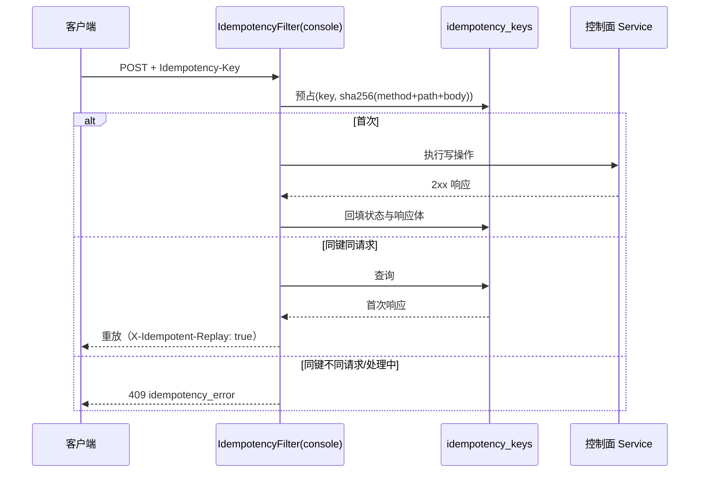

# REQ-5.2：控制面幂等与拆分配置收口

- 日期：2026-11-17
- 状态：已完成（待主人验收）
- 关联规格（知识库 2.0）：`E:\AIWorkbench\workbench\tasks\2026-11-16_ai-hub第五期规划\outputs\20-项目7-第5期-优化与拆分.md` REQ-5.2
- 依赖需求：REQ-5.1
- 提交：7160b8e

## 1. 是什么

拆分后控制面写入不再依赖跨应用事务，本需求把每条写路径改成幂等：

- 自然键幂等：块/发布/授权/注册/接入等按唯一约束与条件更新收敛，重复调用不产生重复数据。
- 持久化幂等键：可选 `Idempotency-Key` 请求头（V14 `idempotency_keys`），同键同请求直接重放首次响应，重启不失效。
- 审计去重：状态未变化的重复调用不再写第二条审计。
- 多表写入先整体校验、再逐表单步 upsert，失败重试可收敛，不留半成品。
- 两应用共用配置集中在 `application-common.yml`，不出现同名不同值。

## 2. 写路径清点与幂等策略

| 写路径 | 策略 | 重复调用结果 |
|---|---|---|
| `/key/block`、`/key/unblock`、`/v1/admin/keys/{hash}/block|unblock` | 条件更新 `WHERE blocked <> ?`；仅变化时审计 | 200，状态一致，审计 1 条 |
| `/v1/admin/models`（创建别名） | 唯一约束 + 冲突读回；同配置重复返回既有；不同配置 400 | 200，别名/部署不重复，审计 1 条 |
| `/v1/admin/models/{alias}`（更新） | 先校验部署，再更新；按前后差异决定审计 | 200，审计仅在变化时写 |
| `/v1/admin/models/{alias}/deployments` | 部署键唯一 + 冲突转更新；关联表主键兜底 | 200，部署/关联各 1 行，审计 1 条 |
| `/v1/admin/project-authorizations` | 唯一约束 + 冲突视为已存在；仅新增时审计 | 200，授权 1 行，审计 1 条（并发同测） |
| `/v1/mcp/servers`（注册） | 同租户名称唯一；相同配置返回既有，不同配置 409 | 201，serverId 一致，审计 1 条 |
| `/v1/prompts`（创建） | 同租户同名版本 1 唯一；同内容返回既有，不同内容 400 | 201，版本 1 一份 |
| `/v1/prompts/{name}/publish` | 行锁 + 已是当前发布版本则短路 | 200，不重复归档/审计 |
| `/v1/rag/documents`（接入） | 内容哈希去重（既有） | 首次 201，重复 200，docId 一致，审计仅首次 |
| `/v1/rag/documents/{id}/reindex` | 重跑索引；审计记录动作 | 幂等结果，可重复执行 |
| `/key/generate`、`/v1/prompts/{name}/versions` | 每次调用是**新资源**（不同 Key/新版本），自然键不适用 | 需 `Idempotency-Key` 才重放 |
| DELETE（模型/MCP/RAG 文档） | 状态已收敛；第二次 404 | 数据不重复；404 视为已删除 |

## 3. 怎么实现的

- 条件更新与审计去重：`ApiKeyMapper.updateBlocked` 增加 `AND blocked <> ?`；
  `KeyServiceImpl` / `AdminServiceImpl` 仅在受影响行数 > 0 时写审计。
- 唯一约束兜底：`ModelCatalogManager`、`ProjectAuthorizationManager`、`McpServerServiceImpl`、
  `PromptServiceImpl` 捕获 `DuplicateKeyException`，转为「已存在」语义并读回；并发不再 500。
- 多表写：`AdminServiceImpl` 先 `validateDeployments` 全量校验，再写别名与部署；部署/关联均 upsert，
  失败重试可补齐，不会留下半写别名。
- 持久化幂等键：
  - V14 `idempotency_keys(idempotency_key 唯一, request_hash, response_status,
    response_content_type, response_body, created_at, updated_at)`。
  - console 新增 `IdempotencyFilter`（仅在带 `Idempotency-Key` 的 JSON 写请求上生效）：
    预占 → 执行 → 回填首次响应；同键同指纹重放，同键不同指纹 409，处理中 409；
    非 2xx 释放键允许重试。multipart 不拦截（内容哈希天然去重）。
- 配置收口：共享开关只保留在 `ai-hub-start` 的 `application-common.yml`；gateway/console 的
  `application.yml` 只放应用名、端口、Flyway 归属与少量本应用开关，无同名不同值。



## 4. 影响面

```yaml
capability:
  type: cross-cutting
  entry_point: "控制面写 Service + console IdempotencyFilter"
  interface_agnostic: true
modules:
  add: [dal IdempotencyKeyMapper/DO + V14, manager/idempotency, console IdempotencyFilter,
        tests ControlPlaneIdempotencyTest]
  change: [ApiKeyMapper, ModelCatalogManager, ProjectAuthorizationManager, KeyServiceImpl,
           AdminServiceImpl, McpServerServiceImpl, PromptServiceImpl, RagDocumentServiceImpl,
           application-test.yml, docs/API-PATHS.md]
interfaces:
  add:
    - "可选请求头 Idempotency-Key（控制面 JSON 写请求）"
    - "重放响应头 X-Idempotent-Replay: true"
  change:
    - "MCP 同名同配置重复注册：409 → 201（幂等重放）"
    - "模型/Prompt 创建：同名同内容重复调用由 400 改为成功返回既有资源"
tables:
  add: [idempotency_keys]
config: []
depends_on: [REQ-5.1]
nfr:
  resources:
    - "单行幂等记录；响应体上限 1MB，超限不缓存"
  failure_modes:
    - "同键处理中：409，客户端稍后重试"
    - "业务 4xx/5xx：释放幂等键，允许修正后重试"
    - "首次响应丢失：同键重放首次响应"
    - "记录长期保留：本期不自动清理（见风险）"
compat: additive
gate: quality
regression: "4.x 重复注册用例按幂等语义调整；其余用例数量不减"
```

### 4.1 契约变更说明

- 新增可选请求头，不改路径与鉴权方式；未携带该头的旧客户端行为不变（自然键幂等仍生效）。
- 两处成功语义变化：MCP 同名同配置重复注册返回 201；模型/Prompt 同名同内容重复创建返回既有资源。
  这两处是需求卡「重复调用结果一致」的直接要求。

## 5. 决策

- 幂等键落库而非内存：需求卡明确「幂等键只在内存（重启失效）」是坑。
- 不引入跨表事务：用「先校验 + 单表可重入步骤」保证重试收敛。
- 审计只在状态实际变化时写；幂等重放不产生第二条审计。
- 凭证轮换（api_key）无法与旧密文比较（AES-GCM 随机 IV），精确重放依赖 `Idempotency-Key`。

## 6. 验证

- 上游 10 模块 `-Pquality verify`：BUILD SUCCESS，5 分 11 秒（Checkstyle/SpotBugs 0）。
- 测试模块 `-Pquality verify` 分批（单次 10 分钟上限）：
  - 控制面 + 架构 + 启动加载器：BUILD SUCCESS，52 用例，4 分 13 秒。
  - 数据面 + 限流：BUILD SUCCESS，105 用例，4 分 16 秒。
- `ai-hub-tests` 共 157 用例 / 34 类，0 失败；全仓约 530 用例 / 100 类。
- Spring 上下文 31 个（30 + `ControlPlaneIdempotencyTest`）。
- 新增 `ControlPlaneIdempotencyTest` 11 个用例：块/解封、模型创建、半写校验、部署 upsert、
  并发授权、MCP 注册、Prompt 创建/发布、RAG 接入、幂等键重放与冲突。

## 7. 复盘

- 自然键能覆盖「状态收敛」类写入，但创建类与凭证轮换必须有持久化幂等键，否则无法区分重放与新请求。
- 真正的半写风险在「先写父表再写子表」；把校验前移 + 子表 upsert 后，重试自然收敛。
- 审计去重必须与状态变化判定绑定，否则每次重放都会追加一条。

## 8. 未验证 / 风险

- `idempotency_keys` 无自动清理策略；长期运行需按保留周期清理（本期未做）。
- 同键并发请求在首个请求完成前返回 409，客户端需重试；未实现等待/重放通知。
- 幂等键按全局唯一（非租户维度）；由 manager 侧代码约定，数据库未加租户前缀。
- 删除类接口第二次返回 404（状态已收敛），未改为 200。
- 未做双进程真实重启后的幂等重放手工验证；由 H2 集成测试覆盖同 JVM 重启语义（记录落库，非内存）。
