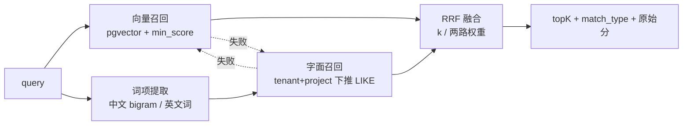

# REQ-5.3：BL-1 混合检索（向量 + 字面 RRF）

- 日期：2026-11-17
- 状态：已完成（待主人验收）
- 关联规格：见 `docs/PROJECT.md`「外部文档源」；第 5 期需求卡 REQ-5.3
- 依赖需求：REQ-3.3、REQ-3.7、REQ-4.1
- 提交：2e29b6d

## 1. 是什么

RAG 检索从「纯向量」升级为「向量 + 字面」两路召回，用 RRF 融合排序：

- 向量路：沿用 pgvector cosine，保留 `min_score`。
- 字面路：同租户/项目下按查询词项做大小写不敏感包含匹配，覆盖中文精确术语/编号/专名。
- 结果带 `match_type`（vector / keyword / both）与两路原始分、融合分。
- 任一路失败时另一路单独返回；`hybrid-enabled=false` 时回到三期行为。

## 2. 有什么用

- 三期实测纯向量对无关中文余弦 0.47–0.59，精确编号/术语不可靠；字面路兜底。
- 对应参照：LangChain EnsembleRetriever / 常见 RRF 融合。
- 面试叙事点：两路召回、RRF 只依赖名次因此对分数量纲不敏感、降级与开关、租户过滤前移。

## 3. 怎么实现的

- 字面召回：`RagChunkMapper.searchKeyword` 在 SQL 里按 `tenant_id + project_id` 下推，
  用 `LOWER(content) LIKE '%' || LOWER(#{term}) || '%'`（ILIKE 等价且 H2 兼容），
  `ORDER BY` 命中词项数降序；词项来自既有规则提取器（中文 bigram / 英文词），
  上限 `keyword-max-terms`。未引入 pg_trgm 扩展，理由见 §5。
- 融合：`RagRetrievalCore` 收集两路候选，按 chunk_id 去重；
  `rrf = w_v/(k+rank_v) + w_k/(k+rank_k)`，`k`、两路权重可配；按融合分排序后截断 topK。
- 可解释：命中携带 `match_type`、`vector_score`、`keyword_score`、`rrf_score`；
  `score` 仍表示向量相似度（仅字面命中为 0）。
- 阈值：`min_score` 只下推到向量路；字面候选不按该阈值过滤，避免误杀。
- 降级：向量路异常（embedding/向量库）时仅用字面路；字面路异常时仅用向量路；
  两路都异常才抛出。关闭混合检索时不降级，异常按三期语义上抛。
- 过滤：两路都在召回层按 tenant/project 下推，并在编排层再次校验，
  再应用 `filters.doc_ids` / `filters.source`。
- 配置：`gateway.rag.search.hybrid-enabled`、`rrf-k`、`rrf-vector-weight`、
  `rrf-keyword-weight`、`keyword-max-terms`，默认开启。



## 4. 影响面

```yaml
capability:
  type: retrieval
  entry_point: "RagRetrievalCore（/v1/rag/search、/v1/rag/answer 内部）"
  interface_agnostic: true
modules:
  change: [common RagProperties.Search, dal RagChunkMapper(+XML),
           manager RagChunkManager, core RagRetrievalCore/RagRetrievedChunk/RagLexicalReranker,
           service RagSearchServiceImpl, api RagSearchHitResDTO,
           application-common.yml, tests]
interfaces:
  change:
    - "POST /v1/rag/search 命中新增 match_type / vector_score / keyword_score / rrf_score（additive）"
    - "默认开启混合检索后，命中顺序与 reranked 语义随之变化；score 仍是向量相似度"
  keep:
    - "路径与鉴权不变；关闭 hybrid-enabled 后与三期行为一致"
tables: []
config:
  - "gateway.rag.search.hybrid-enabled=true"
  - "gateway.rag.search.rrf-k=60"
  - "gateway.rag.search.rrf-vector-weight=1.0"
  - "gateway.rag.search.rrf-keyword-weight=1.0"
  - "gateway.rag.search.keyword-max-terms=16"
depends_on: [REQ-3.3, REQ-3.7, REQ-4.1]
nfr:
  resources:
    - "字面路为单项目内 LIKE 扫描 + LIMIT；无新增连接/线程"
  failure_modes:
    - "向量路异常：字面路单独返回"
    - "字面路异常：向量路单独返回"
    - "两路均异常：返回 500"
    - "开关关闭：回到三期路径"
compat: additive
gate: quality
regression: "原检索/回答/租户隔离用例保留；min_score 与 rerank 用例改按混合语义断言，另加开关关闭专项类"
```

### 4.1 对外契约说明

- 路径与鉴权不变。
- `/v1/rag/search` 命中新增 4 个字段（additive）：`match_type`、`vector_score`、
  `keyword_score`、`rrf_score`；`score` 语义不变（向量相似度）。
- 默认开启混合检索：排序以 RRF 为准，`reranked=false`（规则重排让位）；关闭开关后恢复三期排序与 `reranked`。
- 契约已于 2026-11-17 随第五期统一冻结（见 `docs/API-PATHS.md` §0）。

## 5. 决策

- 选 ILIKE/LIKE 而非 pg_trgm：不引入扩展、H2 测试兼容、当前单项目语料量小；
  若后续数据显示扫描成本高，再评估 `pg_trgm` + GIN（不改变对外契约）。
- 字面路沿用既有 bigram 词项，不引入分词器；中文专名/编号能被 bigram 覆盖。
- RRF 使用名次而非原始分，避免两路分数量纲不可比。
- 混合模式不叠加规则重排，避免三重排序难以解释；规则重排保留给关闭开关的三期路径。

## 6. 验证

- 上游 10 模块 `-Pquality verify`：BUILD SUCCESS，5 分 58 秒（Checkstyle/SpotBugs 0）。
- 测试模块分批 `-Pquality verify`：
  - 控制面 + 架构 + 启动加载器：BUILD SUCCESS，52 用例，3 分 48 秒。
  - 数据面 + 限流：BUILD SUCCESS，108 用例，4 分 11 秒。
- `ai-hub-tests` 共 160 用例 / 35 类，0 失败；全仓约 538 用例 / 101 类。
- Spring 上下文 32 个（新增关闭开关专项上下文）。
- 新增 8 个用例：
  - `RagHybridRetrievalTest`（5）：RRF 与权重、两路降级、开关关闭、min_score 仅向量。
  - `RagSearchIntegrationTest` 新增「精确编号经字面路召回」1 个。
  - `RagHybridDisabledIntegrationTest`（2）：关闭后规则重排与 min_score/top_k 语义。

## 7. 复盘

- RRF 的实现不难，难的是边界：阈值只对向量路、过滤两路一致、开关关闭必须真正回到旧路径。
- 降级必须在编排层做，不能把两路失败都抛给调用方；否则「任一路可用」无法兑现。
- 测试上把旧语义与混合语义分开成两个上下文，比在同一上下文里猜顺序稳定。

## 8. 未验证 / 风险

- 字面路是 `LIKE` 扫描，未做大规模语料性能压测；超大项目可能变慢。
- 词项是 bigram/英文词启发式，未接专业中文分词；同义/错字仍靠向量路。
- 两路候选上限相同（candidateLimit），极端情况下字面路只取到部分高覆盖结果。
- 混合模式下规则重排不再生效；如需两者叠加，需要另立需求评估。
- 契约已于 2026-11-17 冻结（见 `docs/API-PATHS.md` §0）；本需求未改 `/docs/API-PATHS.md` 的路径与鉴权，只补了命中字段说明。
