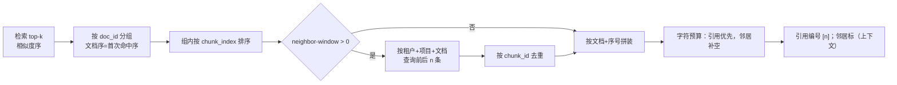

# REQ-5.4：BL-3 切片顺序还原与上下文扩展

- 日期：2026-11-17
- 状态：已完成（待主人验收）
- 关联规格（知识库 2.0）：`E:\AIWorkbench\workbench\tasks\2026-11-16_ai-hub第五期规划\outputs\20-项目7-第5期-优化与拆分.md` REQ-5.4
- 依赖需求：REQ-3.1、REQ-3.3、REQ-3.4、REQ-3.10、REQ-4.1
- 提交：57bb476

## 1. 是什么

`/v1/rag/answer` 的上下文拼装从「按召回顺序拼接」改为「按文档还原原文顺序」：

- 召回 top-k 后按 `doc_id` 分组，组内按 `chunk_index` 升序还原原文顺序。
- 可选邻接扩展：每个命中切片前后各取 n 条（默认 1），扩展结果去重。
- 扩展后的上下文仍受 `answer.max-context-chars` 字符预算约束。
- 引用只来自原命中的 `chunk_id`；扩展邻居以「（上下文）」标记，不作为引用来源。

`/v1/rag/search` 的相似度排序与响应字段保持不变；3.10 的游标分页路径不变。

## 2. 有什么用

- 同一文档多个片段命中时，回答侧拿到的是原文连续的上下文，跨片段引用不再断句、乱序。
- 邻居扩展补足「命中片段前后被切断的句子」，降低只取命中片段导致的语义缺口。
- 预算按字符而非条数控制，扩展不会把 prompt 撑爆。
- 面试叙事点：召回排序（相似度）与上下文拼装（原文顺序）是两件事；扩展可关闭；邻居不产生引用。

## 3. 怎么实现的

- 新增 `core/rag/RagContextAssembler`：按命中的首次出现顺序确定文档组顺序，
  组内按 `chunk_index` 排序；窗口 > 0 时按 `tenant_id + project_id + doc_id + chunk_index BETWEEN`
  查询邻居（合并相邻区间，每次查询最多 `2n+1` 行量级），按 `chunk_id` 去重。
- 新增 `core/rag/RagContextSegment`：`citation` 标记区分原命中与扩展邻居。
- `RagPromptBuilder` 增加按 segment 渲染的入口：
  引用块 `[n]（来源：x）`；上下文块 `（上下文）来源：x`，不分配编号、不进入 citations。
  预算分配优先保住引用块，再用剩余预算填充邻居；至少保留第一条引用。
- `RagAnswerServiceImpl` 注入 `RagContextAssembler`，租户取自认证上下文（与检索的租户口径一致）。
- 邻居查询异常时降级为「仅原命中」，记 WARN；不因上下文扩展失败让回答整体失败。



## 4. 影响面

```yaml
capability:
  type: rag-answer-context
  entry_point: "RagAnswerServiceImpl（/v1/rag/answer 内部）"
  interface_agnostic: true
modules:
  change: [common RagProperties.Answer, dal RagChunkMapper(+XML),
           manager RagChunkManager, core RagContextAssembler/RagContextSegment/RagPromptBuilder,
           service RagAnswerServiceImpl, application-common.yml, tests]
interfaces:
  change:
    - "POST /v1/rag/answer 内部上下文顺序改为文档内原文顺序，默认启用邻居扩展"
    - "响应结构不变；citations 仍只包含原命中 chunk_id"
  keep:
    - "POST /v1/rag/search 排序与字段不变；路径与鉴权不变"
    - "3.10 游标分页行为不变"
tables: []
config:
  - "gateway.rag.answer.neighbor-window=1（0 关闭扩展）"
depends_on: [REQ-3.1, REQ-3.3, REQ-3.4, REQ-3.10, REQ-4.1]
nfr:
  resources:
    - "邻居查询按文档合并区间，只读现有 (doc_id, chunk_index) 索引；无新增连接/线程"
  failure_modes:
    - "邻居查询异常：WARN 并只用原命中拼装"
    - "邻居越租户/越项目：过滤丢弃"
    - "预算不足：只保留能放下的引用，至少保留第一条引用"
compat: extension
gate: quality
regression: "检索/生成/租户隔离/分页用例保留；新增顺序还原、邻居去重、预算与稳定性用例"
```

### 4.1 对外契约说明

- `/v1/rag/answer` 请求与响应字段不变；变化只在发给模型的上下文顺序与组成。
- 默认 `neighbor-window=1`；设为 0 即关闭扩展，只还原顺序。
- 扩展邻居不进入 `citations`，不能作为引用来源。
- 契约待 5.4 完成后统一冻结。

## 5. 决策

- 上下文顺序只改回答侧：`/v1/rag/search` 是相关度排序，改成原文顺序会破坏检索语义与 5.3 的 RRF 结果。
- 邻居从库中按范围查询而非从命中列表推：被召回截断的邻居不在 top-k 内，只能回库取。
- 窗口默认 1、可配 0：默认补一句上下文收益明显，关闭开关便于回退与成本对比。
- 预算优先给引用块：避免邻居挤掉原命中，出现「有上下文但无法引用」。
- 文档组顺序取首次命中顺序：既保持文档间相关度，又保证同文档连续。

## 6. 执行摘要

- 2026-11-17：新增 `RagContextAssembler` + `RagContextSegment`，改造 `RagPromptBuilder` 与
  `RagAnswerServiceImpl`；新增 `RagChunkMapper.selectByDocIdIndexRange`；补单元/集成测试。
- 新增 8 个用例：
  - `RagContextAssemblerTest`（5）：顺序还原、窗口去重、越权过滤、查询失败降级、稳定性。
  - `RagPromptBuilderTest`（+2）：上下文块不产生引用、预算优先引用。
  - `RagAnswerServiceTest`（+1）：同一文档命中按 `chunk_index` 还原顺序。
  - `RagAnswerIntegrationTest`（+1）：多段落文档顺序还原 + 邻居上下文不入引用。
- 验证：全量测试 488 用例 / 0 失败（common 20、api 1、dal 20、manager 24、integration 74、
  core 73、service 93、start 4、gateway 11、console 7、tests 161）；Checkstyle 0、SpotBugs 0、
  JaCoCo 覆盖率检查通过；`mvn -Pquality verify` 最终 BUILD SUCCESS（测试阶段与覆盖阶段分两次
  执行，因单次命令 10 分钟上限；覆盖阶段 `-DskipTests` 复用同批 exec 数据）。

## 7. 复盘

- 顺序还原放在回答侧而不是检索接口：检索的排序语义是相关度，改排序会破坏 5.3 的 RRF 与调用方预期。
- 窗口合并比逐条查询更稳：相邻窗口合并成区间，避免 N+1，也天然处理重叠去重。
- 预算必须优先引用：否则大邻居块会把原命中挤出 prompt，出现「有上下文、无引用」。
- 邻居查询必须带租户与项目下推：检索层的过滤不能替代数据访问层的隔离。

## 8. 多实例检查

- 无新增可变成员变量；上下文拼装为请求内局部状态。
- 无本地锁、无定时任务；邻居读取直接查库，多实例一致。
